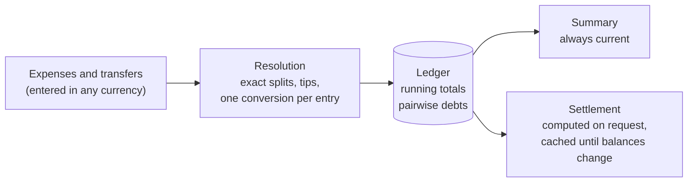

# eranos

[](https://github.com/cristiancristea00/eranos/actions/workflows/ci.yml)

eranos is a Rust library for tracking what a group of people spends
together — a trip, a day out, a household — and for settling up afterwards.
It records who paid for what and how each expense is shared, keeps every
total and balance current as entries change, and turns the balances into
payments with the strategy the app chooses: the fewest payments possible,
a fast greedy plan, or the unsimplified debts between each pair of people.

It is the shared core of the eranos apps for iOS, Android, and the web,
which reach it through its [bindings](#bindings) for eight languages; the
library itself is plain Rust with no I/O and no async runtime.

## Concepts

| Concept      | Type          | What it is                                                                        |
| ------------ | ------------- | --------------------------------------------------------------------------------- |
| Group        | `Group`       | A trip, a day out, or a household: name, currency, language, and everything below |
| Shared group | `SharedGroup` | A group shared between tasks and threads, each call locking it while it runs      |
| Member       | `Member`      | A person: first name (required), last name, email, phone, payment accounts        |
| Account      | `Account`     | Where a member can be paid: an IBAN or a payment-app username                     |
| Category     | `Category`    | A label the group defines, such as "Food", or the built-in "Uncategorised"        |
| Expense      | `Expense`     | What was bought: cost, date, payers, split, optional tip and category             |
| Cost         | `Cost`        | An amount in the group currency, or in another one at a fixed exchange rate       |
| Split        | `Split`       | How an amount is divided: equally, by percentages, by parts, or by exact amounts  |
| Item         | `Item`        | A receipt line of an itemised expense, with its own quantity and split            |
| Tip          | `Tip`         | A fixed amount or a percentage on top, shared proportionally or equally           |
| Transfer     | `Transfer`    | Money one member paid another, such as a repayment                                |
| Summary      | `Summary`     | Spending, paid, consumed, balances, and totals per category, always current       |
| Settlement   | `Settlement`  | The payments that bring every balance to zero                                     |

## Quick start

```rust
use eranos::{
    Balance, CalendarDate, Currency, Expense, Group, Member, Money, Percentage, SettlementStrategy,
    Split, Tip,
};

fn main() -> Result<(), Box<dyn std::error::Error>> {
    let mut group = Group::builder(Currency::EUR, "Lisbon").build()?;
    let ana = group.add_member(Member::builder("Ana").build()?)?;
    let bob = group.add_member(Member::builder("Bob").build()?)?;
    let carol = group.add_member(Member::builder("Carol").build()?)?;

    // Ana paid dinner for three, plus a 10 % tip.
    let (amount, day) = (Money::parse("90.00", Currency::EUR)?, CalendarDate::new(23, 9, 2026)?);
    let dinner = Expense::builder(amount, day, "Dinner", ana, Split::equal([ana, bob, carol]))
        .tip(Tip::percentage(Percentage::parse("10")?))
        .build()?;
    group.add_expense(dinner)?;

    let summary = group.summary();
    assert_eq!(summary.total_spent(), Money::parse("99.00", Currency::EUR)?);
    assert_eq!(summary.member(bob).balance(), Balance::Owes(Money::parse("33.00", Currency::EUR)?));

    // Bob and Carol each pay Ana back 33.00.
    let settlement = group.settlement(SettlementStrategy::MinimumTransfers)?;
    for payment in settlement.payments() {
        println!("{} pays {}", payment.from(), payment.amount());
    }
    Ok(())
}
```

## How it works



<details>
<summary>ASCII version (for renderers without Mermaid)</summary>

```text
 Expenses and    ┌─────────────────┐    ┌───────────────┐    Summary
 transfers   ──► │ Resolution      │──► │ Ledger        │──► (always current)
 (any currency)  │ exact splits,   │    │ running totals│
                 │ tips, one       │    │ pairwise debts│──► Settlement
                 │ conversion each │    └───────────────┘    (on request,
                 └─────────────────┘                          cached)
```

</details>

- **Money is exact.** Amounts are whole minor units, never floats, and
  every division hands out its leftover cents by the largest-remainder
  method, so the parts always add up. Ties rotate with the expense's
  identifier, so the extra cent of an even split does not always land on
  the same person, and a synced expense divides identically on every device.
- **Every currency, one ledger.** An expense in another currency than the
  group's has a converted cost, with an exchange rate fixed when it is
  entered; it is converted once, exactly, into the group currency. A plain
  amount is a local cost, in the group currency at a rate of 1.
- **Totals are incremental.** Each change moves the totals by exactly its
  own shares, checked for overflow before anything is written: a failed
  change leaves the group untouched.
- **Async without a runtime.** The slow calls, the fewest-payments plan, a
  currency change, and loading, also come as futures that yield while they
  work, for any executor or none, and a `SharedGroup` shares a group
  between tasks and threads behind a read-write lock
  ([docs/ARCHITECTURE.md § 12](docs/ARCHITECTURE.md#12-async-and-concurrency)).
- **Three settlement strategies**, chosen by the caller:

  | Strategy           | Payments                                      | Cost                                       |
  | ------------------ | --------------------------------------------- | ------------------------------------------ |
  | `MinimumTransfers` | the provable minimum (the problem is NP-hard) | O(2ⁿ·n) time, 2ⁿ bytes for n open balances |
  | `Greedy`           | at most n − 1                                 | O(n log n)                                 |
  | `Direct`           | one per pair of members with a netted debt    | O(pairs)                                   |

The design, with its trade-offs, is in [docs/ARCHITECTURE.md](docs/ARCHITECTURE.md).

## Examples

Runnable scenarios live in `crates/eranos/examples/`. Each prints a report
that explains every step, with tables of the members, expenses, shares,
balances, and payments, and asserts its own numbers:

| Example                | Shows                                                                                         |
| ---------------------- | --------------------------------------------------------------------------------------------- |
| `quickstart`           | A trip in a few lines: members, expenses, totals, settlement                                  |
| `split_methods`        | Equal, percentage, parts (half a share for a child), exact amounts, two payers                |
| `restaurant_bill`      | Itemised receipt with quantities and per-item splits; proportional vs equal tip               |
| `multi_currency`       | Foreign expenses and a cash repayment at fixed rates; moving the books to another currency    |
| `settling_up`          | The three strategies on one group, then recording the payments                                |
| `members_and_accounts` | Contact details, IBAN validation, archiving a member                                          |
| `persistence`          | Saving and loading a group as JSON (needs the `serde` feature)                                |
| `grand_tour`           | Every feature in one story, from creating a group to sharing it between tasks (needs `serde`) |

```sh
cargo run -p eranos --example settling_up
cargo run -p eranos --features serde --example persistence
cargo run -p eranos --all-features --example grand_tour   # the same identifiers every run
```

Every example also has a Swift, a Kotlin, a Java, a TypeScript, a C, a
C++, and a Python port, in `bindings/swift/examples`,
`bindings/kotlin/examples`, `bindings/java/src/examples`,
`bindings/typescript/examples`, `bindings/c/examples`,
`bindings/cpp/examples`, and `bindings/python/examples`, each printing the
same report byte for byte, which the gates check, the Kotlin ones on the
Kotlin Multiplatform package too
([docs/TESTING.md § 2](docs/TESTING.md#2-layout)).

## Features

| Feature          | Default | Enables                                                                                                                                               |
| ---------------- | ------- | ----------------------------------------------------------------------------------------------------------------------------------------------------- |
| `serde`          | no      | `Serialize`/`Deserialize` for a group and every type it stores; a loaded group is re-validated entry by entry                                         |
| `sequential-ids` | no      | Identifiers count up from one, so examples and tests print the same text on every run; never for apps, whose identifiers would collide across devices |

## Bindings

| Language             | Package               | Runs on                                                           |
| -------------------- | --------------------- | ----------------------------------------------------------------- |
| Swift                | `bindings/swift`      | iOS, iPadOS, macOS, Mac Catalyst, tvOS, watchOS, and visionOS     |
| Kotlin               | `bindings/kotlin`     | Android and the JVM                                               |
| Java                 | `bindings/java`       | JDK 25 and later                                                  |
| Kotlin Multiplatform | `bindings/kmp`        | the JVM, Android, and Apple platforms, from one Kotlin source set |
| TypeScript           | `bindings/typescript` | browsers, and Node 24 and later                                   |
| C                    | `bindings/c`          | C23                                                               |
| C++                  | `bindings/cpp`        | C++23                                                             |
| Python               | `bindings/python`     | Python 3.14 and later                                             |

Each package puts a hand-written layer, in its language's own idiom, over
code generated from the library, and every one prints the library's own
text for every value; `cargo xtask gates` builds and tests them all, and
`cargo xtask package <language>` builds a language's release packages,
which an app consumes, into `target/packages`. How they are built, and
each layer's shape: [docs/BINDINGS.md](docs/BINDINGS.md).

## Development

```sh
cargo xtask gates                                   # every commit gate, in order
cargo xtask test python                             # one language's tests: also lint, format, and examples
cargo test --workspace --all-features               # unit, integration, property, and doc tests
cargo bench -p eranos --features serde --bench '*'  # every benchmark
```

The gates and conventions are in [AGENTS.md](AGENTS.md), every command and
change recipe in [docs/DEVELOPMENT.md](docs/DEVELOPMENT.md), and the test
suites in [docs/TESTING.md](docs/TESTING.md).

## Versioning

eranos follows [Semantic Versioning](https://semver.org/); before 1.0 a
breaking change bumps the minor version. The public Rust API, the serialised
format, and the rounding results are all part of the contract:
[docs/VERSIONING.md](docs/VERSIONING.md).

## Repository layout

```text
eranos/
├── .github/                   the CI workflow; Dependabot and zizmor configuration
├── Cargo.toml                 workspace manifest: pinned dependencies, lints, profiles
├── bindings/
│   ├── c/                     the C package, a header over the C API Diplomat generates
│   ├── cpp/                   the C++ package, a header-only layer over Diplomat's C++ classes
│   ├── java/                  the Java package, over the UniFFI glue
│   ├── kmp/                   the Kotlin Multiplatform package, over the glue gobley generates
│   ├── kotlin/                the Kotlin package for Android and the JVM, over the UniFFI glue
│   ├── python/                the Python package, over the UniFFI glue
│   ├── swift/                 the Swift package for Apple platforms, over the UniFFI glue
│   └── typescript/            the npm package for browsers and Node, over the WebAssembly glue
├── crates/
│   ├── eranos/                the facade callers depend on
│   │   ├── src/               re-exports of the types the internal crates hold
│   │   ├── tests/             scenarios, properties, persistence, errors, api (public API only)
│   │   ├── examples/          runnable scenarios
│   │   └── benches/           criterion benchmarks
│   ├── eranos-core/           identifiers and text rules
│   ├── eranos-calendar/       dates and times of day
│   ├── eranos-money/          amounts, currencies, rates, ratios, and apportionment
│   ├── eranos-account/        payment accounts: IBANs and usernames
│   ├── eranos-contact/        emails and phone numbers
│   ├── eranos-member/         members
│   ├── eranos-category/       categories
│   ├── eranos-ledger/         totals and balances
│   ├── eranos-expense/        expenses, splits, items, and tips
│   ├── eranos-settlement/     settlement strategies
│   ├── eranos-transfer/       transfers
│   ├── eranos-group/          groups and their saved form
│   ├── eranos-bindings/       what every binding exposes, in plain Rust
│   ├── eranos-glue/           the model of the group calls and records, and the glue written from it
│   ├── eranos-glue-macros/    the proc macros the binding core and the UniFFI glue invoke
│   ├── eranos-capi/           the bindings for C and C++, through Diplomat
│   ├── eranos-kmp/            the bindings for Kotlin Multiplatform, through UniFFI and gobley
│   ├── eranos-uniffi/         the bindings for Swift, Kotlin, Java, and Python, through UniFFI
│   ├── eranos-uniffi-bindgen/ UniFFI's generators for those languages
│   ├── eranos-web/            the bindings for browsers and Node, through UniFFI and WebAssembly
│   └── xtask/                 the repository's automation: `cargo xtask gates`, and `generate` for the C bridge
├── docs/                      architecture, bindings, development, testing, versioning
├── deny.toml                  the rules of the CI dependency audit
└── AGENTS.md                  conventions and gates (CLAUDE.md and GEMINI.md link to it)
```

Every crate keeps each module's unit tests in `<module>/tests.rs`;
[docs/ARCHITECTURE.md § 2](docs/ARCHITECTURE.md#2-crate-map) maps the crates
and what depends on what.
