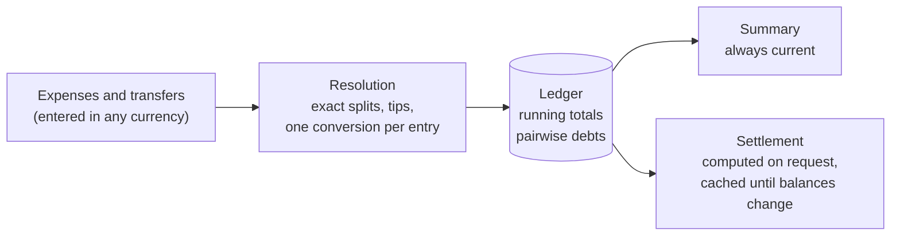

# eranos

[](https://github.com/cristiancristea00/eranos/actions/workflows/ci.yml)

eranos is a Rust library for tracking what a group of people spends
together — a trip, a day out, a household — and for settling up afterwards.
It records who paid for what and how each expense is shared, keeps every
total and balance current as entries change, and turns the balances into
payments with the strategy the app chooses: the fewest payments possible,
a fast greedy plan, or the unsimplified debts between each pair of people.

It is the shared core of the eranos apps for iOS, Android, and the web,
which will reach it through binding crates (UniFFI for Swift and Kotlin,
wasm for the browser); the library itself is pure, synchronous Rust with
no I/O.

## Concepts

| Concept    | Type         | What it is                                                                        |
| ---------- | ------------ | --------------------------------------------------------------------------------- |
| Group      | `Group`      | A trip, a day out, or a household: name, currency, language, and everything below |
| Member     | `Member`     | A person: first name (required), last name, email, phone, payment accounts        |
| Account    | `Account`    | Where a member can be paid: an IBAN or a payment-app username, held as a secret   |
| Category   | `Category`   | A label the group defines, such as "Food"                                         |
| Expense    | `Expense`    | What was bought: cost, date, payers, split, optional tip and category             |
| Cost       | `Cost`       | An amount in the group currency, or in another one at a fixed exchange rate       |
| Split      | `Split`      | How an amount is divided: equally, by percentages, by parts, or by exact amounts  |
| Item       | `Item`       | A receipt line of an itemised expense, with its own quantity and split            |
| Tip        | `Tip`        | A fixed amount or a percentage on top, shared proportionally or equally           |
| Transfer   | `Transfer`   | Money one member paid another, such as a repayment                                |
| Summary    | `Summary`    | Spending, paid, consumed, balances, and totals per category, always current       |
| Settlement | `Settlement` | The payments that bring every balance to zero                                     |

## Quick start

```rust
use eranos::{
    Balance, Currency, Date, Expense, Group, Member, Money, Percentage, SettlementStrategy, Split,
    Tip,
};

fn main() -> Result<(), Box<dyn std::error::Error>> {
    let mut group = Group::builder(Currency::EUR, "Lisbon").build()?;
    let ana = group.add_member(Member::builder("Ana").build()?);
    let bob = group.add_member(Member::builder("Bob").build()?);
    let carol = group.add_member(Member::builder("Carol").build()?);

    // Ana paid dinner for three, plus a 10 % tip.
    let amount = Money::parse("90.00", Currency::EUR)?;
    let dinner = Expense::builder(amount, Date::new(23, 9, 2026)?, "Dinner")
        .paid_by(ana)
        .split(Split::equal([ana, bob, carol]))
        .tip(Tip::percentage(Percentage::parse("10")?))
        .build()?;
    group.add_expense(dinner)?;

    let summary = group.summary();
    assert_eq!(summary.total_spent(), Money::parse("99.00", Currency::EUR)?);
    assert_eq!(summary.member(bob).balance(), Balance::Owes(Money::parse("33.00", Currency::EUR)?));

    // Bob and Carol each pay Ana back 33.00.
    let settlement = group.settlement(SettlementStrategy::MinimumTransfers)?;
    for payment in settlement.payments() {
        println!("{} pays {}", payment.from(), payment.amount());
    }
    Ok(())
}
```

## How it works



<details>
<summary>ASCII version (for renderers without Mermaid)</summary>

```text
 Expenses and    ┌─────────────────┐    ┌───────────────┐    Summary
 transfers   ──► │ Resolution      │──► │ Ledger        │──► (always current)
 (any currency)  │ exact splits,   │    │ running totals│
                 │ tips, one       │    │ pairwise debts│──► Settlement
                 │ conversion each │    └───────────────┘    (on request,
                 └─────────────────┘                          cached)
```

</details>

- **Money is exact.** Amounts are whole minor units, never floats, and
  every division hands out its leftover cents by the largest-remainder
  method, so the parts always add up. Ties rotate with the expense's
  identifier, so the extra cent of an even split does not always land on
  the same person, and a synced expense divides identically on every device.
- **Every currency, one ledger.** An expense in another currency than the
  group's has a converted cost, with an exchange rate fixed when it is
  entered; it is converted once, exactly, into the group currency. A plain
  amount is a local cost, in the group currency at a rate of 1.
- **Totals are incremental.** Each change moves the totals by exactly its
  own shares, checked for overflow before anything is written: a failed
  change leaves the group untouched.
- **Three settlement strategies**, chosen by the caller:

  | Strategy           | Payments                                      | Cost                                       |
  | ------------------ | --------------------------------------------- | ------------------------------------------ |
  | `MinimumTransfers` | the provable minimum (the problem is NP-hard) | O(2ⁿ·n) time, 2ⁿ bytes for n open balances |
  | `Greedy`           | at most n − 1                                 | O(n log n)                                 |
  | `Direct`           | one per pair of members with a netted debt    | O(pairs)                                   |

The design, with its trade-offs, is in [docs/ARCHITECTURE.md](docs/ARCHITECTURE.md).

## Examples

Runnable scenarios live in `crates/eranos/examples/`. Each prints a report
that explains every step, with tables of the members, expenses, shares,
balances, and payments, and asserts its own numbers:

| Example                | Shows                                                                                      |
| ---------------------- | ------------------------------------------------------------------------------------------ |
| `quickstart`           | A trip in a few lines: members, expenses, totals, settlement                               |
| `split_methods`        | Equal, percentage, parts (half a share for a child), exact amounts, two payers             |
| `restaurant_bill`      | Itemised receipt with quantities and per-item splits; proportional vs equal tip            |
| `multi_currency`       | Foreign expenses and a cash repayment at fixed rates; moving the books to another currency |
| `settling_up`          | The three strategies on one group, then recording the payments                             |
| `members_and_accounts` | Contact details, IBAN validation and masking, archiving a member                           |
| `persistence`          | Saving and loading a group as JSON (needs the `serde` feature)                             |

```sh
cargo run -p eranos --example settling_up
cargo run -p eranos --features serde --example persistence
```

## Features

| Feature | Default | Enables                                                                                 |
| ------- | ------- | --------------------------------------------------------------------------------------- |
| `serde` | no      | `Serialize`/`Deserialize` for every type; a loaded group is re-validated entry by entry |

## Development

```sh
cargo test --workspace --all-features       # unit, integration, property, and doc tests
cargo clippy --workspace --all-targets --all-features -- -D warnings
cargo bench -p eranos                       # settlement and ledger benchmarks
```

The gates and conventions are in [AGENTS.md](AGENTS.md), every command and
change recipe in [docs/DEVELOPMENT.md](docs/DEVELOPMENT.md), and the test
suites in [docs/TESTING.md](docs/TESTING.md).

## Versioning

eranos follows [Semantic Versioning](https://semver.org/); before 1.0 a
breaking change bumps the minor version. The public Rust API, the serialised
format, and the rounding results are all part of the contract:
[docs/VERSIONING.md](docs/VERSIONING.md).

## Repository layout

```text
eranos/
├── .github/                   the CI workflow; Dependabot and zizmor configuration
├── Cargo.toml                 workspace manifest: pinned dependencies, lints, profiles
├── crates/eranos/
│   ├── src/                   the library; every module has its unit tests in <module>/tests.rs
│   ├── tests/                 scenarios, properties, persistence (public API only)
│   ├── examples/              runnable scenarios
│   └── benches/               criterion benchmarks
├── docs/                      architecture, development, testing, versioning
├── deny.toml                  the rules of the CI dependency audit
└── AGENTS.md                  conventions and gates (CLAUDE.md and GEMINI.md link to it)
```
