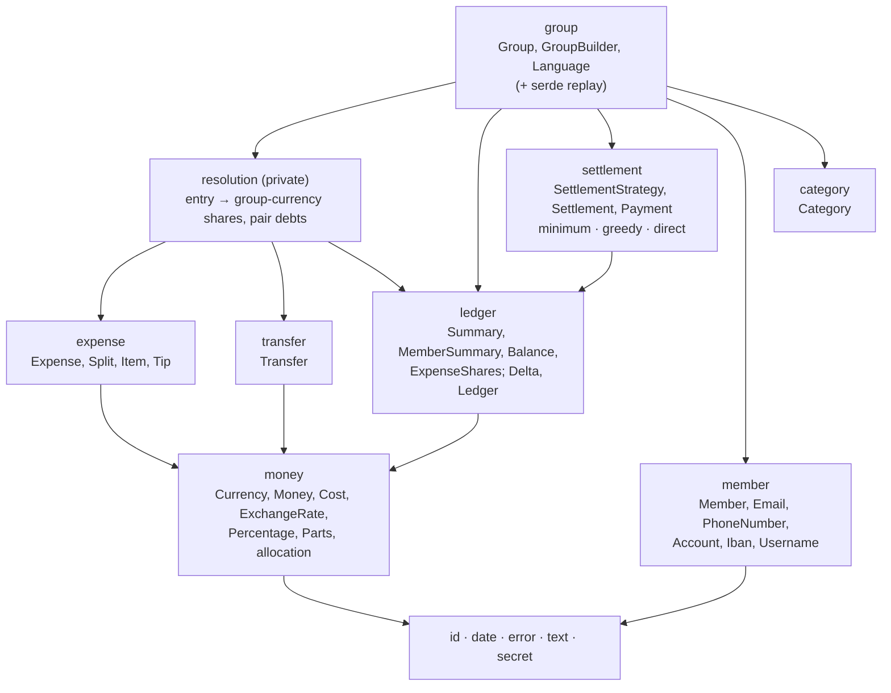
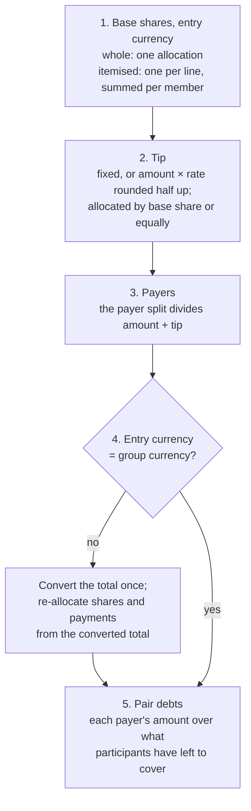

# Architecture

How eranos is built and why. [README.md](../README.md) says what it does,
[AGENTS.md](../AGENTS.md) holds the conventions, and
[TESTING.md](TESTING.md) shows how each rule here is checked.

## Contents

1. [Goals and constraints](#1-goals-and-constraints)
2. [Module map](#2-module-map)
3. [Data model](#3-data-model)
4. [Money and rounding](#4-money-and-rounding)
5. [Resolving an entry](#5-resolving-an-entry)
6. [The ledger and its caches](#6-the-ledger-and-its-caches)
7. [Settlement strategies](#7-settlement-strategies)
8. [Validation and errors](#8-validation-and-errors)
9. [The serialised form](#9-the-serialised-form)
10. [Account details and secrets](#10-account-details-and-secrets)
11. [Future bindings](#11-future-bindings)
12. [Key numbers](#12-key-numbers)

## 1. Goals and constraints

- **One core for every app.** iOS, Android, and the web share the rules, so
  a group computes the same totals and the same cents everywhere. The core
  is pure synchronous Rust: no I/O, no async runtime, no global state, and
  no clock except for generating identifiers.
- **Exact money.** A split that loses or invents a cent is a bug users see.
  Every amount is an integer; every division is exact by construction.
- **Changes are cheap and atomic.** Adding, editing, or removing an entry
  costs time proportional to the entry, not the group, and a change that
  fails leaves nothing half-applied.
- **Deterministic everywhere.** The same entries give the same shares, the
  same totals, and the same settlement on every device and in any order of
  arrival; this is what future sync relies on.
- **Few dependencies.** `thiserror` (derive only), `uuid` (v7 identifiers),
  `zeroize` (wiping secrets), and optionally `serde`. Everything else,
  including the ISO 4217 table, IBAN validation, and dates, is in the crate.

## 2. Module map



<details>
<summary>ASCII version (for renderers without Mermaid)</summary>

```text
                         ┌─────────────────────────────┐
                         │ group                       │
                         │ Group, GroupBuilder,        │
                         │ Language (+ serde replay)   │
                         └──┬──────┬──────┬──────┬─────┘
             ┌──────────────┘      │      │      └──────────────┐
             ▼                     ▼      ▼                     ▼
 ┌───────────────────────┐ ┌────────────┐ ┌───────────────┐ ┌───────────┐
 │ resolution (private)  │ │ ledger     │ │ settlement    │ │ member    │
 │ entry → shares,       │►│ Summary,   │◄│ minimum,      │ │ category  │
 │ pair debts            │ │ Delta      │ │ greedy, direct│ └─────┬─────┘
 └───┬───────────────┬───┘ └─────┬──────┘ └───────────────┘       │
     ▼               ▼           │                                │
 ┌─────────┐   ┌──────────┐      │                                │
 │ expense │   │ transfer │      │                                │
 └────┬────┘   └────┬─────┘      │                                │
      └──────┬──────┴────────────┘                                │
             ▼                                                    │
 ┌───────────────────────────────────────┐                        │
 │ money: Currency, Money, Cost, rates,  │                        │
 │ Percentage, Parts, allocation         │                        │
 └─────────────────┬─────────────────────┘                        │
                   ▼                                              ▼
         ┌──────────────────────────────────────────────────────────┐
         │ id · date · error · text · secret                        │
         └──────────────────────────────────────────────────────────┘
```

</details>

The root re-exports the types callers name; the modules group them for the
documentation. `resolution`, `secret`, and `text` are private, and
`money::allocation` is crate-private: they are free to change.

## 3. Data model

A `Group` has an ID, a name (the only required text), a description, a
**required** currency (every total is in it), and a language tag for the
apps. It owns four maps keyed by UUID v7 identifiers, so iteration order is
creation order on every device:

| Map        | Values                                        | Notes                                                 |
| ---------- | --------------------------------------------- | ----------------------------------------------------- |
| members    | `Member` + archived flag                      | first name required; contacts and accounts optional   |
| categories | `Category`                                    | names unique case-insensitively; optional on expenses |
| expenses   | `Expense` + its resolved `ExpenseShares`      | the resolution is kept for exact removal              |
| transfers  | `Transfer` + its amount in the group currency | the same, for transfers                               |

Entities are immutable values built by builders (`Member::builder`,
`Expense::builder`, …) and edited through `to_builder`; the group validates
every value it receives. `add_*` generates the identifier, `insert_*` takes
one from the caller (imports, sync, deterministic tests), and `replace_*`
keeps it.

An **expense** has a name, a cost (an amount in its own currency, local or
converted into the group currency at a fixed rate), a date and an optional
time, optional description and category, an optional tip, the payers (a
`Split` of the total), and how the cost is shared: an
`ExpenseSplit::Whole(Split)` or `ExpenseSplit::Itemised(Vec<Item>)`. A split
is `Equal`, `Percentages` (basis points summing to exactly 10 000), `Parts`
(hundredths, so 0.5 for a child), or `Amounts` (summing exactly to what is
divided). An **item** has a unit price, a quantity, and its own split; the
line totals must add up to the amount. A **tip** is fixed or a percentage of
the amount, added on top, and shared `Proportional`ly (by consumption) or
`Equal`ly. A **transfer** is money one member paid another, with a cost
like an expense's.

**Archived members** keep their history and balance and may send and
receive transfers, but cannot join a new expense; a replacement may keep an
archived member the original already had. A member referenced by any entry
cannot be removed.

## 4. Money and rounding

- `Money` is `i64` minor units plus a `Currency`. `Currency` covers every
  active ISO 4217 code with a minor unit (165 codes, from the SIX "List One"
  published 2026-09-17), with the ISO number of decimal places: 0 for JPY, 2
  for EUR, 3 for BHD, 4 for CLF. Precious metals, drawing rights, and test
  codes have no minor unit and are not currencies here.
- `ExchangeRate` is an exact positive decimal (`mantissa / 10^scale`, up to
  18 decimal places) meaning "one unit of the entry's currency is this many
  units of the group's". Conversion multiplies in checked `i128` and rounds
  **half away from zero**, the rule of EU Regulation 1103/97 art. 5.
- `Cost` is an entry's amount with its conversion: `Local(Money)` is in the
  group currency and converts at 1; `Converted { amount, rate }`, made by
  `Money::at`, is in another currency. A rate of 1 does not make a cost
  local, because a currency pegged at par (BMD to USD) converts at exactly
  1. Only the group knows its currency, so it checks the kind of cost when
  an entry is added: `MissingExchangeRate` for a local cost in another
  currency, `UnexpectedExchangeRate` for a converted one in its own.
- `Percentage` is basis points (33.33 % = 3 333) and `Parts` hundredths
  (1.5 = 150): both exact integers.
- **Allocation.** Every division is `allocate(total, weights, rotation)`:
  each part is `total × weight / Σ weights` rounded down, and the leftover
  units go one each to the largest remainders (the Hamilton method), so the
  parts add up exactly and each is its exact share rounded down or up.
  Weights that are all zero count as equal, so a division never loses
  money. Members are sorted by ID first, so listing order never matters.
- **Ties rotate.** Equal remainders, as in every even split, are ordered
  from a start position given by FNV-1a over the entry's ID and a pass
  number. The extra cent of 10.00 / 3 therefore lands on a different member
  from one expense to the next, while the same expense divides identically
  everywhere. There is no stored cursor and no randomness.
- **Overflow is an error.** Parsing, conversions, tips, and every total are
  checked; the ledger keeps values within ±`i64::MAX` so any value can be
  negated. A change that would leave the range is refused whole.

## 5. Resolving an entry

Every figure a user enters is in the entry's own currency and is validated
there (items add up to the amount, percentages to 100 %, amounts to what
they divide). Resolution then produces the entry's shares in the group
currency:



<details>
<summary>ASCII version (for renderers without Mermaid)</summary>

```text
 1. Base shares (entry currency)   whole: one allocation
                                   itemised: one per line, summed per member
                 │
                 ▼
 2. Tip           fixed, or amount × rate (half up);
                  allocated by base share, or equally
                 │
                 ▼
 3. Payers        the payer split divides amount + tip
                 │
                 ▼
 4. Foreign?  ── yes ──► convert the total once; re-allocate shares
     │                   and payments from the converted total ──┐
     no                                                          │
     ▼                                                           │
 5. Pair debts  ◄────────────────────────────────────────────────┘
    each payer's amount over what participants have left to cover
```

</details>

Converting the total once and re-dividing it keeps both sides exact: the
converted shares and the converted payments each add up to the converted
total, which a per-share conversion would not guarantee.

The **pair debts** feed the direct settlement. Payers are taken in ID
order; each payer's amount is allocated over the participants in proportion
to what each still has to cover, which is then reduced. The last payer
receives exactly what is left, so every participant's debts add up to their
share and every payer's credits to what they paid, exactly; debts of a
member to themselves are dropped. For a single payer this is simply "every
other participant owes the payer their share".

## 6. The ledger and its caches

The `Ledger` holds the `Summary` (total spent; per member paid, consumed,
sent, received, and net; per category; per member per category) and the
netted debt of every pair of members, keyed `(lower, higher)`.

A change becomes a `Delta` in exact 128-bit arithmetic: adding an entry
adds its resolution, removing subtracts it, replacing does both. Applying a
delta computes and range-checks every new value first and only then writes
them, removing rows that reach zero, so a summary compares equal to a
rebuilt one however it was reached. Net is kept as its own accumulator:
computing it from the other four could overflow when each of them fits.

| Change                                             | Cost                             | Settlement caches |
| -------------------------------------------------- | -------------------------------- | ----------------- |
| add, replace, remove an expense                    | O(k log m), k = members involved | cleared           |
| add, replace, remove a transfer                    | O(log m)                         | cleared           |
| add, update, archive a member; any category change | O(log m)                         | kept              |
| change the group currency                          | O(entries), full rebuild         | cleared           |
| read the summary                                   | O(1) or O(log m)                 | —                 |

Settlements are computed on the first request per strategy and cached in
`OnceLock`s, which keep `Group` `Send + Sync`; every balance-changing
mutation clears them. `change_currency` re-resolves every entry against the
new rates into a scratch ledger and swaps it in only if everything
succeeded: entries in any other currency become converted costs at the
supplied rate (including entries in the old group currency, which were
local), and entries in the new currency become local.

## 7. Settlement strategies

Every strategy pays out exactly the net balances: each debtor pays what
they owe and each creditor receives what they are owed, so nobody pays more
than their debt. Payments are sorted by payer, then recipient. The caller
always names the strategy; there is no default and no automatic fallback.

| Strategy           | Algorithm                                                                                                                      | Cost                   | Payments                                      |
| ------------------ | ------------------------------------------------------------------------------------------------------------------------------ | ---------------------- | --------------------------------------------- |
| `MinimumTransfers` | pair exact opposites; subset dynamic program for the largest partition into zero-sum groups; settle each group in member order | O(2ⁿ·n) time, 2ⁿ bytes | the minimum: n − (number of groups)           |
| `Greedy`           | largest debtor pays largest creditor, ties to the lower ID                                                                     | O(n log n)             | at most n − 1                                 |
| `Direct`           | every netted pair debt becomes a payment                                                                                       | O(pairs)               | the most; each traces back to shared expenses |

Minimising the number of payments is NP-hard (Verhoeff, "Settling multiple
debts efficiently", 2004): n balances need n − g payments, where g is the
largest number of disjoint groups that each sum to zero. The solver:

1. **Pairs exact opposites** (x owed, x owing) first. Taking such a pair as
   its own group is always optimal: if an optimal partition put the two in
   groups G and H, then {x, −x} and (G ∪ H) ∖ {x, −x} is a partition with as
   many groups.
2. **Runs `table[S] = max over i in S of table[S ∖ {i}] + [ΣS = 0]`** over
   every subset S of the remaining n balances, one byte per subset. Walking
   back from the full set along the maximum orders the members so that the
   prefix sums hit zero exactly at the group boundaries.
3. **Settles each group** with the northwest-corner rule: debtors and
   creditors in member order, each payment the overlap of the current debt
   and credit. A group of a maximum partition has no zero-sum subgroup, so
   it takes exactly one payment fewer than its size.

There is no size limit. The table must fit in the address space (n ≤ 63 on
64-bit targets, about 30 on wasm32); beyond that, or when the allocator
refuses, the solver returns `SettlementError::OutOfMemory`. Operating systems
that overcommit memory (Linux) or end memory-hungry apps (iOS) may stop the
process before an allocation fails, which is why the documentation of
`MinimumTransfers` recommends `Greedy` for large groups.

## 8. Validation and errors

Validation happens in two stages. A builder's `build()` checks the entry on
its own (names, positive amounts, sums, currencies inside the entry, tips).
The group's `add_*`/`insert_*`/`replace_*` check the entry against the
group (members exist and are not archived, the category exists, and the
cost is converted exactly when the entry is foreign) and against the
ledger's range.

| Error             | Returned by                                                                                            |
| ----------------- | ------------------------------------------------------------------------------------------------------ |
| `ValueError`      | parsing and constructing values: text, amounts, rates, ratios, dates, contacts, IBANs, currencies, IDs |
| `ExpenseError`    | `ExpenseBuilder::build`, `ItemBuilder::build`                                                          |
| `TransferError`   | `TransferBuilder::build`                                                                               |
| `GroupError`      | every group mutation; the group is unchanged when one is returned                                      |
| `SettlementError` | `Group::settlement` (only `MinimumTransfers` can fail)                                                 |

Every error enum is `#[non_exhaustive]` and built with `thiserror`. Messages
are lowercase without a trailing full stop and never repeat the rejected text,
because inputs include account numbers and contact details.

## 9. The serialised form

With the `serde` feature every type serialises. A group serialises only its
inputs, never the derived totals:

```text
{
  "format": 2,
  "id": "…",
  "categories": [{"id": "…", "entry": {"name": "Food"}}],
  "currency": "EUR",
  "expenses":   [{"id": "…", "entry": {
                  "amount": {"currency": "EUR", "minor_units": 9000},
                  "date": "2026-09-23", "name": "Dinner", "payers": {"equal": ["…"]},
                  "split": {"whole": {"percentages": [["…", 5000], …]}},
                  "tip": {"value": {"percentage": 1000}, "distribution": "proportional"}}}],
  "members":    [{"id": "…", "member": {"first_name": "Ana", …}, "archived": true}],
  "name": "Lisbon",
  "transfers":  [{"id": "…", "entry": {"amount": …, "date": "…", "from": "…", "to": "…"}}],
  "language": "pt-PT"
}
```

- Identifiers are hyphenated UUIDs, currencies their code, rates decimal
  strings, dates `YYYY-MM-DD`, times `hh:mm`, percentages basis points,
  parts hundredths. Absent optional fields are omitted. Keys follow the
  field order of [AGENTS.md](../AGENTS.md): `format` and `id` first, then
  the required fields, then the optional ones, each alphabetically.
- Loading replays the entries through the insert methods: members (all
  unarchived first), categories, expenses, transfers, then the archive
  flags, because an expense may reference a member archived after it was
  added. A hand-edited or corrupted file is refused, never loaded
  inconsistently.
- `format` is checked: a newer one is refused rather than read with fields
  silently dropped. New optional fields get `#[serde(default)]`, so files
  written by older releases keep loading.

## 10. Account details and secrets

IBANs and usernames are held in a buffer that is zeroed when dropped
(`zeroize`), print as `DE89 •••• 3000` or `[REDACTED]` in `Debug` and
`Display`, and are readable only through `expose_secret()`. IBANs are
validated against the SWIFT IBAN Registry (release 103): country code, the
country's length, and the ISO 7064 mod-97 check digits, which catch every
single-character typo.

Copies made outside the library (the caller's strings, a deserialiser's
buffers, the Swift or Kotlin side of a binding) are out of its reach, and
the serialised form contains the details in clear text. Encryption at rest
belongs to each platform's secure storage (Keychain, Keystore, Web Crypto),
which holds keys the library never sees.

## 11. Future bindings

The core is shaped for binding crates added as workspace siblings:

- **`eranos-ffi` (UniFFI for Swift and Kotlin)**, following matrix-rust-sdk:
  a `#[derive(uniffi::Object)]` wrapper holding `Mutex<eranos::Group>`
  (UniFFI objects cannot take `&mut self`), mirror records with `From`
  conversions, one flat error enum, and identifiers as strings (UniFFI has no
  128-bit integers). The release profile keeps `panic = "unwind"` so the
  scaffolding can catch panics at the boundary.
- **`eranos-wasm` (browser)**, through wasm-bindgen or
  uniffi-bindgen-react-native. It must enable `uuid`'s `js` feature: UUID v7
  generation reads the clock and the random source, which
  `wasm32-unknown-unknown` provides only through JavaScript.
- Public types have no lifetimes or generic parameters on their data, IDs
  are `Copy`, and every public type is `Send + Sync`, which a unit test
  asserts.

## 12. Key numbers

Release build on an Apple M4 Pro (`cargo bench -p eranos`):

| Operation                               | Size                                            | Time                     |
| --------------------------------------- | ----------------------------------------------- | ------------------------ |
| `MinimumTransfers`                      | 12 / 16 / 20 open balances                      | 18 µs / 0.36 ms / 7.2 ms |
| `Greedy`                                | 100 / 1 000 members                             | 3.7 µs / 85 µs           |
| `Direct`                                | 100 members sharing every expense (4 950 pairs) | 110 µs                   |
| add or remove an expense of six members | group of 10 000 expenses                        | ≈ 1.5 µs                 |
| read a member's totals                  | any                                             | ≈ 3 ns                   |
