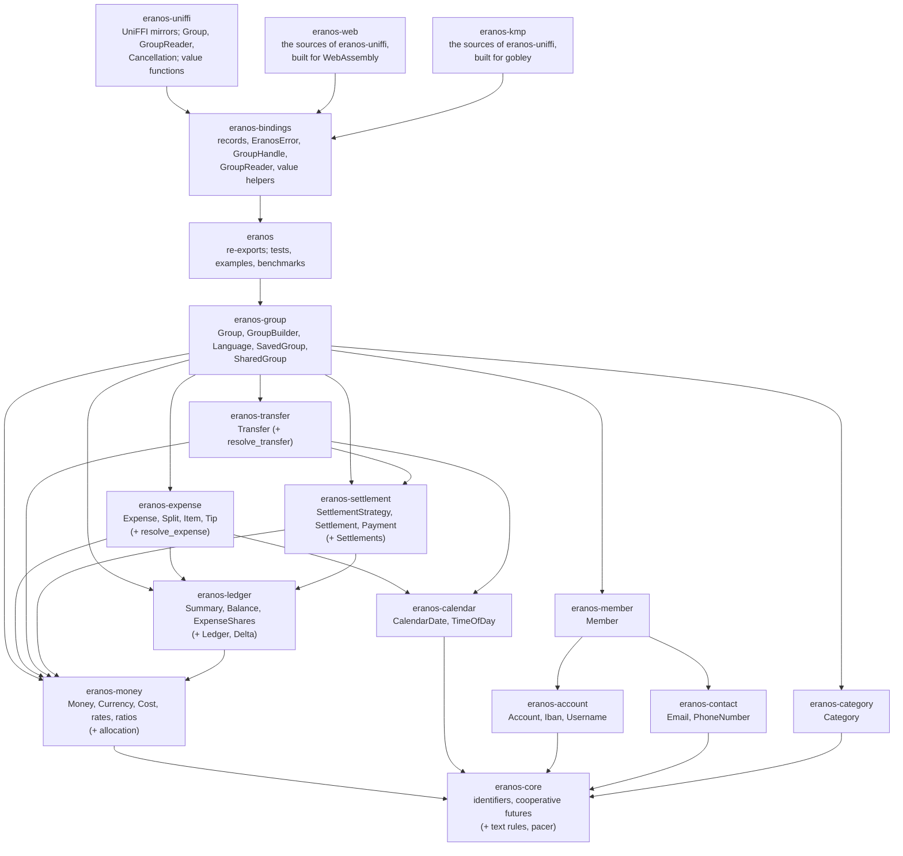
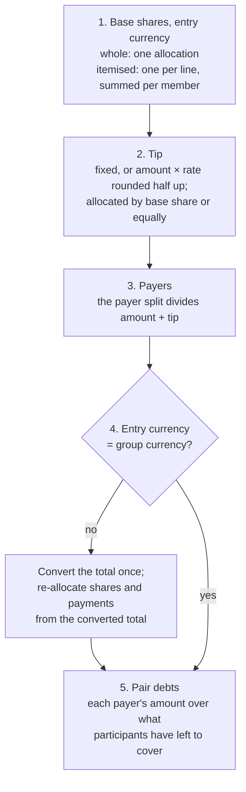
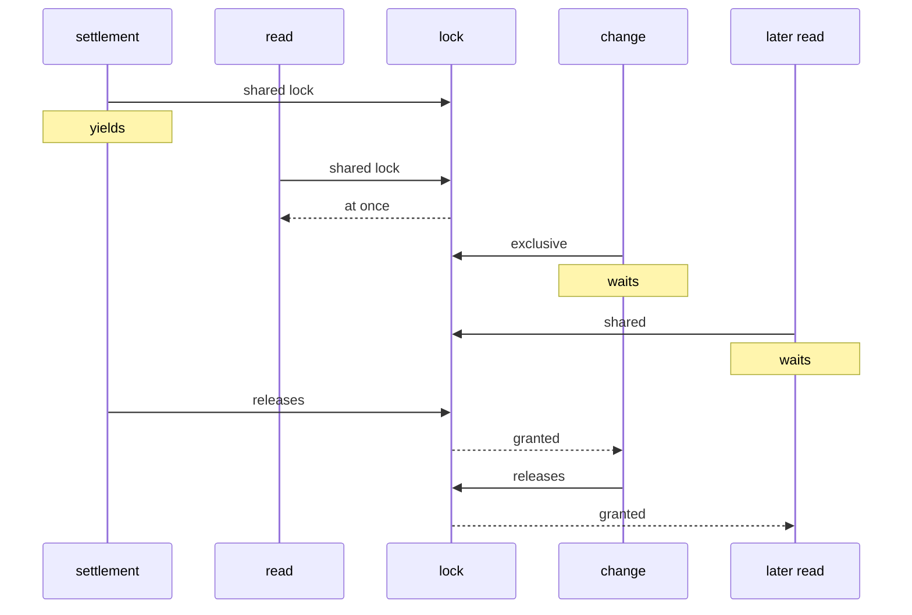

# Architecture

How eranos is built and why. [README.md](../README.md) says what it does,
[AGENTS.md](../AGENTS.md) holds the conventions, and
[TESTING.md](TESTING.md) shows how each rule here is checked.

## Contents

1. [Goals and constraints](#1-goals-and-constraints)
2. [Crate map](#2-crate-map)
3. [Data model](#3-data-model)
4. [Money and rounding](#4-money-and-rounding)
5. [Resolving an entry](#5-resolving-an-entry)
6. [The ledger and its caches](#6-the-ledger-and-its-caches)
7. [Settlement strategies](#7-settlement-strategies)
8. [Validation and errors](#8-validation-and-errors)
9. [The serialised form](#9-the-serialised-form)
10. [Account details](#10-account-details)
11. [Bindings](#11-bindings)
12. [Async and concurrency](#12-async-and-concurrency)
13. [Key numbers](#13-key-numbers)

## 1. Goals and constraints

- **One core for every app.** iOS, Android, and the web share the rules, so
  a group computes the same totals and the same cents everywhere. The core
  is plain Rust: no I/O, no async runtime (its asynchronous calls are
  futures any executor, or the calling thread, can drive;
  [§ 12](#12-async-and-concurrency)), no clock except for generating
  identifiers, and no global state except the lock that generation reads the
  clock under, so the identifiers of concurrent threads stay in creation
  order (or, with the `sequential-ids` feature for examples and tests, the
  counter that replaces the clock), and the phone-number metadata, which
  rlibphonenumber decodes once, on first use, into a table nothing writes
  to.
- **Exact money.** A split that loses or invents a cent is a bug users see.
  Every amount is an integer; every division is exact by construction.
- **Changes are cheap and atomic.** Adding, editing, or removing an entry
  costs time proportional to the entry, not the group, and a change that
  fails leaves nothing half-applied.
- **Deterministic everywhere.** The same entries give the same shares, the
  same totals, and the same settlement on every device and in any order of
  arrival; this is what future sync relies on.
- **Dependencies for the rules others maintain.** `icu_casemap` and
  `icu_normalizer` (Unicode caseless matching of category names),
  `icu_locale_core` (UTS #35 language tags), `icu_properties` (the Unicode
  categories of email characters), `iso4217-static` (the ISO 4217 list,
  pinned exactly), `jiff` (calendar dates, times of day, and their ISO 8601
  parser, without its clock or time zones), and `rlibphonenumber`
  (libphonenumber's numbering plans, pinned exactly); besides them
  `thiserror` (derive only), `uuid` (v7 identifiers), `async-lock` (the
  read-write lock behind `SharedGroup`, without `std`), and optionally
  `serde`. Everything else, including IBAN validation and the email rules,
  is in the crates. The licences the apps' notices must list are Apache-2.0
  (iso4217-static, and rlibphonenumber with libphonenumber's metadata),
  Unicode-3.0 (ICU4X), Unlicense or MIT (jiff), and Apache-2.0 or MIT
  (thiserror, uuid, and async-lock with event-listener,
  event-listener-strategy, and pin-project-lite), besides those of the
  crates they bring; `deny.toml` does not check licences.

## 2. Crate map

The library is thirteen crates. Callers depend on `eranos`, the facade,
which re-exports the types they use from twelve internal crates; each
internal crate owns one part of the domain, holds its own error type, and
depends only on crates below it. Every crate depends on `eranos-core`, and
the facade on all twelve; the graph draws an edge to `eranos-core` only
from the crates with no other dependency in the workspace, and of the
facade's edges only the one to the group. Above the facade,
`eranos-bindings` holds what every binding exposes
([§ 11](#11-bindings)); it depends on the facade and, for their conversion
traits, on the twelve internal crates, whose edges the graph leaves out.
`eranos-uniffi` mirrors it for UniFFI, and `eranos-uniffi-bindgen`, a
package of binaries with no edge in the workspace, holds the generators
that read the UniFFI library. `eranos-web` and `eranos-kmp` compile the
source files of `eranos-uniffi`, which they include by path, on other UniFFI
releases, for WebAssembly and for gobley, so neither has an edge to
`eranos-uniffi`.



<details>
<summary>ASCII version (for renderers without Mermaid)</summary>

```text
 ┌──────────────────────────────────────────────────────────────────────────┐
 │ eranos-uniffi      UniFFI mirrors of the core's types; Group,            │
 │                    GroupReader, Cancellation; the value functions        │
 │ eranos-web         the sources of eranos-uniffi on UniFFI 0.31, built    │
 │                    for WebAssembly                                       │
 │ eranos-kmp         the sources of eranos-uniffi on UniFFI 0.29, built    │
 │                    for gobley                                            │
 ├──────────────────────────────────────────────────────────────────────────┤
 │ eranos-bindings    what every binding exposes: records, EranosError,     │
 │                    GroupHandle, GroupReader, value helpers               │
 ├──────────────────────────────────────────────────────────────────────────┤
 │ eranos             the facade: re-exports; tests, examples, benchmarks   │
 ├──────────────────────────────────────────────────────────────────────────┤
 │ eranos-group       Group, GroupBuilder, Language, SavedGroup,            │
 │                    SharedGroup                                           │
 ├──────────────────────────────────────────────────────────────────────────┤
 │ eranos-expense     Expense, Split, Item, Tip (+ resolve_expense)         │
 │ eranos-transfer    Transfer (+ resolve_transfer)                         │
 │ eranos-member      Member                                                │
 │ eranos-category    Category                                              │
 ├──────────────────────────────────────────────────────────────────────────┤
 │ eranos-settlement  SettlementStrategy, Settlement, Payment               │
 │                    (+ Settlements)                                       │
 │ eranos-account     Account, Iban, Username                               │
 │ eranos-contact     Email, PhoneNumber                                    │
 ├──────────────────────────────────────────────────────────────────────────┤
 │ eranos-ledger      Summary, Balance, ExpenseShares (+ Ledger, Delta)     │
 │ eranos-calendar    CalendarDate, TimeOfDay                               │
 ├──────────────────────────────────────────────────────────────────────────┤
 │ eranos-money       Money, Currency, Cost, rates, ratios (+ allocation)   │
 ├──────────────────────────────────────────────────────────────────────────┤
 │ eranos-core        identifiers and cooperative futures (+ text, pacer)   │
 └──────────────────────────────────────────────────────────────────────────┘
   A crate depends only on crates in the bands below its own; the table
   lists each crate's direct dependencies.
```

</details>

| Crate                   | Holds                                                                                                                                                               | Depends on                                                                                         |
| ----------------------- | ------------------------------------------------------------------------------------------------------------------------------------------------------------------- | -------------------------------------------------------------------------------------------------- |
| `eranos-uniffi-bindgen` | the generators `uniffi-bindgen`, for Swift and Kotlin, and `uniffi-bindgen-java`, which read the library of eranos-uniffi                                           | uniffi, uniffi-bindgen-java                                                                        |
| `eranos-uniffi`         | the `uniffi` mirrors of the core's records, enums, and error; the `Group`, `GroupReader`, and `Cancellation` objects; the value helpers as functions                | eranos-bindings; uniffi                                                                            |
| `eranos-web`            | the source files of eranos-uniffi, compiled on UniFFI 0.31.2 for WebAssembly, with the runtime of uniffi-bindgen-react-native's `wasm2` flavour                     | eranos-bindings; uniffi, and for WebAssembly uniffi-runtime-wasm, wasm-bindgen, and uuid with `js` |
| `eranos-kmp`            | the source files of eranos-uniffi, compiled on UniFFI 0.29.4 for gobley's Kotlin Multiplatform bindings                                                             | eranos-bindings; uniffi                                                                            |
| `eranos-bindings`       | the records and enums every binding exposes, `EranosError`, `IbanReason`, `NewGroup`, `GroupHandle`, `GroupReader`, `Cancellation`, the value helpers               | `eranos` with `serde`, and the twelve internal crates for their conversion traits; serde_json      |
| `eranos`                | the re-exports callers use; the integration tests, examples, and benchmarks                                                                                         | the twelve crates below                                                                            |
| `eranos-group`          | `Group`, `GroupBuilder`, `Language`, `SavedGroup`, `SharedGroup`, `GroupReadGuard`, `GroupWriteGuard`, `GroupError`, `LanguageError`                                | category, core, expense, ledger, member, money, settlement, transfer; async-lock, icu_locale_core  |
| `eranos-expense`        | `Expense`, `ExpenseBuilder`, `ExpenseSplit`, `Split` and its shares, `Item`, `ItemBuilder`, `Tip`, `TipValue`, `TipDistribution`, `ExpenseError`; `resolve_expense` | calendar, core, ledger, money                                                                      |
| `eranos-transfer`       | `Transfer`, `TransferBuilder`, `TransferError`; `resolve_transfer`                                                                                                  | calendar, core, money, settlement                                                                  |
| `eranos-member`         | `Member`, `MemberBuilder`, `MemberError`                                                                                                                            | account, contact, core                                                                             |
| `eranos-category`       | `Category`, `CategoryError`                                                                                                                                         | core; icu_casemap, icu_normalizer                                                                  |
| `eranos-settlement`     | `SettlementStrategy`, `Settlement`, `Payment`, `SettlementError`; `Settlements`, `settle`                                                                           | core, ledger, money                                                                                |
| `eranos-account`        | `Account`, `AccountDetails`, `AccountKind`, `Iban`, `Username`, `AccountError`, `IbanError`                                                                         | core                                                                                               |
| `eranos-contact`        | `Email`, `PhoneNumber`, `ContactError`                                                                                                                              | core; icu_properties, rlibphonenumber                                                              |
| `eranos-ledger`         | `Summary`, `MemberSummary`, `Balance`, `CategoryTotal`, `ExpenseShares`, `MemberShare`; `Ledger`, `Delta`, `MemberPair`, `Debt`, `ResolvedExpense`                  | core, money                                                                                        |
| `eranos-calendar`       | `CalendarDate`, `TimeOfDay`, `CalendarError`                                                                                                                        | core; jiff                                                                                         |
| `eranos-money`          | `Money`, `Currency`, `Cost`, `ExchangeRate`, `CurrencyRate`, `Percentage`, `Parts`, `MoneyError`; `allocation`                                                      | core; iso4217-static                                                                               |
| `eranos-core`           | the five identifiers, `IdError`, `Cooperative`, `block_on`; `text`, `serde_text`, `yield_now`, `Pacer`                                                              | uuid                                                                                               |

For the internal crates, the facade's modules (`eranos::money`,
`eranos::member`, …) and its root re-export what the table lists before a
semicolon, and nothing else: what follows one is machinery the crates above
use, free to change. So is a conversion trait, which every crate holds
beside each of its non-exhaustive enums that the bindings convert, named
after the enum (`FromSplit`, `FromGroupError`, and the like): one method
per variant, so that a crate above tells every variant apart without a
wildcard arm
([DEVELOPMENT.md § 3.9](DEVELOPMENT.md#39-a-crossing-between-crates)).
Every internal crate but `eranos-ledger`, which has no error of its own,
depends on `thiserror`, and every crate but `eranos-ledger` and
`eranos-settlement` has a `serde` feature, which the facade's enables.

## 3. Data model

A `Group` has an ID, a name (the only required text), a description, a
**required** currency (every total is in it), and a language tag for the
apps. It owns four maps keyed by the UUID v7 identifiers of their entries,
so iteration order is the order the entries were built in, on every
device:

| Map        | Values                                        | Notes                                                             |
| ---------- | --------------------------------------------- | ----------------------------------------------------------------- |
| members    | `Member` + archived flag                      | first name required; contacts and accounts optional               |
| categories | `Category`                                    | names unique by Unicode caseless match; Uncategorised is built in |
| expenses   | `Expense` + its shares and pair debts         | the resolution is kept for exact removal                          |
| transfers  | `Transfer` + its amount in the group currency | the same, for transfers                                           |

Entities are immutable values built by builders (`Member::builder`,
`Expense::builder`, …) and edited through `to_builder`; the group validates
every value it receives. A builder's constructor takes every required value:
an expense has four, for one payer or several and for a whole split or
items, and an item two, for an equal split or any other. Every member,
category, expense, and transfer carries its identifier, generated when it
is built and kept by `to_builder`, so an edit stays the same entry: `add_*`
refuses an identifier the group already holds, and `replace_*` finds the
entry to replace by it.

An **expense** has a name, a cost (an amount in its own currency, local or
converted into the group currency at a fixed rate), a date and an optional
time, an optional description, a category (Uncategorised unless another is
set), a tip (none unless set), the payers (a `Split` of the total), and how
the cost is shared: an `ExpenseSplit::Whole(Split)` or
`ExpenseSplit::Itemised(Vec<Item>)`. A split is `Equal`, `Percentages`
(basis points summing to exactly 10 000), `Parts` (hundredths, so 0.5 for a
child), or `Amounts` (summing exactly to what is divided). An **item** has a
unit price, a quantity, and its own split; the line totals must add up to
the amount. A **tip** is fixed or a percentage of the amount, added on top,
and shared `Proportional`ly (by consumption) or `Equal`ly. A **transfer** is
money one member paid another, with a cost like an expense's.

**Archived members** keep their history and balance and may send and
receive transfers, but cannot join a new expense; a replacement may keep an
archived member the original already had. A member referenced by any entry
cannot be removed.

## 4. Money and rounding

- `Money` is `i64` minor units plus a `Currency`. `Currency` covers every
  active ISO 4217 code with a minor unit (165 codes, from the SIX "List One"
  published 2026-01-01, which `iso4217-static` 0.2.4 is generated from),
  with the ISO number of decimal places: 0 for JPY, 2 for EUR, 3 for BHD, 4
  for CLF. Precious metals, drawing rights, and test codes have no minor
  unit and are not currencies here. `Currency` holds the crate's value and
  its minor unit, read once when a code is looked up, so no crate type is
  part of the API; it also gives each currency's ISO English name and
  numeric code.
- `ExchangeRate` is an exact positive decimal (`mantissa / 10^scale`, up to
  18 decimal places) meaning "one unit of the entry's currency is this many
  units of the group's". Conversion multiplies in checked `i128` and rounds
  **half away from zero**, the rule of EU Regulation 1103/97 art. 5.
- `Cost` is an entry's amount with its conversion: `Local(Money)` is in the
  group currency and converts at 1; `Converted { amount, rate }`, made by
  `Money::at`, is in another currency. A rate of 1 does not make a cost
  local, because a currency pegged at par (BMD to USD) converts at exactly
  1. Only the group knows its currency, so it checks the kind of cost when
  an entry is added: `MissingExchangeRate` for a local cost in another
  currency, `UnexpectedExchangeRate` for a converted one in its own.
- `Percentage` is basis points (33.33 % = 3 333) and `Parts` hundredths
  (1.5 = 150): both exact integers.
- **Allocation.** Every division is `allocate(total, weights, rotation)`:
  each part is `total × weight / Σ weights` rounded down, and the leftover
  units go one each to the largest remainders (the Hamilton method), so the
  parts add up exactly and each is its exact share rounded down or up.
  Weights that are all zero count as equal, so a division never loses
  money. Members are sorted by ID first, so listing order never matters.
- **Ties rotate.** Equal remainders, as in every even split, are ordered
  from a start position given by FNV-1a over the entry's ID and a pass
  number. The extra cent of 10.00 / 3 therefore lands on a different member
  from one expense to the next, while the same expense divides identically
  everywhere. There is no stored cursor and no randomness.
- **Overflow is an error.** Parsing, conversions, tips, and every total are
  checked; the ledger keeps values within ±`i64::MAX` so any value can be
  negated. A change that would leave the range is refused whole.

## 5. Resolving an entry

Every figure a user enters is in the entry's own currency and is validated
there (items add up to the amount, percentages to 100 %, amounts to what
they divide). The group then checks that the entry's cost suits the group
currency, a local cost in it and a converted one in any other, so
resolution fails only when a conversion leaves the range of an amount.
Resolution produces the entry's shares in the group currency:



<details>
<summary>ASCII version (for renderers without Mermaid)</summary>

```text
 1. Base shares (entry currency)   whole: one allocation
                                   itemised: one per line, summed per member
                 │
                 ▼
 2. Tip           fixed, or amount × rate (half up);
                  allocated by base share, or equally
                 │
                 ▼
 3. Payers        the payer split divides amount + tip
                 │
                 ▼
 4. Foreign?  ── yes ──► convert the total once; re-allocate shares
     │                   and payments from the converted total ──┐
     no                                                          │
     ▼                                                           │
 5. Pair debts  ◄────────────────────────────────────────────────┘
    each payer's amount over what participants have left to cover
```

</details>

Converting the total once and re-dividing it keeps both sides exact: the
converted shares and the converted payments each add up to the converted
total, which a per-share conversion would not guarantee.

The **pair debts** feed the direct settlement. Payers are taken in ID
order; each payer's amount is allocated over the participants in proportion
to what each still has to cover, which is then reduced. The last payer
receives exactly what is left, so every participant's debts add up to their
share and every payer's credits to what they paid, exactly; debts of a
member to themselves are dropped. For a single payer this is simply "every
other participant owes the payer their share".

## 6. The ledger and its caches

The `Ledger` holds the `Summary` (total spent; per member paid, consumed,
sent, received, and net; per category; per member per category) and the
netted debt of every pair of members, keyed by a `MemberPair` whose `from`
is the lower member.

A change becomes a `Delta` in exact 128-bit arithmetic: adding an entry
adds its resolution, removing subtracts it, replacing does both. Applying a
delta computes and range-checks every new value first and only then writes
them, removing rows that reach zero, so a summary compares equal to a
rebuilt one however it was reached. Net is kept as its own accumulator:
computing it from the other four could overflow when each of them fits.

| Change                                                   | Cost                             | Settlement caches |
| -------------------------------------------------------- | -------------------------------- | ----------------- |
| add, replace, remove an expense                          | O(k log m), k = members involved | cleared           |
| add, replace, remove a transfer                          | O(log m)                         | cleared           |
| add, replace, archive a member; add or rename a category | O(log m)                         | kept              |
| remove a category: its totals move to Uncategorised      | O(expenses + category totals)    | kept              |
| change the group currency                                | O(entries), full rebuild         | cleared           |
| read the summary                                         | O(1) or O(log m)                 | —                 |

Settlements are computed on the first request per strategy and cached in
`OnceLock`s, which keep `Group` `Send + Sync`; the cache belongs to the
settlement module and reads the balances from the summary, and every
balance-changing mutation clears it. A plan is kept once it is computed,
never while it is: no request waits for another's computation, and an
asynchronous request dropped before it completes keeps nothing.
`change_currency` re-resolves every entry against the new rates into a
scratch ledger and swaps it in only if everything succeeded: entries in any
other currency become converted costs at the supplied rate (including
entries in the old group currency, which were local), and entries in the new
currency become local. Its asynchronous form yields once per 1 024 entries
and swaps only after its last yield, so a call dropped at a yield changes
nothing ([§ 12](#12-async-and-concurrency)).

## 7. Settlement strategies

Every strategy pays out exactly the net balances: each debtor pays what
they owe and each creditor receives what they are owed, so nobody pays more
than their debt. Payments are sorted by payer, then recipient. The caller
always names the strategy; there is no default and no automatic fallback.

| Strategy           | Algorithm                                                                                                                      | Cost                   | Payments                                      |
| ------------------ | ------------------------------------------------------------------------------------------------------------------------------ | ---------------------- | --------------------------------------------- |
| `MinimumTransfers` | pair exact opposites; subset dynamic program for the largest partition into zero-sum groups; settle each group in member order | O(2ⁿ·n) time, 2ⁿ bytes | the minimum: n − (number of groups)           |
| `Greedy`           | largest debtor pays largest creditor, ties to the lower ID                                                                     | O(n log n)             | at most n − 1                                 |
| `Direct`           | every netted pair debt becomes a payment                                                                                       | O(pairs)               | the most; each traces back to shared expenses |

Minimising the number of payments is NP-hard (Verhoeff, "Settling multiple
debts efficiently", 2004): n balances need n − g payments, where g is the
largest number of disjoint groups that each sum to zero. The solver:

1. **Pairs exact opposites** (x owed, x owing) first. Taking such a pair as
   its own group is always optimal: if an optimal partition put the two in
   groups G and H, then {x, −x} and (G ∪ H) ∖ {x, −x} is a partition with as
   many groups.
2. **Runs `table[S] = max over i in S of table[S ∖ {i}] + [ΣS = 0]`** over
   every subset S of the remaining n balances, one byte per subset. Walking
   back from the full set along the maximum orders the members so that the
   prefix sums hit zero exactly at the group boundaries.
3. **Settles each group** with the northwest-corner rule: debtors and
   creditors in member order, each payment the overlap of the current debt
   and credit. A group of a maximum partition has no zero-sum subgroup, so
   it takes exactly one payment fewer than its size.

There is no size limit. The table must fit in the address space (n ≤ 63 on
64-bit targets, about 30 on wasm32); beyond that, or when the allocator
refuses, the solver returns `SettlementError::OutOfMemory`. Operating systems
that overcommit memory (Linux) or end memory-hungry apps (iOS) may stop the
process before an allocation fails, which is why the documentation of
`MinimumTransfers` recommends `Greedy` for large groups.

## 8. Validation and errors

Validation happens in two stages. A builder's `build()` checks the entry on
its own (names, positive amounts, sums, currencies inside the entry, tips).
The group's `add_*`/`replace_*` check the entry against the
group (members exist and are not archived, the category exists, and the
cost is converted exactly when the entry is foreign) and against the
ledger's range.

| Error             | Returned by                                                                                                                                                                                       |
| ----------------- | ------------------------------------------------------------------------------------------------------------------------------------------------------------------------------------------------- |
| `IdError`         | reading an identifier from text                                                                                                                                                                   |
| `CalendarError`   | building and reading dates and times of day                                                                                                                                                       |
| `MoneyError`      | building, reading, and combining amounts, currencies, rates, percentages, and parts                                                                                                               |
| `AccountError`    | `Account::new`, `Iban::parse` (with the `IbanError` reason), `Username::new`                                                                                                                      |
| `ContactError`    | `Email::parse`, `PhoneNumber::parse`                                                                                                                                                              |
| `MemberError`     | `MemberBuilder::build`                                                                                                                                                                            |
| `CategoryError`   | `Category::new`, `Category::renamed`                                                                                                                                                              |
| `LanguageError`   | `Language::parse`                                                                                                                                                                                 |
| `ExpenseError`    | `ExpenseBuilder::build`, `ItemBuilder::build`                                                                                                                                                     |
| `TransferError`   | `TransferBuilder::build`                                                                                                                                                                          |
| `GroupError`      | `GroupBuilder::build`, `SavedGroup::into_group`, every group mutation, and `SharedGroup::try_read` and `try_write` while another call holds the lock; the group is unchanged when one is returned |
| `SettlementError` | `Group::settlement` (only `MinimumTransfers` can fail)                                                                                                                                            |

Each module has one error enum, `#[non_exhaustive]` and built with
`thiserror`, and none wraps another: a function reports the failure of its
own module, so a caller that mixes modules uses its own error type or
`Box<dyn Error>`. Messages are lowercase without a trailing full stop and
never repeat the rejected text, because inputs include account numbers and
contact details.

## 9. The serialised form

With the `serde` feature, `Group` and every type it stores serialise and
deserialise: its entries, members, and categories, the identifiers, and the
values inside them, such as `Money`, `Currency`, `ExchangeRate`,
`CalendarDate`, and `Language`. `SavedGroup` only deserialises. What a group
derives (`Summary`, `Settlement`, `ExpenseShares`, and the types they hold),
the builders, the errors, `CurrencyRate`, and `SettlementStrategy` do not
serialise. A group serialises only its inputs, never the derived totals:

```text
{
  "format": 2,
  "id": "…",
  "categories": [{"id": "…", "name": "Food"}],
  "currency": "EUR",
  "expenses":   [{"id": "…",
                  "amount": {"currency": "EUR", "minor_units": 9000},
                  "date": "2026-09-23", "name": "Dinner", "payers": {"equal": ["…"]},
                  "split": {"whole": {"percentages": [["…", 5000], …]}},
                  "tip": {"value": {"percentage": 1000}, "distribution": "proportional"}}],
  "members":    [{"id": "…", "first_name": "Ana", …}],
  "name": "Lisbon",
  "transfers":  [{"id": "…", "amount": …, "date": "…", "from": "…", "to": "…"}],
  "archived":   ["…"],
  "language": "pt-PT"
}
```

- Identifiers are hyphenated UUIDs, currencies their code, rates decimal
  strings, dates `YYYY-MM-DD` and times `hh:mm` (read back by the ISO 8601
  parser behind `CalendarDate::parse` and `TimeOfDay::parse`), percentages
  basis points, parts hundredths, and each share of a split the two-element
  array `[member, value]`. Absent optional fields are omitted, and so are the
  built-in category, an expense's category when it is the built-in one
  (every group has it again when it loads), and a tip equal to
  `Tip::default()`, no tip at all. Keys follow the field order of
  [AGENTS.md](../AGENTS.md): `format` and `id` first, then the required
  fields, then the optional ones, each alphabetically.
- Loading replays the entries through the `add_*` methods: members (all
  unarchived first), categories, expenses, transfers, then the `archived`
  list, because an expense may reference a member archived after it was
  added. A hand-edited or corrupted file is refused, never loaded
  inconsistently. Deserialising a `Group` reports the refusal as the
  deserialiser's error; deserialising a `SavedGroup` and calling
  `into_group` reports it as a `GroupError`, so an app can tell a newer
  file from a damaged one. An entry that could never have been built fails
  the read in both cases, since every entity deserialises through its
  validating constructor. `into_group_async` replays the same steps,
  yielding once per 1 024 of them; it owns the saved form, so a dropped
  load leaves nothing behind, and a copy of the `SavedGroup` starts it
  again ([§ 12](#12-async-and-concurrency)).
- `format` is checked: a newer one is refused rather than read with fields
  silently dropped (`GroupError::UnsupportedFormat`). New optional fields
  get `#[serde(default)]`, so files written by older releases keep
  loading.

## 10. Account details

IBANs and usernames are validated values, held, printed, and serialised in
clear text like every other value: `as_str()` returns an IBAN in electronic
format and a username as entered, trimmed. IBANs are validated against the
SWIFT IBAN Registry (release 103): the country code,
the country's length and BBAN structure (which positions hold digits and
which letters), and the ISO 7064 mod-97 check digits, which must lie
between 02 and 98 and catch every single-character typo.

rlibphonenumber writes national numbers to the `log` facade at `trace`
level while it parses them, and a library cannot turn a dependency's logging
off without global logger state; a binding or an app that installs a logger
keeps the `rlibphonenumber` target below `trace`, so members' numbers stay
out of its logs.

The serialised form contains the details in clear text. Encryption at rest
belongs to each platform's secure storage (Keychain, Keystore, Web Crypto),
which holds keys the library never sees.

## 11. Bindings

`eranos-bindings` holds, in plain Rust, everything the bindings expose. The
glue crates beside it mirror its types and forward every call to it,
converting nothing and deciding nothing, so every rule a binding applies is
tested in Rust: `eranos-uniffi` for Swift, Kotlin, and Java, `eranos-web`
for browsers and Node, `eranos-kmp` for Kotlin Multiplatform, and, planned,
`eranos-capi` for C and C++.

- **Records of text and integers.** Values and entries cross as records and
  enums with data: identifiers as hyphenated UUIDs, currencies as ISO 4217
  codes, exchange rates as decimals, amounts as 64-bit minor units,
  percentages in basis points, and parts in hundredths. Days, months,
  years, hours, minutes, quantities, basis points, and hundredths are
  32-bit signed integers, which every target language has: Kotlin's
  unsigned types are invisible from Java, and JavaScript has one number
  type. A record is checked by the library's rules on its way in, so a bad
  value, a number too large for its field included, is a typed error and
  never wraps into another value.
- **Identity stays with the group.** An entry to add carries no identifier
  (`IdentifierGiven` otherwise), and the call returns the one the group
  generated. An entry to replace names its entry (`IdentifierMissing`
  otherwise), and the replacement starts from the stored entry's
  `to_builder()` and takes every field of the record, so no identifier is
  set from outside.
- **One error, grouped by module.** A binding call can fail in several
  modules at once, since its records are converted before the library
  runs it, and a generated function throws one error type, so every call
  reports `EranosError`. It has a case per module of the library, as the
  library has an error per module: `Account`, `Calendar`, `Category`,
  `Contact`, `Expense`, `Group`, `Id`, `Language`, `Member`, `Money`,
  `Settlement`, and `Transfer`. Each holds the module's failure, an enum
  with a case per variant of the module's error and what the variant holds
  (`GroupFailure::MemberInUse { expenses, member, transfers }`), and, as
  `detail`, the library's message; a field named `message` would clash with
  the property of every Kotlin exception. A caller catches a whole module
  or one failure, and no failure needs its crate's name in front. The
  core's own cases stand beside the modules: `Cancelled`, `IdentifierGiven`,
  `IdentifierMissing`, `InvalidJson`, which names the line and column of a
  refused saved group but not its text, since the text can hold an account
  number, and `Released`. The conversion traits of [§ 2](#2-crate-map) keep
  the conversion exhaustive, so a new variant fails the core's build.
- **One group object.** `GroupHandle` holds a `SharedGroup` and has every
  group call in two forms: a synchronous one, which waits for the lock
  where a thread can sleep and, on wasm, whose one thread must not, fails
  with `GroupFailure::Busy` while another call holds it; and an
  asynchronous one, a `Send + 'static` future that waits for the lock. Only
  the two functions that take a synchronous call's lock depend on the
  target, and the trying form wasm uses is tested on the host. `GroupHandle::read` returns a
  `GroupReader`, which holds the shared lock until it is released or
  dropped, so the reads of one report see no change in between; `release`
  frees the lock at once, for languages whose collector frees objects late,
  and is not named `close`, which the Kotlin and Java generators give every
  object to free it.
- **Cancellation.** Every asynchronous call takes an optional
  `Cancellation`. Cancelling it stops the call at its next yield, or at once
  while the call waits for the lock, and fails it with `Cancelled`; the
  library's calls change nothing until they complete, so the group is left
  as it was, and its lock is released.
- **The value helpers.** Free functions parse and write every value as the
  library does (amounts, rates, percentages, parts, dates, times, language
  tags, balances, currencies, and contact and account details), so every
  text a binding shows is the library's.
- **Shapes every generator takes.** The types keep to what UniFFI 0.29, the
  oldest version the glue crates use, can mirror: records, enums with
  data, one error enum, and objects; no methods on records, and no optional
  list, for which an empty one stands.
- **The browser.** The web crate enables `uuid`'s `js` feature: UUID v7
  generation reads the clock and the random source, which
  `wasm32-unknown-unknown` provides only through JavaScript.
- The release profile keeps `panic = "unwind"` so the glue can catch a
  panic at the boundary. Public types have no lifetimes or generic
  parameters on their data, IDs are `Copy`, and every public type is
  `Send + Sync`, which `tests/api.rs` asserts for the library and the
  core's own tests for the core.

`eranos-uniffi` mirrors the core's records, enums, and error with
`#[uniffi::remote]`, which repeats each definition field for field, so a
change to a core type that the mirror does not repeat fails the glue's
build. It wraps the group handle, the read handle, and the cancellation in
the objects `Group`, `GroupReader`, and `Cancellation`, whose methods
forward to the core, and exports the value helpers as functions and the
asynchronous load as `load_group_async`. Its four source files are
compiled by `eranos-web` as well, against UniFFI 0.31.2, and by
`eranos-kmp`, against 0.29.4: they keep to what 0.29 accepts, and every
release compiles them.
`uniffi.toml` names the generated Swift module `EranosGenerated` and the
generated Kotlin and Java package `eranos.internal`: the generated code sits
beneath each package's hand-written layer.

`eranos-web` builds the same glue for browsers and Node. A crate carries
the derives of one UniFFI release, so it includes the four source files of
`eranos-uniffi` by path and compiles them against 0.31.2, the release whose
metadata uniffi-bindgen-react-native 0.31.0-5 reads, with what the
generator's `wasm2` flavour links: `uniffi-runtime-wasm`, the runtime its
code calls, and `wasm-bindgen` at 0.2.100, the release of the command-line
support the generator embeds to write the glue beside the module. On
`wasm32-unknown-unknown`, UniFFI's core compiles only with its
`wasm-unstable-single-threaded` feature, which drops the `Send` and `Sync`
bounds a target without threads has no use for.

`eranos-kmp` builds the same glue for Kotlin Multiplatform, the same way:
it includes the four source files and compiles them against UniFFI 0.29.4,
the release whose metadata gobley 0.3.7's generator reads, as a shared
library for the JVM and Android, whose metadata the generator reads too,
and as a static library that each Apple target links.

`bindings/swift` is the Swift package for iOS, iPadOS, macOS, Mac Catalyst,
tvOS, watchOS, and visionOS. Its binary target, `EranosFFI`, is an
XCFramework of ten static libraries from the library's thirteen Apple
targets, `lipo` joining the two architectures of the iOS simulator, macOS,
and Mac Catalyst. The generated Swift compiles as the target
`EranosGenerated` in Swift 5 mode, since UniFFI's Swift is not yet clean
under Swift 6's concurrency checks, and the module apps import, `Eranos`, is
written by hand in Swift 6 and imports the generated one with `internal
import`, so no generated type reaches an app. It follows the Swift API
Design Guidelines:

- Every entry has an identifier type of its own (`Member.ID`, `Expense.ID`,
  an `Identifier` of the entity), absent on a new entry.
- A value the library checks is a type that is valid once made: `Currency`,
  from the library's list, and `Money`, `ExchangeRate`, `Percentage`,
  `Parts`, `CalendarDate`, `TimeOfDay`, `Email`, `PhoneNumber`, `IBAN`,
  `Username`, and `Language`, each printing the library's text.
- Every call throws `EranosError` as a typed throw, with the core's case per
  module and a failure enum per module whose payloads are typed
  (`GroupFailure.memberInUse(expenses:member:transfers:)`); a failure the
  generated code reports that is not the library's, such as a defect in the
  bindings, is `unexpected`.
- Every group call is one name overloaded by `async`: asynchronous code
  picks the form that waits for the lock without blocking a thread of the
  pool, and cancelling its task cancels the call. `Group.withRead` holds a
  read handle for a closure.

`bindings/kotlin` is the Kotlin package for Android and the JVM: a Gradle
build of four modules. `generated` compiles the generated Kotlin for the
JVM, and `generated-android` compiles it for Android beside the library
of every Android ABI (`arm64-v8a`, `armeabi-v7a`, `x86`, and `x86_64`,
built for API level 26, the libraries' `minSdk`). `eranos`, the layer apps
depend on, is written by hand, and `eranos-android` compiles the same
sources into an Android library; each depends on its generated module as
an implementation detail, so the generated classes, in `eranos.internal`,
stay off an app's compile classpath. The layer follows the Kotlin library
guidelines:

- Explicit API mode, and no data class: every value and entry writes its
  equality, hash, and text out, so a field added later changes no
  generated `componentN` or `copy`; an entry's own `copy` keeps its
  identifier.
- Every entry has an identifier type of its own, a value class
  (`MemberId`, `ExpenseId`), absent on a new entry. A value the library
  checks has an internal constructor and factories that check it
  (`Currency.of`, `Money.parse`, `CalendarDate.of`), and prints the
  library's text.
- A failure the library reports throws `EranosException`, a subclass per
  module holding the module's failure (`GroupFailure.MemberInUse`) and the
  library's message. A call the program should not make throws the
  standard exception for it: `IllegalArgumentException` for an entry to
  add that has an identifier or one to replace that has none, and
  `IllegalStateException` for a read through a closed `GroupReader`.
- Every group call is a `suspend` function that waits for the lock
  without blocking its thread; cancelling its coroutine drops the
  library's call, which leaves the group as it was. Its twin, whose name
  ends in `Blocking`, blocks instead. `Group` and `GroupReader` are
  `AutoCloseable`, and `Group.withRead` holds a read handle for a block.
- The binary-compatibility validator checks the layer's API against the
  committed dump, `eranos/api/eranos.api`.

`bindings/java` is the Java package, for JDK 25 and later: one Gradle
project whose JAR is the JPMS module `eranos`. The generated Java, in
`eranos.internal`, compiles as a source set of its own with its warnings
allowed; the layer compiles with the generated classes patched into the
module (`--patch-module`), whose `module-info` exports only `eranos`, so
`-Xlint:exports` refuses a public signature that names a generated type.
The layer follows Effective Java and Google Java Style:

- Identifiers, amounts, the shares of a split, and the totals are
  records; a value the library checks is a final class with a private
  constructor and factories that check it (`Currency.of`, `Money.parse`,
  `CalendarDate.of`); an entry is a final class built by a builder, as in
  Rust, and edited through `toBuilder`, which keeps its identifier.
- An absent value is an empty `Optional`, a variant a record of a sealed
  interface, and a failure the library reports a checked
  `EranosException`, a subclass per module holding the module's failure.
  A call the library refuses only on a platform without threads declares
  no checked exception.
- Every group call blocks, and its twin, whose name ends in `Async`,
  returns a `CompletableFuture` whose cancellation cancels the generated
  future, which drops the library's call; a dependent future that
  `thenApply` makes would cancel only itself.
- The generated exception is not sealed, so the conversion from it is a
  table by class, which the error test checks against every class the
  generator writes.

`bindings/typescript` is the npm package `eranos`, for browsers and Node 24
and later. The generated TypeScript, the WebAssembly module, and
wasm-bindgen's glue sit in `src/internal`, which the package's `exports`
leave out: its entry point is the bundle `dist/eranos.js`, whose
declarations drop every item marked `@internal`, beside `eranos_web.wasm`,
which the app hands to `init` before any other call, since a bundler that
copies the file renames it. The player, `@ubjs/wasm` and `@ubjs/core`,
stays a dependency, so the app's resolver picks its browser or its Node
build. The layer follows the Google TypeScript Style Guide:

- Every entry has an identifier type of its own, a branded string
  (`MemberId`, `ExpenseId`) that no other text or identifier stands in for,
  absent on a new entry. A value the library checks is a class with
  factories that check it (`Currency.of`, `Money.parse`, `CalendarDate.of`),
  printing the library's text; entries and totals are read-only interfaces,
  and a variant is a union discriminated by `kind`
  (`{ kind: 'equal', members }`).
- A failure the library reports throws an `EranosError`, a subclass per
  module holding the module's failure, itself a union by `kind`. A call the
  program should not make throws `TypeError`: an entry to add that has an
  identifier, one to replace that has none, and a read through a released
  `GroupReader`.
- Every group call returns a Promise that waits for the lock; aborting the
  `AbortSignal` of its options cancels the call, which leaves the group as
  it was, and rejects with the signal's reason. Its twin, whose name ends
  in `Sync`, does not wait: it throws `GroupError` with the failure `busy`
  while another call holds the lock, since the page's one thread cannot
  wait for it. `Group` and `GroupReader` are `Disposable`, so `using` frees
  them at the end of a block.

`bindings/kmp` is the Kotlin Multiplatform package: a Gradle build of two
modules on gobley's plugins. `generated` holds the Kotlin that gobley's
generator writes from `eranos-kmp`, in `eranos.internal`, beside the library
that gobley's Cargo plugin builds for each target: the host's for the JVM,
the four ABIs' for Android, and a static library for each of the eight Apple
targets that Kotlin/Native, gobley, and rustup's standard libraries all
have, but for macOS on x86_64, which Kotlin deprecates (iOS, its simulator
on arm64 and x86_64, macOS on arm64, tvOS and watchOS, and their arm64
simulators). `eranos` compiles the Kotlin package's layer from its sources,
unchanged, as common code, over `generated` as an implementation detail, so
one layer serves both packages. `generated` ships its own shrinker rules for
JNA, which keep JNA's classes and the generated package, and turns gobley's
off, since they never reach an app. gobley 0.3.7 supports the Android plugin
8, not 9, and the Android plugin 8 calls an internal API that Gradle 9.6
drops and a notation that Gradle 9.1 deprecates, so this build alone runs
Gradle 9.0, on JDK 21, since Gradle 9.0 runs on JDK 24 at the latest; its
Kotlin is the Kotlin package's 2.4.20. gobley's plugin installs its
generator, `gobley-uniffi-bindgen` 0.3.7, into the build directory with a
`cargo install` that passes no `--locked`, so the generator's dependencies
resolve when it installs.

The generators, `uniffi-bindgen` for Swift and Kotlin and
`uniffi-bindgen-java` for Java, are the binaries of `eranos-uniffi-bindgen`,
built on the UniFFI release that builds the library, so the code they write
reads the library's metadata as written. They sit in a package of their
own, of binaries only, so that no build or lint of the libraries, for the
host or for the mobile and wasm targets, compiles a generator. `cargo xtask
gates` writes every language's sources into `target/uniffi/<language>`;
they are never committed. On macOS it also builds the Swift package's
XCFramework in the dev profile, 1.3 GB of debug libraries, copies the
generated Swift into the package, and builds, tests, lints, and documents
the package. On every machine it builds the library of the four Android
ABIs with `cargo ndk`, copies the generated Kotlin into the Kotlin package,
and tests, lints, and documents that package and builds its two Android
libraries, whose native libraries the Android build strips. It copies the
generated Java into the Java package, and checks its format, tests it,
documents it, and builds its JAR. Last, it builds the library for
`wasm32-unknown-unknown`, generates the TypeScript and the module into
the TypeScript package with uniffi-bindgen-react-native, and checks the
package's format, lints it, type-checks it, tests it, documents it, and
builds its bundle, on Node 24, the oldest the package supports. Then it
runs the Kotlin package's tests on the Kotlin Multiplatform package's JVM
target, against gobley's bindings, builds that package's Android
libraries, and, on macOS, compiles its layer for every Apple target.

## 12. Async and concurrency

The library has no async runtime and depends on none. A computation whose
time grows with the group is a cooperative future: it pends only by
yielding, once per budget of work that a `Pacer` counts, never after an
amount of time, so it yields at the same points on every device.

| Call                           | Yields                                 | Between two yields                                                               |
| ------------------------------ | -------------------------------------- | -------------------------------------------------------------------------------- |
| `Group::settlement_async`      | while the exact solver fills its table | 2²¹ subsets times balances, about 0.7 ms; no yield for 16 open balances or fewer |
| `Group::change_currency_async` | after each re-resolved entry           | 1 024 entries, about 1 ms                                                        |
| `SavedGroup::into_group_async` | after each replayed step               | 1 024 members, categories, expenses, transfers, or archivings                    |

Each returns a `Cooperative`, which an executor awaits like any future
and `Cooperative::complete` runs to its end on the calling thread;
`settlement`, `change_currency`, and `into_group` are those completions, so
the synchronous and asynchronous calls run the same code. The greedy and
direct strategies never yield: their largest benchmarked cases take 55 µs
and 110 µs. A call writes nothing before its last yield, so one dropped at
a yield changes nothing: a currency change swaps in its new entries and
ledger after its last yield, a load builds a group of its own, and a
settlement enters the cache only once it is complete
([§ 6](#6-the-ledger-and-its-caches)).

Against the same computations without yield points, measured in
alternating runs on the reference machine, the yield points cost the exact
solver 2 to 3 % at 16 to 24 balances, a few nanoseconds on each settlement
computed (none on one read from the cache), and nothing measurable on a
currency change or a load. The solver's inner loop is the same machine code
either way; the difference follows where the compiler places the code.

### The shared group

`SharedGroup` puts a group behind a read-write lock: async-lock, built
without its `std` feature, so the lock reads no clock and keeps no
per-thread parker (a gate keeps its features off,
[AGENTS.md](../AGENTS.md#gates-before-committing)). Its clones share one
group, and each of its methods mirrors one of the group's, returning a
`Send + 'static` future of an owned result. Reads take the shared lock and
run alongside each other; changes take the exclusive lock and run alone,
once the reads in progress are done; while a change waits, new reads wait
behind it, so a stream of reads cannot starve a change. Only the
settlement and the currency change yield while they hold the lock; every
other call holds it for one poll. A call dropped before it completes
changes nothing and releases the lock it holds or waits for. `read` and
`write` return guards, for a caller that needs several calls with no other
call in between.

A settlement at a yield, with a read beside it, and a change and a later
read waiting their turn:



<details>
<summary>ASCII version (for renderers without Mermaid)</summary>

```text
 settlement         read            lock           change        later read
      │               │               │               │               │
      ├─ shared lock ─┼──────────────>│               │               │
      │ yields        │               │               │               │
      │               ├─ shared lock >│               │               │
      │               │<──── at once ─┤               │               │
      │               │               │<── exclusive ─┤               │
      │               │               │               │ waits         │
      │               │               │<──────────────┼────── shared ─┤
      │               │               │               │               │ waits
      ├─ releases ────┼──────────────>│               │               │
      │               │               ├─ granted ────>│               │
      │               │               │<─── releases ─┤               │
      │               │               ├─ granted ─────┼──────────────>│
```

</details>

### Drivers

| Future                                                          | Pends                                       | Driven by                                                           |
| --------------------------------------------------------------- | ------------------------------------------- | ------------------------------------------------------------------- |
| a `Cooperative`: the `_async` calls of `Group` and `SavedGroup` | only by yielding                            | any executor, or `Cooperative::complete` on the calling thread      |
| a `SharedGroup` call, `read`, or `write`                        | by yielding, or while it waits for the lock | any executor, or `block_on`, which sleeps until the future is woken |

`complete` polls again as soon as a poll pends, with a waker that does
nothing. It is reachable only through `Cooperative`, because a future that
waits for another thread, such as a `SharedGroup` call, would keep the
thread busy until the lock is free. `block_on` parks the thread between
polls and wakes it through the future's waker. On wasm, whose one thread
`block_on` would put to sleep with nothing left to wake it, neither it nor
`read_blocking` and `write_blocking` is compiled; a synchronous caller
tries the lock with `try_read` or `try_write`, which fail with
`GroupError::Busy` instead of waiting.

## 13. Key numbers

Release build on an Apple M4 Pro (`cargo bench -p eranos --features serde --bench '*'`):

| Operation                               | Size                                            | Time                              |
| --------------------------------------- | ----------------------------------------------- | --------------------------------- |
| `MinimumTransfers`                      | 12 / 16 / 20 / 24 open balances                 | 18 µs / 0.36 ms / 7.2 ms / 0.14 s |
| `Greedy`                                | 100 / 1 000 members                             | 3.5 µs / 55 µs                    |
| `Direct`                                | 100 members sharing every expense (4 950 pairs) | 110 µs                            |
| add or remove an expense of six members | group of 10 000 expenses                        | ≈ 1 µs                            |
| read a member's totals                  | any                                             | ≈ 3 ns                            |
| change the currency                     | group of 10 000 expenses                        | 9.8 ms                            |
| load a saved group from JSON            | group of 10 000 expenses                        | 20 ms                             |
