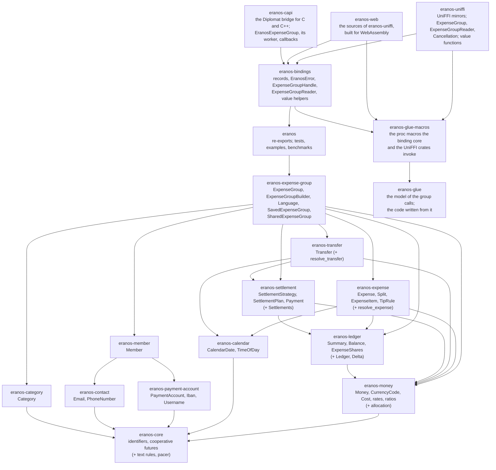
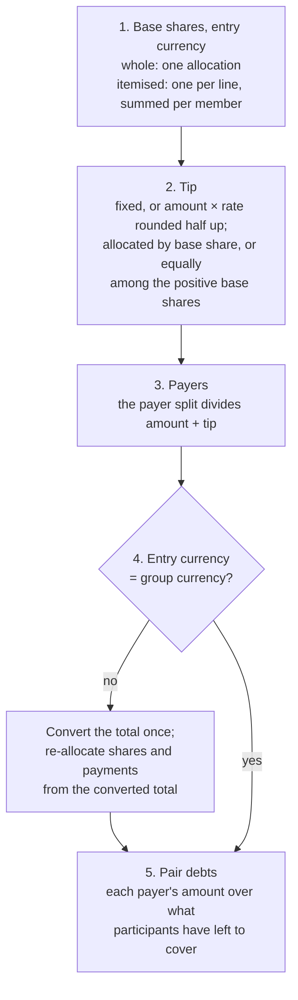
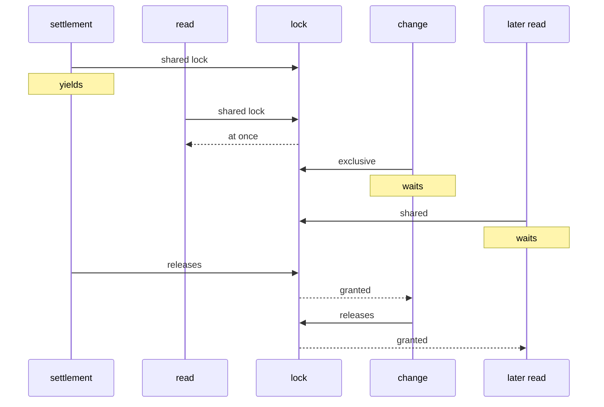

# Architecture

How eranos is built and why. [README.md](../README.md) says what it does,
[AGENTS.md](../AGENTS.md) holds the conventions, and
[TESTING.md](TESTING.md) shows how each rule here is checked.

## Contents

1. [Goals and constraints](#1-goals-and-constraints)
2. [Crate map](#2-crate-map)
3. [Data model](#3-data-model)
4. [Money and rounding](#4-money-and-rounding)
5. [Resolving an entry](#5-resolving-an-entry)
6. [The ledger and its caches](#6-the-ledger-and-its-caches)
7. [Settlement strategies](#7-settlement-strategies)
8. [Validation and errors](#8-validation-and-errors)
9. [The serialised form](#9-the-serialised-form)
10. [Account details](#10-account-details)
11. [Bindings](#11-bindings)
12. [Async and concurrency](#12-async-and-concurrency)
13. [Key numbers](#13-key-numbers)

## 1. Goals and constraints

- **One core for every app.** iOS, Android, and the web share the rules, so
  a group computes the same totals and the same cents everywhere. The core
  is plain Rust: no I/O, no async runtime (its asynchronous calls are
  futures any executor, or the calling thread, can drive;
  [§ 12](#12-async-and-concurrency)), no clock except for generating
  identifiers, and no global state except the lock that generation reads the
  clock under, so the identifiers of concurrent threads stay in creation
  order (or, with the `sequential-ids` feature for examples and tests, the
  counter that replaces the clock), and the phone-number metadata, which
  rlibphonenumber decodes once, on first use, into a table nothing writes
  to.
- **Exact money.** A split that loses or invents a cent is a bug users see.
  Every amount is an integer; every division is exact by construction.
- **Changes are cheap and atomic.** Adding, editing, or removing an entry
  costs time proportional to the entry, not the group, and a change that
  fails leaves nothing half-applied.
- **Deterministic everywhere.** The same entries give the same shares, the
  same totals, and the same settlement on every device and in any order of
  arrival; this is what future sync relies on. Identifiers are text
  compared byte for byte, so the order of every list and the tie rotation
  they seed are the same in every language and on every platform.
- **Dependencies for the rules others maintain.** `icu_casemap` and
  `icu_normalizer` (Unicode caseless matching of category names),
  `icu_locale_core` (UTS #35 language tags), `icu_properties` (the Unicode
  categories of email characters), `iso4217-static` (the ISO 4217 list,
  pinned exactly), `jiff` (calendar dates, times of day, and their ISO 8601
  parser, without its clock or time zones), and `rlibphonenumber`
  (libphonenumber's numbering plans, pinned exactly); besides them
  `thiserror` (derive only), `uuid` (v7 identifiers), `async-lock` (the
  read-write lock behind `SharedExpenseGroup`, without `std`), and optionally
  `serde`. Everything else, including IBAN validation and the email rules,
  is in the crates. The licences the apps' notices must list are Apache-2.0
  (iso4217-static, and rlibphonenumber with libphonenumber's metadata),
  Unicode-3.0 (ICU4X), Unlicense or MIT (jiff), and Apache-2.0 or MIT
  (thiserror, uuid, and async-lock with event-listener,
  event-listener-strategy, and pin-project-lite), besides those of the
  crates they bring; `deny.toml` does not check licences.

## 2. Crate map

The library is thirteen crates. Callers depend on `eranos`, the facade,
which re-exports the types they use from twelve internal crates; each
internal crate owns one part of the domain, holds its own error type, and
depends only on crates below it. Every crate depends on `eranos-core`, and
the facade on all twelve; the graph draws an edge to `eranos-core` only
from the crates with no other dependency in the workspace, and of the
facade's edges only the one to the group. Above the facade,
`eranos-bindings` holds what every binding exposes
([BINDINGS.md](BINDINGS.md)); it depends on the facade and, for their conversion
traits, on the twelve internal crates, whose edges the graph leaves out.
`eranos-uniffi` mirrors it for UniFFI, and `eranos-uniffi-bindgen`, a
package of binaries with no edge in the workspace, holds the generators
that read the UniFFI library. `eranos-web` compiles the source files of
`eranos-uniffi`, which it includes by path, on another UniFFI release, for
WebAssembly, so it has no edge to `eranos-uniffi`; the Kotlin Multiplatform
package's plugin reads `eranos-uniffi` itself. `eranos-capi` exports the
binding core through Diplomat,
whose `diplomat-tool` generates a C API and C++ classes from its bridge.
The binding core lists its group calls once, in a trait, from which the
proc macros of `eranos-glue-macros` write the group handle's and the read
handle's forms; `eranos-glue`, which those macros call, holds the model of
the calls and records and the code written from it, the C bridge's too,
which `cargo xtask generate` writes into eranos-capi's sources.



<details>
<summary>ASCII version (for renderers without Mermaid)</summary>

```text
 ┌─────────────────────────────────────────────────────────────────────────────┐
 │ eranos-uniffi          UniFFI mirrors of the core's types; ExpenseGroup,    │
 │                        ExpenseGroupReader, Cancellation; the value          │
 │                        functions                                            │
 │ eranos-web             the sources of eranos-uniffi on UniFFI 0.31, built   │
 │                        for WebAssembly                                      │
 │ eranos-capi            the Diplomat bridge for C and C++: opaque records,   │
 │                        EranosExpenseGroup with its worker thread, the       │
 │                        callbacks                                            │
 ├─────────────────────────────────────────────────────────────────────────────┤
 │ eranos-bindings        what every binding exposes: records, EranosError,    │
 │                        ExpenseGroupHandle, ExpenseGroupReader, value        │
 │                        helpers                                              │
 ├─────────────────────────────────────────────────────────────────────────────┤
 │ eranos                 the facade: re-exports; tests, examples, benchmarks  │
 ├─────────────────────────────────────────────────────────────────────────────┤
 │ eranos-expense-group   ExpenseGroup, ExpenseGroupBuilder, Language,         │
 │                        SavedExpenseGroup, SharedExpenseGroup                │
 ├─────────────────────────────────────────────────────────────────────────────┤
 │ eranos-expense         Expense, Split, ExpenseItem, TipRule                 │
 │                        (+ resolve_expense)                                  │
 │ eranos-transfer        Transfer (+ resolve_transfer)                        │
 │ eranos-member          Member                                               │
 │ eranos-category        Category                                             │
 ├─────────────────────────────────────────────────────────────────────────────┤
 │ eranos-settlement      SettlementStrategy, Settlement, Payment              │
 │                        (+ Settlements)                                      │
 │ eranos-payment-account PaymentAccount, Iban, Username                       │
 │ eranos-contact         Email, PhoneNumber                                   │
 ├─────────────────────────────────────────────────────────────────────────────┤
 │ eranos-ledger          Summary, Balance, ExpenseShares (+ Ledger, Delta)    │
 │ eranos-calendar        CalendarDate, TimeOfDay                              │
 ├─────────────────────────────────────────────────────────────────────────────┤
 │ eranos-money           Money, CurrencyCode, Cost, rates, ratios             │
 │                        (+ allocation)                                       │
 ├─────────────────────────────────────────────────────────────────────────────┤
 │ eranos-core            identifiers and cooperative futures (+ text, pacer)  │
 ├─────────────────────────────────────────────────────────────────────────────┤
 │ eranos-glue-macros     the proc macros the binding core and the UniFFI      │
 │                        crates invoke                                        │
 ├─────────────────────────────────────────────────────────────────────────────┤
 │ eranos-glue            the model of the group calls; the code written from  │
 │                        it                                                   │
 └─────────────────────────────────────────────────────────────────────────────┘
   A crate depends only on crates in the bands below its own; the table
   lists each crate's direct dependencies.
```

</details>

| Crate                    | Holds                                                                                                                                                                                                                                    | Depends on                                                                                                             |
| ------------------------ | ---------------------------------------------------------------------------------------------------------------------------------------------------------------------------------------------------------------------------------------- | ---------------------------------------------------------------------------------------------------------------------- |
| `eranos-uniffi-bindgen`  | the generators `uniffi-bindgen`, for Swift, Kotlin, and Python, and `uniffi-bindgen-java`, which read the library of eranos-uniffi                                                                                                       | uniffi, uniffi-bindgen-java                                                                                            |
| `eranos-uniffi`          | the `uniffi` copies of the core's records, enums, and error, stamped from their mirrors; the `ExpenseGroup`, `ExpenseGroupReader`, and `Cancellation` objects, their calls stamped from the core's table; the value helpers as functions | eranos-bindings, eranos-glue-macros; uniffi                                                                            |
| `eranos-web`             | the source files of eranos-uniffi, compiled on UniFFI 0.31.2 for WebAssembly, with the runtime of uniffi-bindgen-react-native's `wasm2` flavour                                                                                          | eranos-bindings, eranos-glue-macros; uniffi, and for WebAssembly uniffi-runtime-wasm, wasm-bindgen, and uuid with `js` |
| `eranos-capi`            | the Diplomat bridge for C and C++: an opaque object per record, list, and enum with data, the C-like enums, `EranosError`, `EranosExpenseGroup`, `EranosExpenseGroupReader`, `EranosCancellation`, and the outcomes of the callbacks     | eranos-bindings; diplomat, diplomat-runtime                                                                            |
| `eranos-bindings`        | the records and enums every binding exposes, `EranosError` and its `FlatError`, `IbanReason`, `NewExpenseGroup`, `ExpenseGroupHandle`, `ExpenseGroupReader`, `Cancellation`, the value helpers; the trait that lists the group calls     | `eranos` with `serde`, the twelve internal crates for their conversion traits, and eranos-glue-macros; serde_json      |
| `eranos`                 | the re-exports callers use; the integration tests, examples, and benchmarks                                                                                                                                                              | the twelve crates below                                                                                                |
| `eranos-expense-group`   | `ExpenseGroup`, `ExpenseGroupBuilder`, `Language`, `SavedExpenseGroup`, `SharedExpenseGroup`, `ExpenseGroupReadGuard`, `ExpenseGroupWriteGuard`, `ExpenseGroupError`, `LanguageError`                                                    | category, core, expense, ledger, member, money, settlement, transfer; async-lock, icu_locale_core                      |
| `eranos-expense`         | `Expense`, `ExpenseBuilder`, `ExpenseSplit`, `Split` and its shares, `ExpenseItem`, `ExpenseItemBuilder`, `Discount`, `DiscountValue`, `DiscountScope`, `TipRule`, `TipValue`, `TipDistribution`, `ExpenseError`; `resolve_expense`      | calendar, core, ledger, money                                                                                          |
| `eranos-transfer`        | `Transfer`, `TransferBuilder`, `TransferError`; `resolve_transfer`                                                                                                                                                                       | calendar, core, money, settlement                                                                                      |
| `eranos-member`          | `Member`, `MemberBuilder`, `MemberError`                                                                                                                                                                                                 | account, contact, core                                                                                                 |
| `eranos-category`        | `Category`, `CategoryError`                                                                                                                                                                                                              | core; icu_casemap, icu_normalizer                                                                                      |
| `eranos-settlement`      | `SettlementStrategy`, `SettlementPlan`, `Payment`, `SettlementError`; `Settlements`, `settle`                                                                                                                                            | core, ledger, money                                                                                                    |
| `eranos-payment-account` | `PaymentAccount`, `PaymentAccountDetails`, `PaymentAccountKind`, `Iban`, `Username`, `PaymentAccountError`, `IbanError`                                                                                                                  | core                                                                                                                   |
| `eranos-contact`         | `Email`, `PhoneNumber`, `ContactError`                                                                                                                                                                                                   | core; icu_properties, rlibphonenumber                                                                                  |
| `eranos-ledger`          | `Summary`, `MemberSummary`, `Balance`, `CategoryTotal`, `ExpenseShares`, `MemberShare`; `Ledger`, `Delta`, `MemberPair`, `Debt`, `ResolvedExpense`                                                                                       | core, money                                                                                                            |
| `eranos-calendar`        | `CalendarDate`, `TimeOfDay`, `CalendarError`; `format_calendar_date`, `format_time_of_day`                                                                                                                                               | core; jiff                                                                                                             |
| `eranos-money`           | `Money`, `CurrencyCode`, `Cost`, `ExchangeRate`, `CurrencyRate`, `Percentage`, `Parts`, `Quantity`, `MoneyError`; `allocation`, `format_minor_units`, `format_basis_points`, `format_hundredths`, `format_ten_thousandths`               | core; iso4217-static                                                                                                   |
| `eranos-core`            | the five identifiers, `CategoryKey`, `IdError`, `Cooperative`, `block_on`; `text`, `serde_text`, `yield_now`, `Pacer`                                                                                                                    | uuid                                                                                                                   |
| `eranos-glue-macros`     | the proc macros `calls`, which writes the forms of the binding core's group calls, and `mirrored`, `uniffi_objects`, and `uniffi_mirror`, each over eranos-glue                                                                          | eranos-glue; syn                                                                                                       |
| `eranos-glue`            | the model of the group calls and of the mirrored records, and the code written from it: the group handle's and the read handle's forms, the table and mirror macros, the UniFFI objects' methods and copies, the C bridge                | proc-macro2, quote, syn                                                                                                |

For the internal crates, the facade's modules (`eranos::money`,
`eranos::member`, …) and its root re-export what the table lists before a
semicolon, and nothing else: what follows one is machinery the crates above
use, free to change. So is a conversion trait, which every crate holds
beside each of its non-exhaustive enums that the bindings convert, named
after the enum (`FromSplit`, `FromExpenseGroupError`, and the like): one method
per variant, so that a crate above tells every variant apart without a
wildcard arm
([DEVELOPMENT.md § 3.9](DEVELOPMENT.md#39-a-crossing-between-crates)).
Every internal crate but `eranos-ledger`, which has no error of its own,
depends on `thiserror`, and every crate but `eranos-ledger` and
`eranos-settlement` has a `serde` feature, which the facade's enables.

## 3. Data model

An `ExpenseGroup` has an ID, a name (the only required text), a description, a
**required** currency (every total is in it), and a language tag for the
apps. It owns four maps keyed by the identifiers of their entries, so
iteration order is the byte order of the identifiers' text, on every device,
which for generated identifiers is the order they were generated in. The
categories map is keyed by `CategoryKey`, which puts the built-in
Uncategorised first whatever the text of the others:

| Map        | Values                                        | Notes                                                             |
| ---------- | --------------------------------------------- | ----------------------------------------------------------------- |
| members    | `Member` + archived flag                      | first name required; contacts and accounts optional               |
| categories | `Category`                                    | names unique by Unicode caseless match; Uncategorised is built in |
| expenses   | `Expense` + its shares and pair debts         | the resolution is kept for exact removal                          |
| transfers  | `Transfer` + its amount in the group currency | the same, for transfers                                           |

Entities are immutable values built by builders (`Member::builder`,
`Expense::builder`, …) and edited through `to_builder`; the group validates
every value it receives. A builder's constructor takes every required value:
an expense has four, for one payer or several and for a whole split or
items, and an item two, for an equal split or any other. The group and
every member, category, expense, and transfer carry an identifier from
the moment their constructor is called: a constructor with the plain name
generates one (`Member::builder`, `Category::new`), and its twin takes the
app's own, such as the key of its store (`Member::builder_with_id`,
`Category::with_id`). The plain form generates before anything is
checked, so an entry the builder then refuses has still used up the
identifier generated for it, and `build` generates nothing. `to_builder`
keeps the identifier, so an edit stays the same entry: `add_*` refuses an
identifier the group already holds, Uncategorised's included, and
`replace_*` finds the entry to replace by it.

An **identifier** (`ExpenseGroupId`, `MemberId`, `CategoryId`, `ExpenseId`,
`TransferId`) is text stored as it is given: at most 64 bytes of UTF-8, not
empty, without control characters, and without whitespace at either end,
which is refused rather than trimmed. Two identifiers are equal when their
bytes are, so case matters and two spellings of one UUID are two
identifiers. The text lives in a 64-byte buffer padded with zero bytes,
which no valid text holds, so an identifier is `Copy` and its derived
comparisons follow the byte order of the text. A generated identifier is a
UUID v7 in lowercase hyphenated form, whose text orders as its timestamp
does; Uncategorised's is the nil UUID's text,
`00000000-0000-0000-0000-000000000000`.

An **expense** has a name, a cost (an amount in its own currency, local or
converted into the group currency at a fixed rate), a date and an optional
time, an optional description, a category (Uncategorised unless another is
set), a tip (none unless set), the payers (a `Split` of the total), and how
the cost is shared: an `ExpenseSplit::Whole(Split)` or
`ExpenseSplit::Itemised(Vec<ExpenseItem>)`. A split is `Equal`, `Parts`
(hundredths, so 0.5 for a child), `Percentages` (basis points summing to
exactly 10 000), or `Amounts` (summing exactly to what is divided). An
**item** has a unit price, a quantity (a `Quantity`, one unless set), an
optional discount, and its own split; its line total is the unit price
times the quantity, rounded half away from zero, less the discount, and
the line totals must add up to the amount. A **discount** is a percentage
of at most 100 % or a fixed amount of at most what it reduces, taken off
the line (the default) or off each unit ([§ 4](#4-money-and-rounding)). A
**tip** is fixed or a percentage of the amount,
added on top, and shared `Proportional`ly (by consumption) or `Equal`ly
among the participants with a share above zero
([§ 5](#5-resolving-an-entry)). A **transfer** is money one member paid
another, with a cost like an expense's.

**Archived members** keep their history and balance and may send and
receive transfers, but cannot join a new expense; a replacement may keep an
archived member the original already had. A member referenced by any entry
cannot be removed.

## 4. Money and rounding

- `Money` is `i64` minor units plus a `CurrencyCode`. `CurrencyCode` covers
  every active ISO 4217 code with a minor unit (165 codes, from the SIX
  "List One" published 2026-01-01, which `iso4217-static` 0.2.4 is generated
  from), with the ISO number of decimal places: 0 for JPY, 2 for EUR, 3 for
  BHD, 4 for CLF. Precious metals, drawing rights, and test codes have no
  minor unit and are not currencies here. `CurrencyCode` holds the crate's
  value and its minor unit, read once when a code is looked up, so no crate
  type is part of the API; it also gives each currency's ISO English name
  and numeric code. The text form of `Money` writes its minor units through
  `format_minor_units`, which places the point among the digits, and the
  binding core writes an amount from the details its record carries through
  the same function ([BINDINGS.md § 5](BINDINGS.md#5-the-text-a-binding-shows)).
- `ExchangeRate` is an exact positive decimal (`mantissa / 10^scale`, up to
  18 decimal places) meaning "one unit of the entry's currency is this many
  units of the group's". Conversion multiplies in checked `i128` and rounds
  **half away from zero**, the rule of EU Regulation 1103/97 art. 5.
- `Cost` is an entry's amount with its conversion: `Local(Money)` is in the
  group currency and converts at 1; `Converted { amount, rate }`, made by
  `Money::at`, is in another currency. A rate of 1 does not make a cost
  local, because a currency pegged at par (BMD to USD) converts at exactly
  1. Only the group knows its currency, so it checks the kind of cost when
  an entry is added: `MissingExchangeRate` for a local cost in another
  currency, `UnexpectedExchangeRate` for a converted one in its own.
- `Percentage` is basis points (33.33 % = 3 333) and `Parts` hundredths
  (1.5 = 150): both exact integers. Their text forms write through
  `format_basis_points` and `format_hundredths`, which take any `i64`, and
  so does the binding core for the numbers its records hold, as the text
  forms of `CalendarDate` and `TimeOfDay` write through eranos-calendar's
  `format_calendar_date` and `format_time_of_day`, which take any `i32`
  ([BINDINGS.md § 5](BINDINGS.md#5-the-text-a-binding-shows)).
- `Quantity` is ten-thousandths (0.452 = 4 520), positive and at most
  `i64::MAX`, so that it crosses the bindings as a signed 64-bit integer;
  its text form, which `parse` reads back, has no trailing zeros and
  writes through `format_ten_thousandths`. Percentages, parts, and
  quantities read and write their decimals through one fixed-point parser
  and writer, given their places. An item's line total is
  `allocation::apply_ten_thousandths(unit price, quantity)`: the product in
  `i128`, divided by 10 000 and rounded **half away from zero**, so 0.335
  at 1.00 EUR is 0.34 EUR and a whole quantity gives the exact product. A
  line whose product is below half a minor unit is free: its total is zero
  and its split divides it to zeros, so a split of amounts on it, which
  cannot add up to zero, is refused as `AmountsDoNotAddUp`; an expense of
  free lines alone adds up to no positive amount, which `build` refuses. A
  line beyond the range is refused as `Overflow`.
  `apply_basis_points`, which a percentage tip uses, is the same division
  of basis points.
- A `Discount` reduces a line in one of two ways, and the line total and
  the discount's amount always add up to the line total before the
  discount. Off the line, the default, a percentage is
  `apply_basis_points(line before the discount, rate)`, rounded once, and
  a fixed amount is taken off as entered. Off each unit, the percentage
  of the unit price is rounded first, and the reduced price is then
  multiplied by the quantity, so three units at 3.33 EUR with 50 % off
  cost 4.98 EUR with the discount off each unit and 4.99 EUR with it off
  the line. A percentage
  above 100 % is refused as `DiscountAboveHundredPercent`, a negative
  fixed amount as `NegativeDiscount`, one larger than what it reduces as
  `DiscountAbovePrice`, and one in another currency as
  `CurrencyMismatch`; 100 %, or a fixed amount equal to what it reduces,
  makes a free line.
- **Doubles.** Apps hold amounts, percentages, parts, quantities, and rates
  as doubles, so `Money`, `Percentage`, `Parts`, `Quantity`, and
  `ExchangeRate` each have a `from_f64`, and every binding calls it, so the
  same double is the same value in every language. It writes the double as
  std's `Display` does, the shortest decimal that reads back as the same
  double and never with an exponent, rounds that text half away from zero
  to the type's places (the currency's, 2, 2, 4, and 18), where the first
  dropped digit decides, and
  parses the result with the type's own parser, so a double meets the
  checks typed text meets. Rounding the text rather than the double keeps
  what the user typed: the double nearest 1.005 lies below it, so
  `(value * 100.0).round()` gives 1.00 EUR where `from_f64` gives 1.01. A
  rate keeps the digits of the shortest form up to its 18th place: 25.5 has
  scale 1, and `0.1 + 0.2` keeps its 17 decimal places. NaN and the
  infinities are refused as `MoneyError::NotFinite`, and a result of zero
  has no sign. Beyond the conversion's `is_finite` and `to_string`, no code
  of the library reads a float: the glue hands the double on untouched.
- **Allocation.** Every division is `allocate(total, weights, rotation)`:
  each part is `total × weight / Σ weights` rounded down, and the leftover
  units go one each to the largest remainders (the Hamilton method), so the
  parts add up exactly and each is its exact share rounded down or up.
  Weights that are all zero count as equal, so a division never loses
  money. Members are sorted by ID first, so listing order never matters.
- **Ties rotate.** Equal remainders, as in every even split, are ordered
  from a start position given by FNV-1a over the UTF-8 bytes of the entry's
  identifier text and the eight bytes of a pass number, least significant
  first. The extra cent of 10.00 / 3 therefore lands on a different member
  from one expense to the next, while the same expense divides identically
  everywhere. There is no stored cursor and no randomness.
- **Overflow is an error.** Parsing, conversions, tips, and every total are
  checked; the ledger keeps values within ±`i64::MAX` so any value can be
  negated. A change that would leave the range is refused whole.

## 5. Resolving an entry

Every figure a user enters is in the entry's own currency and is validated
there (items add up to the amount, percentages to 100 %, amounts to what
they divide). The group then checks that the entry's cost suits the group
currency, a local cost in it and a converted one in any other, so
resolution fails only when a conversion leaves the range of an amount.
Resolution produces the entry's shares in the group currency:



<details>
<summary>ASCII version (for renderers without Mermaid)</summary>

```text
 1. Base shares (entry currency)   whole: one allocation
                                   itemised: one per line, summed per member
                 │
                 ▼
 2. Tip           fixed, or amount × rate (half up);
                  allocated by base share, or equally
                  among the positive base shares
                 │
                 ▼
 3. Payers        the payer split divides amount + tip
                 │
                 ▼
 4. Foreign?  ── yes ──► convert the total once; re-allocate shares
     │                   and payments from the converted total ──┐
     no                                                          │
     ▼                                                           │
 5. Pair debts  ◄────────────────────────────────────────────────┘
    each payer's amount over what participants have left to cover
```

</details>

An itemised expense's base shares divide each line total after its
discount, so a line on the house, discounted to zero, divides to zeros as
any free line does.

An **equal tip** is allocated with a weight of one for each participant
whose base share is positive and zero for the others, so a member whose
share rounds to zero, or who shares only free lines, tips nothing. The base
shares add up to the amount, which `build` keeps positive, so at least one
weight is one; `allocate` would count all-zero weights as equal.

Converting the total once and re-dividing it keeps both sides exact: the
converted shares and the converted payments each add up to the converted
total, which a per-share conversion would not guarantee.

The **pair debts** feed the direct settlement. Payers are taken in ID
order; each payer's amount is allocated over the participants in proportion
to what each still has to cover, which is then reduced. The last payer
receives exactly what is left, so every participant's debts add up to their
share and every payer's credits to what they paid, exactly; debts of a
member to themselves are dropped. For a single payer this is simply "every
other participant owes the payer their share".

## 6. The ledger and its caches

The `Ledger` holds the `Summary` (total spent; per member paid, consumed,
sent, received, and net; per category; per member per category) and the
netted debt of every pair of members, keyed by a `MemberPair` whose `from`
is the lower member.

A change becomes a `Delta` in exact 128-bit arithmetic: adding an entry
adds its resolution, removing subtracts it, replacing does both. Applying a
delta computes and range-checks every new value first and only then writes
them, removing rows that reach zero, so a summary compares equal to a
rebuilt one however it was reached. Net is kept as its own accumulator:
computing it from the other four could overflow when each of them fits.

| Change                                                   | Cost                             | Settlement caches |
| -------------------------------------------------------- | -------------------------------- | ----------------- |
| add, replace, remove an expense                          | O(k log m), k = members involved | cleared           |
| add, replace, remove a transfer                          | O(log m)                         | cleared           |
| add, replace, archive a member; add or rename a category | O(log m)                         | kept              |
| remove a category: its totals move to Uncategorised      | O(expenses + category totals)    | kept              |
| change the group currency                                | O(entries), full rebuild         | cleared           |
| read the summary                                         | O(1) or O(log m)                 | —                 |

Settlements are computed on the first request per strategy and cached in
`OnceLock`s, which keep `ExpenseGroup` `Send + Sync`; the cache belongs to the
settlement module and reads the balances from the summary, and every
balance-changing mutation clears it. A plan is kept once it is computed,
never while it is: no request waits for another's computation, and an
asynchronous request dropped before it completes keeps nothing.
`change_currency` re-resolves every entry against the new rates into a
scratch ledger and swaps it in only if everything succeeded: entries in any
other currency become converted costs at the supplied rate (including
entries in the old group currency, which were local), and entries in the new
currency become local. Its asynchronous form yields once per 1 024 entries
and swaps only after its last yield, so a call dropped at a yield changes
nothing ([§ 12](#12-async-and-concurrency)).

## 7. Settlement strategies

Every strategy pays out exactly the net balances: each debtor pays what
they owe and each creditor receives what they are owed, so nobody pays more
than their debt. Payments are sorted by payer, then recipient. The caller
always names the strategy; there is no default. `Adaptive` is the one that
chooses an algorithm by the group's size, and the settlement names the
strategy whose plan it is.

| Strategy           | Algorithm                                                                                                                                         | Cost                                              | Payments                                      |
| ------------------ | ------------------------------------------------------------------------------------------------------------------------------------------------- | ------------------------------------------------- | --------------------------------------------- |
| `Adaptive`         | pair exact opposites; the exact solver below when at most 20 balances are left and its table can be allocated, greedy otherwise                   | at most O(2²⁰·20) time and 1 MiB, else O(n log n) | the minimum within the limit, greedy's beyond |
| `MinimumTransfers` | pair exact opposites; subset dynamic program for the largest partition into zero-sum groups; settle each group in member order                    | O(2ⁿ·n) time, 2ⁿ bytes                            | the minimum: n − (number of groups)           |
| `Greedy`           | largest debtor pays largest creditor, ties to the lower ID, with and without exact opposites paired first; the fewer payments, the first on a tie | O(n log n)                                        | at most n − 1, within 3/2 of the minimum      |
| `Direct`           | every netted pair debt becomes a payment                                                                                                          | O(pairs)                                          | the most; each traces back to shared expenses |

Minimising the number of payments is NP-hard (Verhoeff, "Settling multiple
debts efficiently", 2004): n balances need n − g payments, where g is the
largest number of disjoint groups that each sum to zero. The solver:

1. **Pairs exact opposites** (x owed, x owing) first. Taking such a pair as
   its own group is always optimal: if an optimal partition put the two in
   groups G and H, then {x, −x} and (G ∪ H) ∖ {x, −x} is a partition with as
   many groups.
2. **Runs `table[S] = max over i in S of table[S ∖ {i}] + [ΣS = 0]`** over
   every subset S of the remaining n balances, one byte per subset. Walking
   back from the full set along the maximum orders the members so that the
   prefix sums hit zero exactly at the group boundaries.
3. **Settles each group** with the northwest-corner rule: debtors and
   creditors in member order, each payment the overlap of the current debt
   and credit. A group of a maximum partition has no zero-sum subgroup, so
   it takes exactly one payment fewer than its size.

There is no size limit. The table must fit in the address space (n ≤ 63 on
64-bit targets, about 30 on wasm32); beyond that, or when the allocator
refuses, the solver returns `SettlementError::OutOfMemory`. Operating systems
that overcommit memory (Linux) or end memory-hungry apps (iOS) may stop the
process before an allocation fails, which is why the documentation of
`MinimumTransfers` recommends `Adaptive`.

`Adaptive` bounds that cost. It pairs exact opposites once and, when at
most 20 balances are left, settles them with the exact solver, so its plan
is the one `MinimumTransfers` gives; when more are left, it computes the
plan `Greedy` gives from the same pairing. `SettlementPlan::strategy` names the
strategy whose plan it is, never `Adaptive`, and the plan is cached under
`Adaptive`. Twenty balances take a 1 MiB table and about 7 ms on the
reference machine; phones run from about its speed (flagships) to about a
ninth of it (budget Android, by single-core Geekbench 6 scores), and
WebAssembly takes 2.5 to 3 times as long as native code (measured side by
side on Node 24), so even a budget phone in a browser settles twenty
balances within about a fifth of a second, and every extra balance would
double that. The limit is part of the numbers ([VERSIONING §
1](VERSIONING.md#1-the-public-contract)): another limit would settle some
groups with other payments, so it changes only in a breaking release. One
device can still settle a group differently from another: one whose
allocator refuses the 1 MiB table settles greedily instead of failing,
where another settles exactly.

Greedy computes two plans: the largest debtor paying the largest creditor
throughout, ties to the lower ID, and the same after exact opposites have
paid each other as in step 1. It keeps the one with fewer payments, the first
on a tie, so pairing changes a plan only where it saves a payment. Every
payment clears at least one member, so n balances take at most n − 1
payments, and the plan kept is within 3/2 of the minimum: the pairs belong to
a minimal plan, and the m balances they leave hold no opposite pair, so every
zero-sum group among them has at least three members and they need at least
2m/3 payments, where the second plan makes at most m − 1. Neither plan always
wins: for −3, −3, −5, +6, and +5 the first takes four payments and the second
three, and for −14, −4, −16, −9, +20, +16, +18, −7, and −4 the first takes six,
the minimum, and the second seven.

## 8. Validation and errors

Validation happens in two stages. A builder's `build()` checks the entry on
its own (names, positive amounts, sums, currencies inside the entry,
discounts, tips).
The group's `add_*`/`replace_*` check the entry against the
group (members exist and are not archived, the category exists, and the
cost is converted exactly when the entry is foreign) and against the
ledger's range.

| Error                 | Returned by                                                                                                                                                                                                                    |
| --------------------- | ------------------------------------------------------------------------------------------------------------------------------------------------------------------------------------------------------------------------------ |
| `IdError`             | the identifiers' `new` and `parse`, for text that is empty, longer than 64 bytes, holds a control character, or starts or ends with whitespace                                                                                 |
| `CalendarError`       | building and reading dates and times of day                                                                                                                                                                                    |
| `MoneyError`          | building, reading, and combining amounts, currencies, rates, percentages, parts, and quantities                                                                                                                                |
| `PaymentAccountError` | `PaymentAccount::new`, `Iban::parse` (with the `IbanError` reason), `Username::new`                                                                                                                                            |
| `ContactError`        | `Email::parse`, `PhoneNumber::parse`                                                                                                                                                                                           |
| `MemberError`         | `MemberBuilder::build`                                                                                                                                                                                                         |
| `CategoryError`       | `Category::new`, `Category::with_id`, `Category::renamed`                                                                                                                                                                      |
| `LanguageError`       | `Language::parse`                                                                                                                                                                                                              |
| `ExpenseError`        | `ExpenseBuilder::build`, `ExpenseItemBuilder::build`                                                                                                                                                                           |
| `TransferError`       | `TransferBuilder::build`                                                                                                                                                                                                       |
| `ExpenseGroupError`   | `ExpenseGroupBuilder::build`, `SavedExpenseGroup::into_expense_group`, every group mutation, and `SharedExpenseGroup::try_read` and `try_write` while another call holds the lock; the group is unchanged when one is returned |
| `SettlementError`     | `ExpenseGroup::settlement` (only `MinimumTransfers` can fail)                                                                                                                                                                  |

Each module has one error enum, `#[non_exhaustive]` and built with
`thiserror`, and none wraps another: a function reports the failure of its
own module, so a caller that mixes modules uses its own error type or
`Box<dyn Error>`. Messages are lowercase without a trailing full stop and
never repeat the rejected text, because inputs include account numbers and
contact details.

## 9. The serialised form

With the `serde` feature, `ExpenseGroup` and every type it stores serialise
and deserialise: its entries, members, and categories, the identifiers, and
the values inside them, such as `Money`, `CurrencyCode`, `ExchangeRate`,
`CalendarDate`, and `Language`. `SavedExpenseGroup` only deserialises. What
a group derives (`Summary`, `SettlementPlan`, `ExpenseShares`, and the types
they hold), the builders, the errors, `CurrencyRate`, and
`SettlementStrategy` do not serialise. A group serialises only its inputs,
never the derived totals:

```text
{
  "format": 4,
  "id": "…",
  "name": "Lisbon",
  "currency": "EUR",
  "language": "pt-PT",
  "members":    [{"id": "…", "first_name": "Ana", …}],
  "archived":   ["…"],
  "categories": [{"id": "…", "name": "Food"}],
  "expenses":   [{"id": "…", "name": "Dinner",
                  "amount": {"minor_units": 9000, "currency": "EUR"},
                  "payers": {"equal": ["…"]},
                  "split": {"whole": {"percentages": [["…", 5000], …]}},
                  "date": "2026-09-23",
                  "tip": {"value": {"percentage": 1000}, "distribution": "proportional"}}],
  "transfers":  [{"id": "…", "sender": "…", "receiver": "…", "amount": …, "date": "…"}]
}
```

- Identifiers are their text, currencies their code, rates decimal
  strings, dates `YYYY-MM-DD` and times `hh:mm` (read back by the ISO 8601
  parser behind `CalendarDate::parse` and `TimeOfDay::parse`), percentages
  basis points, parts hundredths, an item's quantity its decimal text
  (`"quantity": "1.5"`), which a reader that parses JSON numbers as doubles
  cannot round, an item's discount its value and its scope
  (`"discount": {"value": {"percentage": 1000}, "scope": "unit"}`), whose
  scope reads as `line` when it is left out, and each share of a split the
  two-element array `[member, value]`. Absent optional fields are omitted,
  an item's discount among them, and so are the
  built-in category, an expense's category when it is the built-in one
  (every group has it again when it loads), a tip equal to
  `TipRule::NONE`, no tip at all, and a quantity of one, which an item
  without one reads as. An item's line totals, before its discount and
  after it, are derived, so not written. Keys follow the field order of
  [AGENTS.md](../AGENTS.md): `format` and `id` first, then the fields that
  describe the value in their natural order, the optional ones after the
  required, and a group's collections last.
- Loading checks the entries as the `add_*` methods do, in this order:
  members (all unarchived first), categories, expenses, transfers, then
  the `archived` list, because an expense may reference a member archived
  after it was added; it range-checks the totals once, after the last
  entry, since the entries replay in the order of their identifiers, not
  the order the group was built in, and the sums between two of them can
  leave the range where the group's never did. The group and every entry
  take their saved identifiers through
  the constructors' `with_id` twins, as an app gives its own, so a load
  generates none. A hand-edited or corrupted file is refused, never
  loaded inconsistently. Deserialising an `ExpenseGroup` reports the
  refusal as the deserialiser's error; deserialising a `SavedExpenseGroup`
  and calling `into_expense_group` reports it as an `ExpenseGroupError`, so
  an app can tell a newer file from a damaged one. An entry that could never have been
  built fails the read in both cases, since every entity deserialises
  through its validating constructor. `into_expense_group_async` replays the
  same steps, yielding once per 1 024 of them; it owns the saved form, so a
  dropped load leaves nothing behind, and a copy of the `SavedExpenseGroup`
  starts it again ([§ 12](#12-async-and-concurrency)).
- `format` is checked: a newer one is refused rather than read with fields
  silently dropped (`ExpenseGroupError::UnsupportedFormat`), and so is an
  older one, and the reader stops at the `format` key of a file this
  version cannot read, wherever the key stands, so a newer file reports
  its format whatever its shape. Format 4 names a transfer's members
  `sender` and `receiver`, which a reader of format 3, whose keys were
  `from` and `to`, would miss; 0.8.0 reads format 4 only. New optional
  fields get `#[serde(default)]`, so files of the same format written by
  older releases keep loading.
- The saved form is JSON. Identifiers serialise as text in every serde
  format, where the 16 bytes of a UUID were written in binary ones, so data
  a binary format wrote before format 3 does not read back.

## 10. Account details

IBANs and usernames are validated values, held, printed, and serialised in
clear text like every other value: `as_str()` returns an IBAN in electronic
format and a username as entered, trimmed. IBANs are validated against the
SWIFT IBAN Registry (release 103): the country code,
the country's length and BBAN structure (which positions hold digits and
which letters), and the ISO 7064 mod-97 check digits, which must lie
between 02 and 98 and catch every single-character typo.

rlibphonenumber writes national numbers to the `log` facade at `trace`
level while it parses them, and a library cannot turn a dependency's logging
off without global logger state; a binding or an app that installs a logger
keeps the `rlibphonenumber` target below `trace`, so members' numbers stay
out of its logs.

The serialised form contains the details in clear text. Encryption at rest
belongs to each platform's secure storage (Keychain, Keystore, Web Crypto),
which holds keys the library never sees.

## 11. Bindings

Every binding stands on `eranos-bindings`, which holds what the bindings
expose in plain Rust, and on a glue crate that exports it for its
language's generator, beneath a hand-written layer per language:
[BINDINGS.md](BINDINGS.md) is their home, from the crates to each
package's layer.

## 12. Async and concurrency

The library has no async runtime and depends on none. A computation whose
time grows with the group is a cooperative future: it pends only by
yielding, once per budget of work that a `Pacer` counts, never after an
amount of time, so it yields at the same points on every device.

| Call                                          | Yields                                 | Between two yields                                                               |
| --------------------------------------------- | -------------------------------------- | -------------------------------------------------------------------------------- |
| `ExpenseGroup::settlement_async`              | while the exact solver fills its table | 2²¹ subsets times balances, about 0.7 ms; no yield for 16 open balances or fewer |
| `ExpenseGroup::change_currency_async`         | after each re-resolved entry           | 1 024 entries, about 1.3 ms                                                      |
| `SavedExpenseGroup::into_expense_group_async` | after each replayed step               | 1 024 members, categories, expenses, transfers, or archivings                    |

Each returns a `Cooperative`, which an executor awaits like any future and
`Cooperative::complete` runs to its end on the calling thread; `settlement`,
`change_currency`, and `into_expense_group` are those completions, so the
synchronous and asynchronous calls run the same code. The exact solver fills
its table for `MinimumTransfers` and for `Adaptive` within its limit; the
greedy and direct strategies, and `Adaptive` beyond its limit, never yield:
their largest benchmarked cases take about 0.15 ms (`Greedy`, 1 000 members)
and 0.33 ms (`Direct`, 100 members). A call writes nothing before its last
yield, so one dropped at a yield changes nothing: a currency change swaps in
its new entries and ledger after its last yield, a load builds a group of
its own, and a settlement enters the cache only once it is complete
([§ 6](#6-the-ledger-and-its-caches)).

Against the same computations without yield points, measured in
alternating runs on the reference machine, the yield points cost the exact
solver 2 to 3 % at 16 to 24 balances, a few nanoseconds on each settlement
computed (none on one read from the cache), and nothing measurable on a
currency change or a load. The solver's inner loop is the same machine code
either way; the difference follows where the compiler places the code.

### The shared group

`SharedExpenseGroup` puts a group behind a read-write lock: async-lock, built
without its `std` feature, so the lock reads no clock and keeps no
per-thread parker (a gate keeps its features off,
[AGENTS.md](../AGENTS.md#gates-before-committing)). Its clones share one
group, and each of its methods mirrors one of the group's, returning a
`Send + 'static` future of an owned result. Reads take the shared lock and
run alongside each other; changes take the exclusive lock and run alone,
once the reads in progress are done; while a change waits, new reads wait
behind it, so a stream of reads cannot starve a change. Only the
settlement and the currency change yield while they hold the lock; every
other call holds it for one poll. A call dropped before it completes
changes nothing and releases the lock it holds or waits for. `read` and
`write` return guards, for a caller that needs several calls with no other
call in between.

A settlement at a yield, with a read beside it, and a change and a later
read waiting their turn:



<details>
<summary>ASCII version (for renderers without Mermaid)</summary>

```text
 settlement         read            lock           change        later read
      │               │               │               │               │
      ├─ shared lock ─┼──────────────>│               │               │
      │ yields        │               │               │               │
      │               ├─ shared lock >│               │               │
      │               │<──── at once ─┤               │               │
      │               │               │<── exclusive ─┤               │
      │               │               │               │ waits         │
      │               │               │<──────────────┼────── shared ─┤
      │               │               │               │               │ waits
      ├─ releases ────┼──────────────>│               │               │
      │               │               ├─ granted ────>│               │
      │               │               │<─── releases ─┤               │
      │               │               ├─ granted ─────┼──────────────>│
```

</details>

### Drivers

| Future                                                                        | Pends                                       | Driven by                                                           |
| ----------------------------------------------------------------------------- | ------------------------------------------- | ------------------------------------------------------------------- |
| a `Cooperative`: the `_async` calls of `ExpenseGroup` and `SavedExpenseGroup` | only by yielding                            | any executor, or `Cooperative::complete` on the calling thread      |
| a `SharedExpenseGroup` call, `read`, or `write`                               | by yielding, or while it waits for the lock | any executor, or `block_on`, which sleeps until the future is woken |

`complete` polls again as soon as a poll pends, with a waker that does
nothing. It is reachable only through `Cooperative`, because a future that
waits for another thread, such as a `SharedExpenseGroup` call, would keep the
thread busy until the lock is free. `block_on` parks the thread between
polls and wakes it through the future's waker. On wasm, whose one thread
`block_on` would put to sleep with nothing left to wake it, neither it nor
`read_blocking` and `write_blocking` is compiled; a synchronous caller
tries the lock with `try_read` or `try_write`, which fail with
`ExpenseGroupError::Busy` instead of waiting.

## 13. Key numbers

Release build on an Apple M4 Pro (`cargo bench -p eranos --features serde --bench '*'`):

| Operation                                                      | Size                                            | Time                                     |
| -------------------------------------------------------------- | ----------------------------------------------- | ---------------------------------------- |
| `Adaptive`                                                     | 18 / 20 / 21 / 100 open balances                | 1.6 ms / 7.3 ms / 1.7 µs / 8.6 µs        |
| the exact solver in WebAssembly (Node 24), against native code | 16 / 18 / 20 open balances                      | 2.9 / 2.7 / 2.5 times as long            |
| `Greedy` through the TypeScript package (Node 24)              | 100 members                                     | 0.12 ms, mostly crossing into JavaScript |
| `MinimumTransfers`                                             | 12 / 16 / 20 / 24 open balances                 | 19 µs / 0.36 ms / 7.2 ms / 0.14 s        |
| `Greedy`                                                       | 100 / 1 000 members                             | 8.7 µs / 133–158 µs                      |
| `Direct`                                                       | 100 members sharing every expense (4 950 pairs) | 0.33 ms                                  |
| add or remove an expense of six members                        | group of 10 000 expenses                        | ≈ 3 µs                                   |
| read a member's totals                                         | any                                             | ≈ 6 ns                                   |
| change the currency                                            | group of 10 000 expenses                        | 14 ms                                    |
| load a saved group from JSON                                   | group of 10 000 expenses                        | 33 ms                                    |
