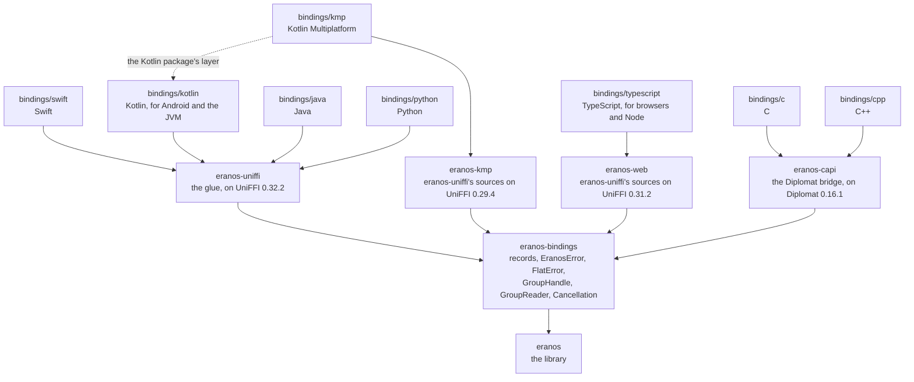

# Bindings

How eranos reaches apps in eight languages: one binding core in plain
Rust, the glue crates that export it, and a package per language, whose
hand-written layer is what an app uses. [ARCHITECTURE.md](ARCHITECTURE.md)
says how a group works inside,
[DEVELOPMENT.md](DEVELOPMENT.md#2-building-and-testing) holds each
package's commands, and [TESTING.md](TESTING.md#5-coverage) says how each
layer is tested.

| Language             | Package                                                             | Glue and generator                                                  | Runs on                                                                           |
| -------------------- | ------------------------------------------------------------------- | ------------------------------------------------------------------- | --------------------------------------------------------------------------------- |
| Swift                | `bindings/swift`, the SwiftPM package `Eranos`                      | `eranos-uniffi` on UniFFI 0.32.2, `uniffi-bindgen`                  | iOS and iPadOS 17, macOS 14, Mac Catalyst 17, tvOS 17, watchOS 10, and visionOS 1 |
| Kotlin               | `bindings/kotlin`, the Gradle modules `eranos` and `eranos-android` | `eranos-uniffi` on UniFFI 0.32.2, `uniffi-bindgen`                  | Android from API level 26, on four ABIs, and the JVM from release 17              |
| Java                 | `bindings/java`, the JPMS module `eranos`                           | `eranos-uniffi` on UniFFI 0.32.2, `uniffi-bindgen-java`             | JDK 25 and later                                                                  |
| Kotlin Multiplatform | `bindings/kmp`                                                      | `eranos-kmp` on UniFFI 0.29.4, gobley 0.3.7                         | the JVM, Android, and eight Apple targets                                         |
| TypeScript           | `bindings/typescript`, the npm package `eranos`                     | `eranos-web` on UniFFI 0.31.2, uniffi-bindgen-react-native 0.31.0-5 | browsers, and Node 24 and later                                                   |
| C                    | `bindings/c`, `eranos.h`                                            | `eranos-capi` on Diplomat 0.16.1, `diplomat-tool`                   | C23                                                                               |
| C++                  | `bindings/cpp`, `eranos.hpp`                                        | `eranos-capi` on Diplomat 0.16.1, `diplomat-tool`                   | C++23                                                                             |
| Python               | `bindings/python`, the package `eranos`                             | `eranos-uniffi` on UniFFI 0.32.2, `uniffi-bindgen`                  | Python 3.14 and later                                                             |

## Contents

- [Bindings](#bindings)
  - [Contents](#contents)
  - [1. The crates](#1-the-crates)
  - [2. What every binding shares](#2-what-every-binding-shares)
  - [3. Types in each language](#3-types-in-each-language)
  - [4. Calls, threads, and cancellation](#4-calls-threads-and-cancellation)
  - [5. The text a binding shows](#5-the-text-a-binding-shows)
  - [6. Account details](#6-account-details)
  - [7. Identifiers that repeat](#7-identifiers-that-repeat)
  - [8. The glue crates](#8-the-glue-crates)
  - [9. The packages](#9-the-packages)
    - [Swift](#swift)
    - [Kotlin](#kotlin)
    - [Java](#java)
    - [TypeScript](#typescript)
    - [Kotlin Multiplatform](#kotlin-multiplatform)
    - [C](#c)
    - [C++](#c-1)
    - [Python](#python)
  - [10. How the gates build the packages](#10-how-the-gates-build-the-packages)

## 1. The crates

`eranos-bindings` holds, in plain Rust, everything the bindings expose.
The glue crates beside it mirror its types and forward every call to it,
converting nothing and deciding nothing, so every rule a binding applies
is tested in Rust: `eranos-uniffi` for Swift, Kotlin, Java, and Python,
`eranos-web` for browsers and Node, `eranos-kmp` for Kotlin Multiplatform,
and `eranos-capi` for C and C++. Each package puts a hand-written layer
over the code its generator writes, and apps see only the layer; the
generated code is internal to every package.



<details>
<summary>ASCII version (for renderers without Mermaid)</summary>

```text
 ┌──────────────────────────────────────────────────────────────────────────┐
 │ bindings/swift       Swift, on eranos-uniffi                             │
 │ bindings/kotlin      Kotlin, for Android and the JVM, on eranos-uniffi   │
 │ bindings/java        Java, on eranos-uniffi                              │
 │ bindings/kmp         Kotlin Multiplatform, on eranos-kmp, with the       │
 │                      Kotlin package's layer                              │
 │ bindings/typescript  TypeScript, for browsers and Node, on eranos-web    │
 │ bindings/c           C, on eranos-capi                                   │
 │ bindings/cpp         C++, on eranos-capi                                 │
 │ bindings/python      Python, on eranos-uniffi                            │
 ├──────────────────────────────────────────────────────────────────────────┤
 │ eranos-uniffi        the glue, on UniFFI 0.32.2                          │
 │ eranos-kmp           eranos-uniffi's sources on UniFFI 0.29.4            │
 │ eranos-web           eranos-uniffi's sources on UniFFI 0.31.2            │
 │ eranos-capi          the Diplomat bridge, on Diplomat 0.16.1             │
 ├──────────────────────────────────────────────────────────────────────────┤
 │ eranos-bindings      records, EranosError, FlatError, GroupHandle,       │
 │                      GroupReader, Cancellation, the value helpers        │
 ├──────────────────────────────────────────────────────────────────────────┤
 │ eranos               the library                                         │
 └──────────────────────────────────────────────────────────────────────────┘
   A package sits on the glue crate it names, each glue crate on the
   binding core, and the core on the library.
```

</details>

## 2. What every binding shares

- **Records of text and integers.** Values and entries cross as records
  and enums with data: identifiers as hyphenated UUIDs, currencies as ISO
  4217 codes, exchange rates as decimals, amounts as 64-bit minor units,
  percentages in basis points, and parts in hundredths. Days, months,
  years, hours, minutes, quantities, basis points, and hundredths are
  32-bit signed integers, which every target language has: Kotlin's
  unsigned types are invisible from Java, and JavaScript has one number
  type. A record is checked by the library's rules on its way in, so a bad
  value, a number too large for its field included, is a typed error and
  never wraps into another value.
- **Identity stays with the group.** An entry to add carries no identifier
  (`IdentifierGiven` otherwise), and the call returns the one the group
  generated. An entry to replace names its entry (`IdentifierMissing`
  otherwise), and the replacement starts from the stored entry's
  `to_builder()` and takes every field of the record, so no identifier is
  set from outside.
- **One error, grouped by module.** A binding call can fail in several
  modules at once, since its records are converted before the library runs
  it, and a generated function throws one error type, so every call
  reports `EranosError`. It has a case per module of the library, as the
  library has an error per module: `Account`, `Calendar`, `Category`,
  `Contact`, `Expense`, `Group`, `Id`, `Language`, `Member`, `Money`,
  `Settlement`, and `Transfer`. Each holds the module's failure, an enum
  with a case per variant of the module's error and what the variant holds
  (`GroupFailure::MemberInUse { expenses, member, transfers }`), and, as
  `detail`, the library's message; a field named `message` would clash
  with the property of every Kotlin exception. A caller catches a whole
  module or one failure, and no failure needs its crate's name in front.
  The core's own cases stand beside the modules: `Cancelled`,
  `IdentifierGiven`, `IdentifierMissing`, `InvalidJson`, which names the
  line and column of a refused saved group but not its text, since the
  text can hold an account number, and `Released`. The conversion traits
  of [ARCHITECTURE.md § 2](ARCHITECTURE.md#2-crate-map) keep the
  conversion exhaustive, so a new variant fails the core's build.
- **One group object.** `GroupHandle` holds a `SharedGroup` and has every
  group call in two forms: a synchronous one, which waits for the lock
  where a thread can sleep and, on wasm, whose one thread must not, fails
  with `GroupFailure::Busy` while another call holds it; and an
  asynchronous one, a `Send + 'static` future that waits for the lock.
  Only the two functions that take a synchronous call's lock depend on the
  target, and the trying form wasm uses is tested on the host.
  `GroupHandle::read` returns a `GroupReader`, which holds the shared lock
  until it is released or dropped, so the reads of one report see no
  change in between; `release` frees the lock at once, for languages whose
  collector frees objects late, and is not named `close`, which the Kotlin
  and Java generators give every object to free it.
- **Cancellation.** Every asynchronous call takes an optional
  `Cancellation`. Cancelling it stops the call at its next yield, or at
  once while the call waits for the lock, and fails it with `Cancelled`;
  the library's calls change nothing until they complete, so the group is
  left as it was, and its lock is released.
- **The value helpers.** Free functions parse and write every value as the
  library does (amounts, rates, percentages, parts, dates, times, language
  tags, balances, currencies, and contact and account details), so every
  text a binding shows is the library's.
- **Shapes every generator takes.** The types keep to what UniFFI 0.29,
  the oldest version the glue crates use, can mirror: records, enums with
  data, one error enum, and objects; no methods on records, and no
  optional list, for which an empty one stands.
- **The browser.** The web crate enables `uuid`'s `js` feature: UUID v7
  generation reads the clock and the random source, which
  `wasm32-unknown-unknown` provides only through JavaScript.
- The release profile keeps `panic = "unwind"` so the glue can catch a
  panic at the boundary. Public types have no lifetimes or generic
  parameters on their data, IDs are `Copy`, and every public type is
  `Send + Sync`, which `tests/api.rs` asserts for the library and the
  core's own tests for the core.

## 3. Types in each language

Each layer turns the core's records into its language's own kinds of type,
under the core's names, and every value prints the library's text.

| What            | Swift                         | Kotlin                         | Java                                         | TypeScript                    | C                               | C++                                    | Python                                           |
| --------------- | ----------------------------- | ------------------------------ | -------------------------------------------- | ----------------------------- | ------------------------------- | -------------------------------------- | ------------------------------------------------ |
| the group       | `final class Group`           | `class Group`, `AutoCloseable` | `final class Group`, `AutoCloseable`         | `class Group`, `Disposable`   | `EranosGroup *`                 | `Group`, which only moves              | `class Group`, a context manager                 |
| a read handle   | `GroupReader`, `withRead`     | `GroupReader`, `withRead`      | `GroupReader`                                | `GroupReader`, `Disposable`   | `EranosGroupReader *`           | `GroupReader`                          | `GroupReader`, a context manager                 |
| an identifier   | `Member.ID`                   | the value class `MemberId`     | the record `MemberId`                        | the branded string `MemberId` | text                            | the class `MemberId`                   | the `NewType` `MemberId`                         |
| a checked value | a struct: `Currency`, `Money` | a class: `Currency`, `Money`   | `Currency`, a final class; `Money`, a record | a class: `Currency`, `Money`  | an opaque object: `EranosMoney` | `Currency`, a class; `Money`, a struct | `Currency`, a class; `Money`, a frozen dataclass |
| an entry        | a struct: `Expense`           | a class: `Expense`             | a final class with a builder                 | an interface: `Expense`       | an opaque object with setters   | a struct: `Expense`                    | a frozen dataclass: `Expense`                    |
| a variant       | an enum: `Split`              | a sealed interface: `Split`    | a sealed interface of records                | a union by `kind`: `Split`    | an opaque object with `kind`    | a `std::variant`                       | a union of frozen dataclasses: `Split`           |
| a failure       | `EranosError`, thrown typed   | `EranosException`, thrown      | `EranosException`, checked                   | `EranosError`, thrown         | `EranosError *`, returned       | `eranos::Error`, in a `std::expected`  | `EranosError`, raised                            |

## 4. Calls, threads, and cancellation

Every group call has a synchronous and an asynchronous form, which each
language names in its own way, and an asynchronous call is cancelled with
the language's own mechanism, which the layer turns into the core's
`Cancellation`: the call stops at its next yield, or at once while it
waits for the lock, fails with the cancellation, and leaves the group as
it was.

| Language   | Synchronous form                        | Asynchronous form                                     | Cancellation                     |
| ---------- | --------------------------------------- | ----------------------------------------------------- | -------------------------------- |
| Swift      | `group.name()`                          | `await group.name()`, the same name                   | the task's                       |
| Kotlin     | `group.nameBlocking()`                  | `group.name()`, a `suspend` function                  | the coroutine's                  |
| Java       | `group.name()`                          | `group.nameAsync()`, a `CompletableFuture`            | `cancel` on the future           |
| TypeScript | `group.nameSync()`, which does not wait | `group.name()`, a Promise                             | the `AbortSignal` of its options |
| C          | `eranosGroupName(group, text)`          | `eranosGroupNameAsync(group, cancellation, callback)` | `eranosCancellationCancel`       |
| C++        | `group.name()`                          | `group.nameAsync(&cancellation)`, a `std::future`     | `cancellation.cancel()`          |
| Python     | `group.name()`                          | `await group.name_async()`, a coroutine               | `cancel()` on the task           |

A synchronous call waits while another call holds the group's write lock,
or while a change waits behind a read in progress, since the lock lets a
waiting change turn new reads away until it has run: on Swift's main
thread too, where an app calls the asynchronous form instead, and on the
thread of Python's event loop, where a coroutine awaits the `_async` form
instead. On wasm,
whose one thread must not wait, the TypeScript package's synchronous form
fails with `GroupFailure::Busy` while another call holds the lock. The C
and C++ packages run every asynchronous call on the group's worker thread,
in the order of the calls, and report its outcome there, to a callback or
through a `std::future`; a load runs on a thread of its own. Kotlin
Multiplatform shares the Kotlin package's layer, and with it the Kotlin
row.

## 5. The text a binding shows

Every text a binding shows comes from the library: amounts, balances,
rates, percentages, parts, dates, times, currencies, language tags,
contact and account details, error messages, and the saved group. The
value helpers of [§ 2](#2-what-every-binding-shares) write each as the
library does, and every layer's values print through them, so a report
reads the same in every language, and a change to how the library writes a
value reaches every binding at once.

## 6. Account details

An account's IBAN and username cross as text, as the library holds them
([ARCHITECTURE.md § 10](ARCHITECTURE.md#10-account-details)): checked when
they reach the library and printed in full, with no masking and no secret
type. An app that hides part of one on screen does so itself.

## 7. Identifiers that repeat

Every glue crate has the feature `sequential-ids`, which turns on the
library's: identifiers count up from one instead of reading the clock, so
a program that builds the same entries in the same order gets the same
identifiers and prints the same text. It is for examples and tests; the
identifiers of two devices would collide
([README.md](../README.md#features)). The ports of the examples run on it
and print their examples' reports byte for byte
([TESTING.md § 2](TESTING.md#2-layout)).

## 8. The glue crates

`eranos-uniffi` copies the core's records, enums, and error for UniFFI
with `#[uniffi::remote]`, which repeats each definition field for field. A
crate carries the derives of one UniFFI release, so the core's items cannot
carry them; instead each carries `#[mirrored]`, which adds a macro of its
fields, and the core's `mirrors!` hands every mirror to the glue's
`uniffi_mirror!`, which stamps the copies, so a copy always repeats its
item. It wraps the group handle, the read handle, and the cancellation in
the objects `Group`, `GroupReader`, and `Cancellation`, whose methods
forward to the core: every group call's two forms and every read's are
stamped from the core's `group_calls!` table, the trait that lists the
calls, with the core's documentation, its links as code spans; the
constructors, `read`, and `release` are written by hand. It exports the
value helpers as functions and the asynchronous load as
`load_group_async`. Its three source files are compiled by `eranos-web` as
well, against UniFFI 0.31.2, and by `eranos-kmp`, against 0.29.4: they keep
to what 0.29 accepts, and every release compiles them and the code the
macros stamp in them.
`uniffi.toml` names the generated Swift module `EranosGenerated` and the
generated Kotlin and Java package `eranos.internal`, and the generated
Python module keeps the namespace's name, `eranos`, which the Python
package holds as `eranos._internal.eranos`: the generated code sits beneath
each package's hand-written layer.

`eranos-web` builds the same glue for browsers and Node. A crate carries
the derives of one UniFFI release, so it includes the three source files of
`eranos-uniffi` by path and compiles them against 0.31.2, the release whose
metadata uniffi-bindgen-react-native 0.31.0-5 reads, with what the
generator's `wasm2` flavour links: `uniffi-runtime-wasm`, the runtime its
code calls, and `wasm-bindgen` at 0.2.100, the release of the command-line
support the generator embeds to write the glue beside the module. On
`wasm32-unknown-unknown`, UniFFI's core compiles only with its
`wasm-unstable-single-threaded` feature, which drops the `Send` and `Sync`
bounds a target without threads has no use for.

`eranos-kmp` builds the same glue for Kotlin Multiplatform, the same way:
it includes the three source files and compiles them against UniFFI 0.29.4,
the release whose metadata gobley 0.3.7's generator reads, as a shared
library for the JVM and Android, whose metadata the generator reads too,
and as a static library that each Apple target links.

`eranos-capi` is the glue for C and C++, a bridge that Diplomat's macro
turns into C functions and that `diplomat-tool` reads to write a C header
and C++ classes, which live in `eranos::detail`. `diplomat-tool` reads the
crate's source files, not what a macro expands them to, so most of the
bridge is code the repository holds: `cargo xtask generate` writes
`src/generated/records.rs`, an object for every record, list, and enum the
calls reach, and `src/generated/group.rs`, the group with both forms of
every call, the read handle with every read's, the cancellation, and an
outcome per kind of answer, from the core's `#[mirrored]` items and its
trait of calls, through eranos-glue's generator, and lays them out with
rustfmt. The generator's templates hold what the core cannot say: the
group's constructors and read handle, the cancellation, and the methods of
a record that are not a field's, such as an expense's total. A test of
xtask fails while a committed file holds other code than the generator
writes; it compares tokens, so rustfmt's commas, a `match` arm's braces, and
the wrapping of a doc comment cannot fail it, and the files' line endings
cannot either. The worker thread, the checks of text, the error, the dates
and times, amounts, lists of text, and the value helpers stay hand-written
beside them. Diplomat carries opaque
objects, plain structs, and C-like enums, so a record, a list, and an enum
with data is an opaque object: a record has a constructor of its required
fields, a getter of every field, and, for an entry, a setter of each; a
list has `len` and `get`, and `create` and `push` when a caller builds
one; an enum with data has `kind`, a constructor per variant, and a getter
per field. A date and a time of day are plain structs. Text crosses as
bytes, which the bridge checks are UTF-8, reporting `InvalidText`
otherwise, and text a call returns is written into a `DiplomatWrite`. An
error crosses as the binding core's `FlatError`: a kind, a failure, the
message, and a field per value a failure holds, since Diplomat's enums
hold no data; the bridge's C-like enums convert from the core's through
Diplomat's `enum_convert`, so the flattening, and every failure's arm,
stays where the Rust tests reach it. Every group call has a synchronous
form, which blocks while another call holds the lock, and an asynchronous
one, which runs on the group's worker thread, started by the first such
call, in the order of the calls, and reports its outcome to a callback
there, a load on a thread of its own. Diplomat refuses a callback that
must be `Send`, so the bridge moves each one in a wrapper that asserts it:
the C and C++ APIs document that a callback runs on another thread. Only
one Diplomat library links into a program, since the runtime exports fixed
symbol names.

The generators, `uniffi-bindgen` for Swift, Kotlin, and Python and
`uniffi-bindgen-java` for Java, are the binaries of `eranos-uniffi-bindgen`,
built on the UniFFI release that builds the library, so the code they write
reads the library's metadata as written. They sit in a package of their
own, of binaries only, so that no build or lint of the libraries, for the
host or for the mobile and wasm targets, compiles a generator.

## 9. The packages

### Swift

`bindings/swift` is the Swift package for iOS, iPadOS, macOS, Mac Catalyst,
tvOS, watchOS, and visionOS. Its binary target, `EranosFFI`, is an
XCFramework of ten static libraries from the library's thirteen Apple
targets, `lipo` joining the two architectures of the iOS simulator, macOS,
and Mac Catalyst. The generated Swift compiles as the target
`EranosGenerated` in Swift 5 mode, since UniFFI's Swift is not yet clean
under Swift 6's concurrency checks, and the module apps import, `Eranos`, is
written by hand in Swift 6 and imports the generated one with `internal
import`, so no generated type reaches an app. It follows the Swift API
Design Guidelines:

- Every entry has an identifier type of its own (`Member.ID`, `Expense.ID`,
  an `Identifier` of the entity), absent on a new entry.
- A value the library checks is a type that is valid once made: `Currency`,
  from the library's list, and `Money`, `ExchangeRate`, `Percentage`,
  `Parts`, `CalendarDate`, `TimeOfDay`, `Email`, `PhoneNumber`, `IBAN`,
  `Username`, and `Language`, each printing the library's text.
- Every call throws `EranosError` as a typed throw, with the core's case per
  module and a failure enum per module whose payloads are typed
  (`GroupFailure.memberInUse(expenses:member:transfers:)`); a failure the
  generated code reports that is not the library's, such as a defect in the
  bindings, is `unexpected`.
- Every group call is one name overloaded by `async`: asynchronous code
  picks the form that waits for the lock without blocking a thread of the
  pool, and cancelling its task cancels the call. `Group.withRead` holds a
  read handle for a closure.

`bindings/swift/examples` is a package of its own over this one, with a
program per example of eranos that prints the example's report
([TESTING.md § 2](TESTING.md#2-layout)); SwiftLint lints and analyses it
with the package.

### Kotlin

`bindings/kotlin` is the Kotlin package for Android and the JVM: a Gradle
build of four modules. `generated` compiles the generated Kotlin for the
JVM, and `generated-android` compiles it for Android beside the library
of every Android ABI (`arm64-v8a`, `armeabi-v7a`, `x86`, and `x86_64`,
built for API level 26, the libraries' `minSdk`). `eranos`, the layer apps
depend on, is written by hand, and `eranos-android` compiles the same
sources into an Android library; each depends on its generated module as
an implementation detail, so the generated classes, in `eranos.internal`,
stay off an app's compile classpath. `generated-android` carries shrinker
rules to every app that depends on it: JNA's classes and the generated
package, which JNA reads by name, stay as they are when the app shrinks
its code. The layer follows the Kotlin library guidelines:

- Explicit API mode, and no data class: every value and entry writes its
  equality, hash, and text out, so a field added later changes no
  generated `componentN` or `copy`; an entry's own `copy` keeps its
  identifier.
- Every entry has an identifier type of its own, a value class
  (`MemberId`, `ExpenseId`), absent on a new entry. A value the library
  checks has an internal constructor and factories that check it
  (`Currency.of`, `Money.parse`, `CalendarDate.of`), and prints the
  library's text.
- A failure the library reports throws `EranosException`, a subclass per
  module holding the module's failure (`GroupFailure.MemberInUse`) and the
  library's message. A call the program should not make throws the
  standard exception for it: `IllegalArgumentException` for an entry to
  add that has an identifier or one to replace that has none, and
  `IllegalStateException` for a read through a closed `GroupReader`.
- Every group call is a `suspend` function that waits for the lock
  without blocking its thread; cancelling its coroutine drops the
  library's call, which leaves the group as it was. Its twin, whose name
  ends in `Blocking`, blocks instead. `Group` and `GroupReader` are
  `AutoCloseable`, and `Group.withRead` holds a read handle for a block.
- The binary-compatibility validator checks the layer's API against the
  committed dump, `eranos/api/eranos.api`.

The module `examples` holds a package per example of eranos, over the layer,
that prints the example's report ([TESTING.md § 2](TESTING.md#2-layout));
ktlint and detekt check it with the layer, detekt with the two exceptions
its `detekt.yml` gives the reasons for.

### Java

`bindings/java` is the Java package, for JDK 25 and later: one Gradle
project whose JAR is the JPMS module `eranos`. The generated Java, in
`eranos.internal`, compiles as a source set of its own with its warnings
allowed; the layer compiles with the generated classes patched into the
module (`--patch-module`), whose `module-info` exports only `eranos`, so
`-Xlint:exports` refuses a public signature that names a generated type.
The layer follows Effective Java and Google Java Style:

- Identifiers, amounts, the shares of a split, and the totals are
  records; a value the library checks is a final class with a private
  constructor and factories that check it (`Currency.of`, `Money.parse`,
  `CalendarDate.of`); an entry is a final class built by a builder, as in
  Rust, and edited through `toBuilder`, which keeps its identifier.
- An absent value is an empty `Optional`, a variant a record of a sealed
  interface, and a failure the library reports a checked
  `EranosException`, a subclass per module holding the module's failure.
  A call the library refuses only on a platform without threads declares
  no checked exception.
- Every group call blocks, and its twin, whose name ends in `Async`,
  returns a `CompletableFuture` whose cancellation cancels the generated
  future, which drops the library's call; a dependent future that
  `thenApply` makes would cancel only itself.
- The generated exception is not sealed, so the conversion from it is a
  table by class, which the error test checks against every class the
  generator writes.

The source set `examples` holds a package per example of eranos, over the
layer, that prints the example's report
([TESTING.md § 2](TESTING.md#2-layout)); it compiles as the tests do, with
every lint as an error and Error Prone, and google-java-format checks it
with the layer.

### TypeScript

`bindings/typescript` is the npm package `eranos`, for browsers and Node 24
and later. The generated TypeScript, the WebAssembly module, and
wasm-bindgen's glue sit in `src/internal`, which the package's `exports`
leave out: its entry point is the bundle `dist/eranos.js`, whose
declarations drop every item marked `@internal`, beside `eranos_web.wasm`,
which the app hands to `init` before any other call, since a bundler that
copies the file renames it. The player, `@ubjs/wasm` and `@ubjs/core`,
stays a dependency, so the app's resolver picks its browser or its Node
build. The layer follows the Google TypeScript Style Guide:

- Every entry has an identifier type of its own, a branded string
  (`MemberId`, `ExpenseId`) that no other text or identifier stands in for,
  absent on a new entry. A value the library checks is a class with
  factories that check it (`Currency.of`, `Money.parse`, `CalendarDate.of`),
  printing the library's text; entries and totals are read-only interfaces,
  and a variant is a union discriminated by `kind`
  (`{ kind: 'equal', members }`).
- A failure the library reports throws an `EranosError`, a subclass per
  module holding the module's failure, itself a union by `kind`. A call the
  program should not make throws `TypeError`: an entry to add that has an
  identifier, one to replace that has none, and a read through a released
  `GroupReader`.
- Every group call returns a Promise that waits for the lock; aborting the
  `AbortSignal` of its options cancels the call, which leaves the group as
  it was, and rejects with the signal's reason. Its twin, whose name ends
  in `Sync`, does not wait: it throws `GroupError` with the failure `busy`
  while another call holds the lock, since the page's one thread cannot
  wait for it. `Group` and `GroupReader` are `Disposable`, so `using` frees
  them at the end of a block.

`examples` holds a module per example of eranos, over the layer, that prints
the example's report on Node ([TESTING.md § 2](TESTING.md#2-layout));
Prettier, ESLint, and `tsc` check it with the layer.

### Kotlin Multiplatform

`bindings/kmp` is the Kotlin Multiplatform package: a Gradle build of two
modules on gobley's plugins. `generated` holds the Kotlin that gobley's
generator writes from `eranos-kmp`, in `eranos.internal`, beside the library
that gobley's Cargo plugin builds for each target: the host's for the JVM,
the four ABIs' for Android, and a static library for each of the eight Apple
targets that Kotlin/Native, gobley, and rustup's standard libraries all
have, but for macOS on x86_64, which Kotlin deprecates (iOS, its simulator
on arm64 and x86_64, macOS on arm64, tvOS and watchOS, and their arm64
simulators). `eranos` compiles the Kotlin package's layer from its sources,
unchanged, as common code, over `generated` as an implementation detail, so
one layer serves both packages. `generated` ships its own shrinker rules for
JNA, which keep JNA's classes and the generated package, and turns gobley's
off, since they never reach an app. gobley 0.3.7 supports the Android plugin
8, not 9, and the Android plugin 8 calls an internal API that Gradle 9.6
drops and a notation that Gradle 9.1 deprecates, so this build alone runs
Gradle 9.0, on JDK 21, since Gradle 9.0 runs on JDK 24 at the latest; its
Kotlin is the Kotlin package's 2.4.20. gobley's plugin installs its
generator, `gobley-uniffi-bindgen` 0.3.7, into the build directory with a
`cargo install` that passes no `--locked`, so the generator's dependencies
resolve when it installs. Its module `examples` compiles the Kotlin
package's ports of the examples, from their sources, for the JVM target.

### C

`bindings/c` is the C package: `eranos.h`, which includes a part per
kind of value under `eranos/`, each of `static inline` functions over
Diplomat's C API, whose names start with a type's and an underscore and
are not part of the layer. It follows one naming rule, that of the C++
layer too: PascalCase for types (`EranosGroup`, `EranosText`), camelCase
for functions, parameters, and fields (`eranosGroupAddExpense`,
`minorUnits`), and UPPER_CASE for constants and enum values
(`ERANOS_SETTLEMENT_STRATEGY_DIRECT`), which alias Diplomat's so that a
`switch` over an enum takes them; no name carries an affix, and every
comparison puts its constant first (`nullptr != value`, `0 < count`).

The package is C23: its headers need GCC 13 or later (`-std=c2x`, or
`-std=c23` from GCC 14) or Clang 19 or later, and MSVC's C compiler cannot
build them. Every function that answers a value is `[[nodiscard]]`, so a
caller that wants none casts it to `void`, and an enum's constants are
`constexpr` values of the enum's type, so comparing one with a value of
another enum draws `-Wenum-compare`. The layer writes C23's `nullptr`;
`NULL` works wherever it does.

- A call the library can refuse returns the error, or nullptr on success,
  and gives its value through its last parameter, an object the caller
  destroys; an optional value returns whether there is one. Every destroy
  function takes nullptr, as `free` does.
- Text goes in as UTF-8 ended by a NUL, nullptr reading as empty text, and
  comes back in an `EranosText`, which the call replaces and ends with a
  NUL; a buffer of Diplomat's grows or ends the program, as the library's
  own allocations do, so the NUL always has room.
- An asynchronous call takes a callback struct, a context and a function
  that receives the error or the value, which it owns; the struct stays
  valid until its function runs, once. A trampoline for each kind of
  outcome reads the outcome, destroys it, and calls the function.
- Every parameter the function does not change is `const`, the pointer
  itself included (`EranosGroup const *const group`), and a call that
  changes what later calls see takes its object as not `const`, though
  Diplomat's function takes it `const`.

`examples` holds a program per example of eranos, over the layer, that
prints the example's report ([TESTING.md § 2](TESTING.md#2-layout)), and
`report.h` and `report.c`, the tables and headings the programs share;
each builds as the tests do, under the sanitizers, and leaks nothing,
which `LeakSanitizer` checks. clang-format and clang-tidy check them with
the layer, clang-tidy without its magic numbers, which in a port are the
amounts and dates of its report.

### C++

`bindings/cpp` is the C++23 package: `eranos.hpp`, which includes a part
per kind of value under `eranos/`, beside the declarations every part
names and the conversions to and from Diplomat's classes, which need every
type complete and so come last, in `eranos/detail/`; a part is a fragment
of `eranos.hpp` and names it as the header to include. It follows the C++
Core Guidelines with the naming rule above:

- A value without an invariant is a struct with public fields (`Money`,
  `Percentage`, `Parts`); a value the library checks is a class with a
  private constructor and factories that check it (`Currency::of`,
  `CalendarDate::of`, `Email::parse`), its fields in one private member;
  every identifier is a class of its own over its text, with `std::hash`.
  A record is a struct whose constructor takes its required fields, and a
  variant a `std::variant` of structs (`EqualSplit`, `LocalCost`).
- A call the library can refuse returns a `std::expected` of its value and
  `eranos::Error`, a plain value with the kind, the message, the failure,
  and what the failure holds, which it shares, so copying it cannot throw;
  a call that no argument can make fail, such as a group's name or an
  amount's text, returns its value. Nothing throws: the tests and the ports
  build with `-fno-exceptions`, so a `throw` or a `try` in a header fails
  the gates, and a program built without exceptions can use the package.
- `Group` owns its handle, so it moves and never copies; an asynchronous
  call returns a `std::future` of what the synchronous form returns, as a
  `std::expected`, and takes an optional `Cancellation`, which leaves an
  error of the kind `CANCELLED` in the future. `GroupReader` releases the
  lock when it is destroyed or released.
- Text goes in as `std::string_view` and comes back as `std::string`.
  Every class and struct is `final`, `const` sits after what it qualifies,
  on every parameter the function does not move from, and on every member
  function that changes nothing a later call sees; `noexcept`,
  `constexpr`, and `[[nodiscard]]` go wherever they apply.
- Equality is defaulted wherever it compares every field; `Currency`
  compares its code alone. An identifier orders by its text through a
  `<=>` written out, since the defaulted one holds a branch that no
  comparison takes, which the layer's coverage would report as unrun.
  A call that reads a list takes a `std::span`, such as the rates of
  `changeCurrency`.

The package is C++23: its headers need C++23's `std::expected` with its
monadic operations, `std::to_underlying`, and `std::optional`'s monadic
operations, and C++20's defaulted comparisons, which libstdc++ 13 and
libc++ 17 provide, or MSVC 19.36 with `/std:c++latest` (from 19.43, also
`/std:c++23preview`); the tests and ports also use `std::print`
(libstdc++ 14, libc++ 18) and `std::ranges::contains` (libstdc++ 13,
libc++ 19).

`examples` holds a program per example of eranos, over the layer, that
prints the example's report ([TESTING.md § 2](TESTING.md#2-layout)), and
`report.hpp` and `report.cpp`, the tables and headings the programs share;
each builds and is checked as the C ports are, clang-tidy without its magic
numbers and without its check of an optional read unchecked, since a port
reads one it expects with `value()`, which ends the port when it is
absent, as `must()` ends it, printing the library's message, when the
library refuses a call the example makes.

### Python

`bindings/python` is the Python package `eranos`, for Python 3.14 and
later. The generated module, `eranos._internal.eranos`, loads the host
library from its own directory through ctypes, which releases the GIL for
every call, so the gates link the library beside it. The layer's modules
are private (`eranos._group`, `eranos._entries`), and `eranos` exports what
apps use, as its `__all__` lists, so no generated class reaches an app.
The layer follows PEP 8, with lines of 150 columns as in the other
languages, and carries a type on every function, parameter, and return,
which ty checks with every rule an error; the generated module keeps to no
checker, so ty reads its annotations without checking its code, and Ruff
leaves it out:

- Every entry has an identifier type of its own, a `NewType` over `str`
  (`MemberId`, `ExpenseId`), absent on a new entry. A value the library
  checks is a class whose constructor checks it, as `datetime.date`'s
  does (`Currency('EUR')`, `CalendarDate(23, 9, 2026)`,
  `Email('ana@example.com')`), and prints the library's text. Amounts,
  entries, and totals are frozen dataclasses: an entry takes its fields by
  keyword and is edited with `copy.replace`, which keeps its identifier,
  and a variant is a union of frozen dataclasses (`EqualSplit`,
  `LocalCost`), which a `match` takes apart.
- A failure the library reports raises an `EranosError`, a subclass per
  module holding the module's failure, a dataclass nested in it
  (`GroupError.MemberInUse`), with the library's message; a saved group
  that is not JSON raises `InvalidJsonError`, with the line and column.
  A call the program should not make raises the standard error for it:
  `ValueError` for an entry to add that has an identifier or one to
  replace that has none, and `RuntimeError` for a call on a closed `Group`
  or a read through a released `GroupReader`.
- Every group call blocks, and its twin, whose name ends in `_async`, is a
  coroutine that waits for the lock without blocking the event loop;
  cancelling its task drops the library's call, which leaves the group as
  it was, and raises `asyncio.CancelledError` in the task. `Group` and
  `GroupReader` are context managers: leaving the block closes the group
  or releases the reader.
- A transfer's and a payment's members are `sender` and `receiver`, since
  `from` is a keyword; the generated module names the field `_from`.
- The generated module attaches a data enum's cases to it only after it
  defines them, and nothing seals its classes, so the conversion from them
  is a table by class, which the conversion tests check against every
  class the generator writes.

Sphinx's autodoc writes the documentation from the docstrings, in Google's
style, which napoleon reads, with every warning an error.

## 10. How the gates build the packages

`cargo xtask gates` writes every language's sources into
`target/uniffi/<language>`; they are never committed. On macOS it also
builds the Swift package's XCFramework in the dev profile, 1.3 GB of debug
libraries, copies the generated Swift into the package, builds the package
and its examples, tests the package, lints and analyses both, and documents
the package. On every machine it builds the library of the four Android ABIs
with `cargo ndk`, copies the generated Kotlin into the Kotlin package, and
tests, lints, and documents that package and builds its two Android
libraries, whose native libraries the Android build strips. It copies the
generated Java into the Java package, and checks its format, tests it,
documents it, and builds its JAR. Last, it builds the library for
`wasm32-unknown-unknown`, generates the TypeScript and the module into the
TypeScript package with uniffi-bindgen-react-native, and checks the
package's format, lints it, type-checks it, tests it, documents it, and
builds its bundle, on Node 24, the oldest the package supports. Then it runs
the Kotlin package's tests on the Kotlin Multiplatform package's JVM target,
against gobley's bindings, builds that package's Android libraries, and, on
macOS, compiles its layer for every Apple target. Then it builds
`eranos-capi`'s static library, generates the C and the C++ headers from its
bridge with `diplomat-tool`, and, for each package, builds its tests with
the LLVM that `LLVM_HOME` names, runs them under the sanitizers, holds every
line and function of its layer covered, and checks its format, lint, and
documentation. Then it copies the generated Python into the Python
package, beside a link to the host library, installs the package's tools
as `uv.lock` pins them, and checks the package's format, lints it,
type-checks it, tests it and holds every line and branch of its layer
covered, and documents it, on Python 3.14, the oldest the package
supports. Last, it builds eranos-uniffi's host library with
`sequential-ids` into `target/sequential`, and eranos-kmp's, eranos-web's,
and eranos-capi's beside it, generates the UniFFI sources, and runs every
port: on macOS the Swift ports, on a copy of the Swift package over the
first library, the Kotlin ports on the JVM, over the Kotlin package's
bindings and over the Kotlin Multiplatform package's, the Java ports, the
TypeScript ports, on Node, in a copy of the TypeScript package over
eranos-web built the same way, and the C and C++ ports, built under the
sanitizers on eranos-capi's library, each report compared with its
example's.

`cargo xtask coverage` builds eranos-uniffi and eranos-capi with the Rust
coverage's instrumentation and runs the Swift, Kotlin, Java, Python, C, and
C++ tests on them, which measures the glue through the foreign tests
([TESTING.md § 5](TESTING.md#5-coverage)).
