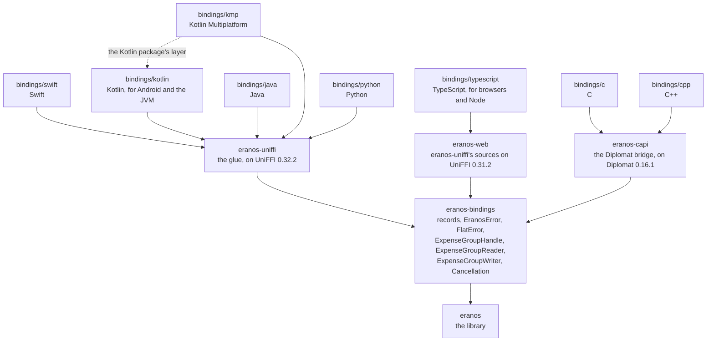

# Bindings

How eranos reaches apps in eight languages: one binding core in plain
Rust, the glue crates that export it, and a package per language, whose
hand-written layer is what an app uses. [ARCHITECTURE.md](ARCHITECTURE.md)
says how a group works inside,
[DEVELOPMENT.md](DEVELOPMENT.md#2-building-and-testing) holds each
package's commands, and [TESTING.md](TESTING.md#5-coverage) says how each
layer is tested.

| Language             | Package                                                             | Glue and generator                                                  | Runs on                                                                           |
| -------------------- | ------------------------------------------------------------------- | ------------------------------------------------------------------- | --------------------------------------------------------------------------------- |
| Swift                | `bindings/swift`, the SwiftPM package `Eranos`                      | `eranos-uniffi` on UniFFI 0.32.2, `uniffi-bindgen`                  | iOS and iPadOS 17, macOS 14, Mac Catalyst 17, tvOS 17, watchOS 10, and visionOS 1 |
| Kotlin               | `bindings/kotlin`, the Gradle modules `eranos` and `eranos-android` | `eranos-uniffi` on UniFFI 0.32.2, `uniffi-bindgen`                  | Android from API level 26, on four ABIs, and the JVM from release 17              |
| Java                 | `bindings/java`, the JPMS module `eranos`                           | `eranos-uniffi` on UniFFI 0.32.2, `uniffi-bindgen-java`             | JDK 25 and later                                                                  |
| Kotlin Multiplatform | `bindings/kmp`                                                      | `eranos-uniffi` on UniFFI 0.32.2, the UniFFI plugin of Ubique 1.3.0 | the JVM, Android, and four Apple targets                                          |
| TypeScript           | `bindings/typescript`, the npm package `eranos`                     | `eranos-web` on UniFFI 0.31.2, uniffi-bindgen-react-native 0.31.0-6 | browsers, and Node 24 and later                                                   |
| C                    | `bindings/c`, `eranos.h`                                            | `eranos-capi` on Diplomat 0.16.1, `diplomat-tool`                   | C23                                                                               |
| C++                  | `bindings/cpp`, `eranos.hpp`                                        | `eranos-capi` on Diplomat 0.16.1, `diplomat-tool`                   | C++23                                                                             |
| Python               | `bindings/python`, the package `eranos`                             | `eranos-uniffi` on UniFFI 0.32.2, `uniffi-bindgen`                  | Python 3.14 and later                                                             |

## Contents

- [Bindings](#bindings)
  - [Contents](#contents)
  - [1. The crates](#1-the-crates)
  - [2. What every binding shares](#2-what-every-binding-shares)
  - [3. Types in each language](#3-types-in-each-language)
  - [4. Calls, threads, and cancellation](#4-calls-threads-and-cancellation)
  - [5. The text a binding shows](#5-the-text-a-binding-shows)
  - [6. Account details](#6-account-details)
  - [7. Identifiers that repeat](#7-identifiers-that-repeat)
  - [8. The glue crates](#8-the-glue-crates)
  - [9. The packages](#9-the-packages)
    - [Swift](#swift)
    - [Kotlin](#kotlin)
    - [Java](#java)
    - [TypeScript](#typescript)
    - [Kotlin Multiplatform](#kotlin-multiplatform)
    - [C](#c)
    - [C++](#c-1)
    - [Python](#python)
  - [10. How the gates build the packages](#10-how-the-gates-build-the-packages)

## 1. The crates

`eranos-bindings` holds, in plain Rust, everything the bindings expose.
The glue crates beside it mirror its types and forward every call to it,
converting nothing and deciding nothing, so every rule a binding applies
is tested in Rust: `eranos-uniffi` for Swift, Kotlin, Java, Python, and
Kotlin Multiplatform, `eranos-web` for browsers and Node, and `eranos-capi`
for C and C++. Each package puts a hand-written layer
over the code its generator writes, and apps see only the layer; the
generated code is internal to every package.



<details>
<summary>ASCII version (for renderers without Mermaid)</summary>

```text
 ┌──────────────────────────────────────────────────────────────────────────┐
 │ bindings/swift       Swift, on eranos-uniffi                             │
 │ bindings/kotlin      Kotlin, for Android and the JVM, on eranos-uniffi   │
 │ bindings/java        Java, on eranos-uniffi                              │
 │ bindings/kmp         Kotlin Multiplatform, on eranos-uniffi, with the    │
 │                      Kotlin package's layer                              │
 │ bindings/typescript  TypeScript, for browsers and Node, on eranos-web    │
 │ bindings/c           C, on eranos-capi                                   │
 │ bindings/cpp         C++, on eranos-capi                                 │
 │ bindings/python      Python, on eranos-uniffi                            │
 ├──────────────────────────────────────────────────────────────────────────┤
 │ eranos-uniffi        the glue, on UniFFI 0.32.2                          │
 │ eranos-web           eranos-uniffi's sources on UniFFI 0.31.2            │
 │ eranos-capi          the Diplomat bridge, on Diplomat 0.16.1             │
 ├──────────────────────────────────────────────────────────────────────────┤
 │ eranos-bindings      records, EranosError, FlatError,                    │
 │                      ExpenseGroupHandle, ExpenseGroupReader,             │
 │                      ExpenseGroupWriter, Cancellation, the value helpers │
 ├──────────────────────────────────────────────────────────────────────────┤
 │ eranos               the library                                         │
 └──────────────────────────────────────────────────────────────────────────┘
   A package sits on the glue crate it names, each glue crate on the
   binding core, and the core on the library.
```

</details>

## 2. What every binding shares

- **Records of text and integers.** Values and entries cross as records and
  enums with data: identifiers as their text, which for a generated one is a
  UUID v7 in lowercase hyphenated form, a currency a caller names on its own
  (a new group's, a currency change's and its rates', and the one
  `money_parse` and `exchange_rate_convert` take) as its ISO 4217 code,
  exchange rates as decimals, amounts as 64-bit minor units, percentages in
  basis points, parts in hundredths, an item's quantity in
  ten-thousandths, and its discount as a `Discount` of a `DiscountValue`, a
  percentage in basis points or a fixed amount, and a `DiscountScope`, the
  line or each unit. A currency the library answers with, in an amount, as
  the group currency, and in a failure, crosses as `CurrencyDetails`: its
  code, name, numeric code, and decimal places, so a layer shows an amount
  without looking its currency up. Days, months, years, hours, minutes,
  basis points, and hundredths are 32-bit signed integers, which every
  target language has: Kotlin's unsigned types are invisible from Java, and
  JavaScript has one number type; the library bounds basis points and
  hundredths to `i32::MAX`, so no ratio an app reads back is clamped. Minor units and quantities are 64-bit
  signed integers (a `bigint` in TypeScript): a quantity of four decimal
  places, 0.452 as 4 520, holds up to `i64::MAX` ten-thousandths, the
  library's own limit, so every quantity it holds crosses. A currency's
  decimal places are the one exception, a `u8` as the library holds them, so
  the core writes an amount for every value the field can hold. A record is
  checked by the library's rules on its way in, so a bad value, a number too
  large for its field included, is a typed error and never wraps into
  another value; an amount whose currency details are not the library's for
  its code is refused with `MoneyFailure::UnknownCurrency`, as an unknown
  code is. A value the library always holds is never optional in a record:
  an expense's `category` and `tip` read back as the library holds them, the
  built-in category's identifier and the no-tip rule (0 % shared
  proportionally) when the expense has no other, and a record to add or
  replace sets them as given; a discount's `scope` is required too, and
  only each layer's constructors start it at the line. A value the domain
  makes optional is optional, never an empty stand-in: an item's discount,
  absent for a line at full price; an expense's note, a member's
  last name, and a transfer's note, optional text, which a replacement
  without it clears; so are a new group's note and language; and the
  group's `set_note` and `set_language` take optional text, none
  clearing the value. Text is trimmed, and blank text reads back absent.
- **Identity is given or generated.** Every entry and every new group
  carries an identifier from the moment it is made: the app's own, any text
  the library accepts, such as the key of its store, or a generated one. The
  core's records always carry it, and `identifier_generate` makes one; each
  language makes an entry or a group in two ways, one that takes the
  identifier and one that generates it when it is called, as the library's
  constructors and their `with_id` twins do, and no record leaves it out.
  Adding an entry returns its identifier, and one the group already holds is
  refused as a duplicate. `identifier_parse` checks a text by the rules
  every kind of identifier shares before an app stores it, and every kind
  draws a generated identifier from the one generator of eranos-core. An
  entry to replace names its entry, which the group must hold (the
  `Unknown…` failure of its kind otherwise), and the replacement starts from
  the stored entry's `to_builder()` and takes every field of the record, so
  a replacement cannot move an entry to another identifier.
- **One error, grouped by module.** A binding call can fail in several
  modules at once, since its records are converted before the library runs
  it, and a generated function throws one error type, so every call
  reports `EranosError`. It has a case per module of the library, as the
  library has an error per module: `Id`, `PaymentAccount`, `Calendar`,
  `Category`, `Contact`, `Money`, `Member`, `Expense`, `Settlement`,
  `Transfer`, `ExpenseGroup`, and `Language`. Each holds the module's failure, an enum
  with a case per variant of the module's error and what the variant holds
  (`ExpenseGroupFailure::MemberInUse { member, expenses, transfers }`), and, as
  `detail`, the library's message; a field named `message` would clash
  with the property of every Kotlin exception. A caller catches a whole
  module or one failure, and no failure needs its crate's name in front.
  `Id` holds `IdFailure`, whose cases are `Empty`, `TooLong` (more than 64
  bytes of UTF-8), `ControlCharacter`, and `SurroundingWhitespace`, the
  first rule the text breaks, in that order; the flat form names them
  `IdEmpty`, `IdTooLong`, `IdControlCharacter`, and
  `IdSurroundingWhitespace`. The core's own cases stand beside the
  modules: `MismatchedRecord`, which names the field a record gave another
  way than the library derives it (`MismatchedField::IbanCountryCode`,
  `PhoneInternational`, or `CurrencyDetails`); `InvalidJson`, which names
  the line and column of a refused saved group but not its text, since the
  text can hold an account number; `Cancelled`; and `Released`. In the flat
  form, a mismatched record's field is its failure. The conversion traits
  of [ARCHITECTURE.md § 2](ARCHITECTURE.md#2-crate-map) keep the
  conversion exhaustive, so a new variant fails the core's build.
- **One group object.** `ExpenseGroupHandle` holds a `SharedExpenseGroup`
  and has every group call in two forms: a synchronous one, which waits for
  the lock where a thread can sleep and, on wasm, whose one thread must not,
  fails with `ExpenseGroupFailure::Busy` while another call holds it; and an
  asynchronous one, a `Send + 'static` future that waits for the lock. A
  call the trait marks `#[infallible]` has nothing to fail with outside
  wasm, so its synchronous form answers its value itself there, and a
  `Result` on wasm; the glue writes the two forms under `cfg`, and so does
  the UniFFI glue, whose layers for the other targets take the value
  without a throw. Only the functions that take a synchronous call's lock
  depend on the target, and the trying form wasm uses is tested on the
  host.
  `ExpenseGroupHandle::read` returns an `ExpenseGroupReader`, which holds
  the shared lock until it is released or dropped, so the reads of one
  report see no change in between, and `write` an `ExpenseGroupWriter`,
  which holds the exclusive lock the same way, so its reads and changes
  run with no other call in between. Each handle has the synchronous form
  of its calls, which fail with `Released` after `release`; `release`
  frees the lock at once, for languages whose collector frees objects
  late, and is not named `close`, which the Kotlin and Java generators
  give every object to free it. Any synchronous call of the group on the
  thread that holds a write handle waits forever, since the handle holds
  the lock the call needs and the thread cannot release it meanwhile.
- **Cancellation.** Every asynchronous call takes an optional
  `Cancellation`. Cancelling it stops the call at its next yield, or at
  once while the call waits for the lock, and fails it with `Cancelled`;
  the library's calls change nothing until they complete, so the group is
  left as it was, and its lock is released.
- **The value helpers.** Free functions parse and write every value as the
  library does (identifiers, amounts, rates, percentages, parts, dates,
  times, language tags, balances, currencies, and contact and account
  details), so every text a binding shows is the library's, and give the
  values an expense starts at: `category_id_uncategorised`, the built-in
  category's identifier, and `tip_rule_none`, the no-tip rule.
  `money_from_f64`, `percentage_from_f64`, `parts_from_f64`,
  `quantity_from_f64`, and `exchange_rate_from_f64` convert a double as the
  library does ([ARCHITECTURE.md § 4](ARCHITECTURE.md#4-money-and-rounding)),
  so an app that holds values as doubles gets the same ones in every
  language, and `quantity_from_whole` makes a quantity of whole units. Every
  formatter writes from what it is given and cannot fail
  ([§ 5](#5-the-text-a-binding-shows)); a value an entry holds as numbers
  has a check beside its formatter (`percentage_check`, `parts_check`,
  `quantity_check`, `calendar_date_check`, and `time_of_day_check`), which
  refuses what the library refuses.
  `expense_item_line_total_before_discount`,
  `expense_item_discount_amount`, and `expense_item_line_total` answer an
  item's line total before its discount, its unit price times its quantity
  rounded half away from zero, what its discount takes off, and its line
  total, as the library computes them, so no layer multiplies a price or
  takes a discount itself.
  `phone_number_parse` and `iban_parse` answer a record that carries the
  text the library derives: a `PhoneNumber` of `e164` and `international`,
  and an `Iban` of `iban` and `country_code`.
  `expense_members` and `expense_split_participants` list an expense's
  members and the members who share a split's cost, each once in the
  library's order of identifiers, which is the order of their UTF-8 bytes
  and not the order of UTF-16 code units that Kotlin, Java, and
  TypeScript compare strings by.
- **What each layer adds over the records.** A record carries no methods
  through UniFFI, so each layer writes the rest of the library's API on
  its own types, in its own idiom: the summary's lookups, `member`,
  `category_total`, and `member_category_total`, which answer zero, and a
  settled balance, for what the summary does not list, as
  `Summary::member` does; `Money::zero`, `is_zero`, `is_positive`, and
  `is_negative`; and a transfer that records a settlement's payment, as
  `Transfer::builder_from_payment` does, with its identifier generated or
  given. The C layer reaches the lookups through the binding core's
  `Summary`, since C builds no record of its own, and the TypeScript
  layer, whose summary is an interface, writes them as functions.
- **Shapes every generator takes.** The types keep to what UniFFI 0.29,
  the oldest version the glue crates use, can mirror: records, enums with
  data, one error enum, and objects; no methods on records, and no
  optional list, for which an empty one stands.
- **The browser.** The web crate enables `uuid`'s `js` feature: UUID v7
  generation reads the clock and the random source, which
  `wasm32-unknown-unknown` provides only through JavaScript.
- The release profile keeps `panic = "unwind"` so the glue can catch a
  panic at the boundary. Public types have no lifetimes or generic
  parameters on their data, IDs are `Copy`, and every public type is
  `Send + Sync`, which `tests/api.rs` asserts for the library and the
  core's own tests for the core.

## 3. Types in each language

Each layer turns the core's records into its language's own kinds of type,
under the core's names, and every value prints the library's text.

| What            | Swift                             | Kotlin                                | Java                                             | TypeScript                            | C                               | C++                                        | Python                                               |
| --------------- | --------------------------------- | ------------------------------------- | ------------------------------------------------ | ------------------------------------- | ------------------------------- | ------------------------------------------ | ---------------------------------------------------- |
| the group       | `final class ExpenseGroup`        | `class ExpenseGroup`, `AutoCloseable` | `final class ExpenseGroup`, `AutoCloseable`      | `class ExpenseGroup`, `Disposable`    | `EranosExpenseGroup *`          | `ExpenseGroup`, which only moves           | `class ExpenseGroup`, a context manager              |
| a read handle   | `ExpenseGroupReader`, `withRead`  | `ExpenseGroupReader`, `withRead`      | `ExpenseGroupReader`                             | `ExpenseGroupReader`, `Disposable`    | `EranosExpenseGroupReader *`    | `ExpenseGroupReader`                       | `ExpenseGroupReader`, a context manager              |
| a write handle  | `ExpenseGroupWriter`, `withWrite` | `ExpenseGroupWriter`, `withWrite`     | `ExpenseGroupWriter`                             | `ExpenseGroupWriter`, `Disposable`    | `EranosExpenseGroupWriter *`    | `ExpenseGroupWriter`                       | `ExpenseGroupWriter`, a context manager              |
| an identifier   | `Member.ID`                       | the value class `MemberId`            | the record `MemberId`                            | the branded string `MemberId`         | text                            | the class `MemberId`                       | the `NewType` `MemberId`                             |
| a checked value | a struct: `CurrencyCode`, `Money` | a class: `CurrencyCode`, `Money`      | `CurrencyCode`, a final class; `Money`, a record | a class: `CurrencyCode`, `Money`      | an opaque object: `EranosMoney` | `CurrencyCode`, a class; `Money`, a struct | `CurrencyCode`, a class; `Money`, a frozen dataclass |
| an entry        | a struct: `Expense`               | a class: `Expense`                    | a final class with a builder                     | interfaces: `Expense`, `ExpenseInput` | an opaque object with setters   | a struct: `Expense`                        | a frozen dataclass: `Expense`                        |
| a variant       | an enum: `Split`                  | a sealed interface: `Split`           | a sealed interface of records                    | a union by `kind`: `Split`            | an opaque object with `kind`    | a `std::variant`                           | a union of frozen dataclasses: `Split`               |
| a failure       | `EranosError`, thrown typed       | `EranosException`, thrown             | `EranosException`, checked                       | `EranosError`, thrown                 | `EranosError *`, returned       | `eranos::Error`, in a `std::expected`      | `EranosError`, raised                                |

## 4. Calls, threads, and cancellation

Every group call has a synchronous and an asynchronous form, which each
language names in its own way, and an asynchronous call is cancelled with
the language's own mechanism, which the layer turns into the core's
`Cancellation`: the call stops at its next yield, or at once while it
waits for the lock, fails with the cancellation, and leaves the group as
it was.

| Language   | Synchronous form                        | Asynchronous form                                            | Cancellation                     |
| ---------- | --------------------------------------- | ------------------------------------------------------------ | -------------------------------- |
| Swift      | `group.name()`                          | `await group.name()`, the same name                          | the task's                       |
| Kotlin     | `group.nameBlocking()`                  | `group.name()`, a `suspend` function                         | the coroutine's                  |
| Java       | `group.name()`                          | `group.nameAsync()`, a `CompletableFuture`                   | `cancel` on the future           |
| TypeScript | `group.nameSync()`, which does not wait | `group.name()`, a Promise                                    | the `AbortSignal` of its options |
| C          | `eranosExpenseGroupName(group, text)`   | `eranosExpenseGroupNameAsync(group, cancellation, callback)` | `eranosCancellationCancel`       |
| C++        | `group.name()`                          | `group.nameAsync(&cancellation)`, a `std::future`            | `cancellation.cancel()`          |
| Python     | `group.name()`                          | `await group.name_async()`, a coroutine                      | `cancel()` on the task           |

A synchronous call waits while another call holds the group's write lock,
or while a change waits behind a read in progress, since the lock lets a
waiting change turn new reads away until it has run: on Swift's main
thread too, where an app calls the asynchronous form instead, and on the
thread of Python's event loop, where a coroutine awaits the `_async` form
instead. On wasm,
whose one thread must not wait, the TypeScript package's synchronous form
fails with `ExpenseGroupFailure::Busy` while another call holds the lock;
everywhere else a read that cannot fail, such as the group's name or its
summary, is a plain value, in Swift a property. The C
and C++ packages run every asynchronous call on the group's worker thread,
in the order of the calls, and report its outcome there, to a callback or
through a `std::future`; a load runs on a thread of its own. Kotlin
Multiplatform shares the Kotlin package's layer, and with it the Kotlin
row.

## 5. The text a binding shows

Every text a binding shows comes from the library: amounts, balances,
rates, percentages, parts, quantities, dates, times, currencies, language
tags, contact and account details, error messages, and the saved group. The
value helpers of [§ 2](#2-what-every-binding-shares) write each as the
library does, and every layer's values print through them, so a report
reads the same in every language, and a change to how the library writes a
value reaches every binding at once.

An amount prints from its record: `money_format` writes the minor units
with the decimal places of the record's `CurrencyDetails`, through
`eranos_money::format_minor_units`, which the library's own text form of an
amount writes with, and then the code; `balance_format` puts the library's
words, "owes", "settled", and "gets back", around it. Neither looks the
currency up, so neither can fail, for any of the 256 numbers of decimal
places a record can hold: the formatter places the point among the digits
rather than dividing by a power of ten, which overflows an `i64` from 19
places. A test of the core holds both to the library's text for every
currency and every kind of balance.

A percentage, parts, a quantity, a date, and a time print from their
numbers through the writers the library's own text forms call:
`eranos_money::format_basis_points`, `format_hundredths`, and
`format_ten_thousandths`, and `eranos_calendar::format_calendar_date` and
`format_time_of_day`. They take any number, so `percentage_format`,
`parts_format`, `quantity_format`, `calendar_date_format`, and
`time_of_day_format` cannot fail: a number the library refuses, a negative
percentage, zero parts, a zero quantity, 30 February, or 24:00, is written
the way a valid one is, "-12.5%", "0", "0", "2026-02-30", and "24:00", and
the check beside each formatter is what refuses it. A layer that holds a
value it checked when it made it prints it without a fallback; C, whose
structs hold any numbers, checks with the check.

A phone number and an IBAN cross with the text the library derives from
them, which the core fills whenever it reads one from the library: a
`PhoneNumber` holds its E.164 form and its international form, grouped as
its country groups it, which is the number's text in every language, as
it is the library's, while the E.164 form is the one to dial, store, and
save; and an IBAN, in `iban_parse`'s `Iban` and in an
account's `PaymentAccountDetails::Iban`, holds its country code. A layer
reads the derived text from the record, so it calls no helper that could
fail to print a value it holds. On the way in, the core parses the value
as the library parses any phone number or IBAN and refuses a record whose
derived text is not what the library derives from it with
`EranosError::MismatchedRecord`, naming the field, as it refuses an amount
whose currency details are not the library's for their code.

## 6. Account details

An account's IBAN and username cross as text, as the library holds them
([ARCHITECTURE.md § 10](ARCHITECTURE.md#10-account-details)), the IBAN with
its country code beside it ([§ 5](#5-the-text-a-binding-shows)): checked
when they reach the library and printed in full, with no masking and no
secret type. An app that hides part of one on screen does so itself.

## 7. Identifiers that repeat

Every glue crate has the feature `sequential-ids`, which turns on the
library's: identifiers count up from one instead of reading the clock, so
a program that generates its identifiers in the same order gets the same
ones and prints the same text. It is for examples and tests; the
identifiers of two devices would collide
([README.md](../README.md#features)). The ports of the examples run on it
and print their examples' reports byte for byte
([TESTING.md § 2](TESTING.md#2-layout)).

## 8. The glue crates

`eranos-uniffi` copies the core's records, enums, and error for UniFFI with
`#[uniffi::remote]`, which repeats each definition field for field. A crate
carries the derives of one UniFFI release, so the core's items cannot carry
them; instead each carries `#[mirrored]`, which adds a macro of its fields,
and the core's `mirrors!` hands every mirror to the glue's `uniffi_mirror!`,
which stamps the copies, so a copy always repeats its item. It wraps the
group handle, the read handle, the write handle, and the cancellation in
the objects `ExpenseGroup`, `ExpenseGroupReader`, `ExpenseGroupWriter`,
and `Cancellation`, whose methods forward to the core: every group call's
two forms, every read's on the read handle, and every call's on the write
handle are stamped from the core's `expense_group_calls!` table, the trait
that lists the calls, with the core's documentation, its links as code
spans; the
constructors, `read`, and `release` are written by hand. It exports the
value helpers as functions and the asynchronous load as
`load_expense_group_async`. Its three source files are compiled by
`eranos-web` as well, against UniFFI 0.31.2: they keep to what 0.31
accepts, and both releases compile them and the code the macros stamp in
them. `uniffi.toml` names the generated Swift
module `EranosGenerated` and the generated Kotlin and Java package
`eranos.internal`, and the generated Python module keeps the namespace's
name, `eranos`, which the Python package holds as `eranos._internal.eranos`:
the generated code sits beneath each package's hand-written layer.

`eranos-web` builds the same glue for browsers and Node. A crate carries
the derives of one UniFFI release, so it includes the three source files of
`eranos-uniffi` by path and compiles them against 0.31.2, the release whose
metadata uniffi-bindgen-react-native 0.31.0-6 reads, with what the
generator's `wasm2` flavour links: `uniffi-runtime-wasm`, the runtime its
code calls, and `wasm-bindgen` at 0.2.114, the release of the command-line
tool the generator runs to write the glue beside the module. On
`wasm32-unknown-unknown`, UniFFI's core compiles only with its
`wasm-unstable-single-threaded` feature, which drops the `Send` and `Sync`
bounds a target without threads has no use for.

The Kotlin Multiplatform package builds `eranos-uniffi` itself, through
its UniFFI plugin, as a shared library for the JVM and Android, whose
metadata the plugin's generator reads, and as a static library that each
Apple target links ([§ 9](#kotlin-multiplatform)).

`eranos-capi` is the glue for C and C++, a bridge that Diplomat's macro
turns into C functions and that `diplomat-tool` reads to write a C header
and C++ classes, which live in `eranos::detail`. `diplomat-tool` reads the
crate's source files, not what a macro expands them to, so most of the
bridge is code the repository holds: `cargo xtask generate` writes
`src/generated/records.rs`, an object for every record, list, and enum the
calls reach and for the records the library parses, and
`src/generated/expense_group.rs`, the group with both forms of
every call, the read handle with every read's, the write handle with
every call's, the cancellation, and an outcome per kind of answer, from the core's `#[mirrored]` items and its
trait of calls, through eranos-glue's generator, and lays them out with
rustfmt. An outcome holds the call's failure or its answer, and hands the
answer over, a flag's included, only when the call succeeded; it holds an
`Option` only where the answer may be absent: optional text, and the
record or the flag of a lookup, which has an outcome of its own,
`EranosFoundMemberOutcome` beside the `EranosMemberOutcome` of the calls
that always return a member, and `EranosFoundFlagOutcome` for whether a
member is archived, absent for an unknown one; the call's synchronous form
gives a `DiplomatOption<bool>`, since Diplomat refuses an `Option`
of a value inside a `Result`. The synchronous form of a call that the core
marks as one that cannot fail returns its answer itself, as the core's does
outside wasm, and a `Result` only for the text it checks. A call that takes
optional text
has a twin of each form that passes none, since C passes no absent text,
named `clear_` for its `set_`: `clear_note` returns nothing, and
`clear_language` a `Result`, as `set_language` does, since the core marks
only the note's call `#[infallible]`. The generator's templates hold
what the core cannot say: the group's constructors and its read and write
handles, the cancellation, and the methods of a record that are not a
field's, such as an
expense's total and an item's line totals and its discount's amount. A
test of xtask fails while a committed file holds other code than the
generator writes; it compares tokens, so rustfmt's commas, a `match` arm's
braces, and the wrapping of a doc comment cannot fail it, and the files'
line endings cannot either. The
worker thread, the checks of text, the error, the dates and times,
amounts, lists of text, and the value helpers stay hand-written beside
them. Diplomat carries opaque objects, plain structs, and C-like enums, so
a record, a list, and an enum with data is an opaque object: a record has
a constructor of its required fields, which starts every other field
absent, empty, or at its default (an item's quantity at one unit, 10 000
ten-thousandths; an expense's tip at the no-tip rule and its category at
the built-in one), a getter of every field, and, for an entry, a setter of
each; a list has `len` and `get`, and `create` and `push` when a caller
builds one; an enum with data has `kind`, a constructor per variant, and a
getter per field. A record the library parses,
`EranosPhoneNumber` or `EranosIban`, is read-only and made only by its
`parse`, so C never pairs a value with text the library did not derive
from it: `EranosMember`'s `set_phone` takes the number's text, which the
library parses, filling its international form, and
`EranosPaymentAccountDetails`'s `create_iban` takes the IBAN's text and
fills its country code, each refusing what the library refuses. The
formatters of a date, a time, a percentage, parts, and a quantity
(`EranosQuantity`, beside `parse`, `from_whole`, and `from_double`) write
any numbers and return nothing, and a `check` beside each refuses what the
library refuses. The no-tip rule is `EranosTipRule`'s `none`, and the
built-in category's identifier `EranosIdentifier`'s `uncategorised`. A
date and a time of day are plain structs. Text crosses as bytes, which the
bridge checks are UTF-8, reporting `InvalidText` otherwise, and text a call
returns is written into a `DiplomatWrite`. An
error crosses as the binding core's `FlatError`: a kind, a failure, the
message, and a field per value a failure holds, since Diplomat's enums
hold no data; the bridge's C-like enums convert from the core's through
Diplomat's `enum_convert`, so the flattening, and every failure's arm,
stays where the Rust tests reach it. Every group call has a synchronous
form, which blocks while another call holds the lock, and an asynchronous
one, which runs on the group's worker thread, started by the first such
call, in the order of the calls, and reports its outcome to a callback
there, a load on a thread of its own. Diplomat refuses a callback that
must be `Send`, so the bridge moves each one in a wrapper that asserts it:
the C and C++ APIs document that a callback runs on another thread. Only
one Diplomat library links into a program, since the runtime exports fixed
symbol names.

The generators, `uniffi-bindgen` for Swift, Kotlin, and Python and
`uniffi-bindgen-java` for Java, are the binaries of `eranos-uniffi-bindgen`,
built on the UniFFI release that builds the library, so the code they write
reads the library's metadata as written. They sit in a package of their
own, of binaries only, so that no build or lint of the libraries, for the
host or for the mobile and wasm targets, compiles a generator.

## 9. The packages

### Swift

`bindings/swift` is the Swift package for iOS, iPadOS, macOS, Mac Catalyst,
tvOS, watchOS, and visionOS. Its binary target, `EranosFFI`, is an
XCFramework of ten static libraries from the library's thirteen Apple
targets, `lipo` joining the two architectures of the iOS simulator, macOS,
and Mac Catalyst. The generated Swift compiles as the target
`EranosGenerated`, and the module apps import, `Eranos`, is written by hand
and imports the generated one with `internal import`, so no generated type
reaches an app; both compile in Swift 6 language mode. It follows the
Swift API Design Guidelines:

- Every entry has an identifier type of its own (`Member.ID`, `Expense.ID`,
  an `Identifier` of the entity), which `Identifier(_:)` checks by the
  library's rules and `generate()` makes (`Member.ID.generate()`). Every
  entry has two initialisers: one takes its `id` first, with no default
  (`Member(id:firstName:)`), and one without it generates it
  (`Member(firstName:)`, which calls the first with `.generate()`); so has
  the group, `ExpenseGroup(id:name:currency:note:language:)` and
  `ExpenseGroup(name:currency:note:language:)`.
- An expense's `tip` and `category` are never optional. `TipRule.noTip`,
  the no-tip rule, named so since `.none` reads as `Optional.none`, and
  `Category.ID.uncategorised`, the built-in category's identifier, are
  static members read once from the core's value helpers; both
  initialisers default to them, and an expense without another tip or
  category reads back with them.
- A value the library checks is a type that is valid once made: `CurrencyCode`,
  from the library's list, and `Money`, `ExchangeRate`, `Percentage`,
  `Parts`, `Quantity`, `CalendarDate`, `TimeOfDay`, `Email`, `PhoneNumber`,
  `IBAN`, `Username`, and `Language`, each printing the library's text. A
  `CurrencyCode` holds the `CurrencyDetails` the core gives with an amount,
  as the group currency, and in a failure, and an amount crosses back with
  them, so the layer looks no currency up. A `PhoneNumber` holds its
  `e164` and `international` forms, the second also its `description`,
  and an `IBAN` its text and `countryCode`, as the core gives them, and
  each crosses back with them, so the layer derives neither form again.
  `Percentage`, `Parts`, `Quantity`, `CalendarDate`, and `TimeOfDay` check
  their numbers through the core's checks when they are made and print
  through its formatters, which cannot fail; `Quantity(whole:)` makes a
  quantity of whole units through `quantity_from_whole`.
  `Money(amount:currency:)`, `Percentage(_:)`, `Parts(_:)`, `Quantity(_:)`,
  and `ExchangeRate(_:)` take a `Double` and convert it through the core's
  `money_from_f64`, `percentage_from_f64`, `parts_from_f64`,
  `quantity_from_f64`, and `exchange_rate_from_f64`
  ([§ 2](#2-what-every-binding-shares)), so a double is the same value in
  Swift as in every other language.
- An item's `quantity` defaults to `Quantity.one` and its `discount` to
  none. A `Discount` holds a `DiscountValue`, `.percentage` or `.fixed`,
  and a `DiscountScope`, `.line` or `.unit`, which
  `Discount(value:scope:)` starts at `.line`.
  `ExpenseItem.lineTotalBeforeDiscount()`, `discountAmount()`, and
  `lineTotal()` read the line total before the discount, what the
  discount takes off, and the line total from the core's
  `expense_item_line_total_before_discount`,
  `expense_item_discount_amount`, and `expense_item_line_total`, so the
  layer never multiplies a unit price or takes a discount itself.
- Every call that can fail throws `EranosError` as a typed throw, with the
  core's case per module and a failure enum per module whose payloads are
  typed (`ExpenseGroupFailure.memberInUse(member:expenses:transfers:)`); a
  failure the generated code reports that is not the library's, such as a
  defect in the bindings, is `unexpected`. A synchronous read that cannot
  fail throws nothing: the group's `id`, `name`, `currency`, `note`,
  `language`, and `summary` are properties, and `members()`,
  `categories()`, `expenses()`, `transfers()`, and `save()` plain methods,
  as is `changeNote(to:)`.
- Every group call is one name overloaded by `async`: asynchronous code
  picks the form that waits for the lock without blocking a thread of the
  pool, and cancelling its task cancels the call. `ExpenseGroup.withRead`
  holds a read handle for a closure, and `withWrite` a write handle.

`bindings/swift/examples` is a package of its own over this one, with a
program per example of eranos that prints the example's report
([TESTING.md § 2](TESTING.md#2-layout)); SwiftLint lints and analyses it
with the package.

### Kotlin

`bindings/kotlin` is the Kotlin package for Android and the JVM: a Gradle
build of four modules. `generated` compiles the generated Kotlin for the
JVM, and `generated-android` compiles it for Android beside the library
of every Android ABI (`arm64-v8a`, `armeabi-v7a`, `x86`, and `x86_64`,
built for API level 26, the libraries' `minSdk`). `eranos`, the layer apps
depend on, is written by hand, and `eranos-android` compiles the same
sources into an Android library; each depends on its generated module as
an implementation detail, so the generated classes, in `eranos.internal`,
stay off an app's compile classpath. `generated-android` carries shrinker
rules to every app that depends on it: JNA's classes and the generated
package, which JNA reads by name, stay as they are when the app shrinks
its code. The layer follows the Kotlin library guidelines:

- Explicit API mode, and no data class: every value and entry writes its
  equality, hash, and text out, so a field added later changes no
  generated `componentN` or `copy`; an entry's own `copy` keeps its
  identifier.
- Every entry has an identifier type of its own, a value class
  (`MemberId`, `ExpenseId`) whose companion's `parse` checks it and
  `generate` makes one. Every entry's primary constructor takes its `id`
  first, with no default, and a secondary constructor without it
  generates it (`Member(id, "Ana")` and `Member("Ana")`); so does the
  group, `ExpenseGroup(id, name, currency)` and
  `ExpenseGroup(name, currency)`. The companion values
  `CategoryId.UNCATEGORISED` and `TipRule.NONE`, which the core's helpers
  give, are the built-in category's identifier and the no-tip rule, and
  both of `Expense`'s constructors default its `category` and `tip`, which
  are never `null`, to them. A value the library checks has
  an internal constructor and factories that check it (`CurrencyCode.of`,
  `Money.parse`, `CalendarDate.of`), and prints the library's text: a
  date, a time, a percentage, parts, and a quantity through the core's
  formatters, which cannot fail. `Money.fromDouble(value, currency)` and
  the `fromDouble` of `Percentage`, `Parts`, `Quantity`, and
  `ExchangeRate`, in their companions, convert a `Double` through the
  core's `money_from_f64` and its siblings
  ([§ 2](#2-what-every-binding-shares)), so a double is the same value in
  Kotlin as in every other language. An `ExpenseItem`'s `quantity` is a
  `Quantity`, ten-thousandths in a `Long`, and defaults to `Quantity.ONE`,
  one unit, and its `discount` defaults to `null`, none: a `Discount` of a
  `DiscountValue`, the sealed interface of `Percentage` and `Fixed`, and a
  `DiscountScope`, `LINE` or `UNIT`, which its constructor defaults to
  `LINE`. The item's `lineTotalBeforeDiscount()`, `discountAmount()`, and
  `lineTotal()` are the core's `expense_item_line_total_before_discount`,
  `expense_item_discount_amount`, and `expense_item_line_total`, so no
  receipt multiplies a price or takes a discount in Kotlin. A
  `PhoneNumber` and an `Iban` keep the international form and the country
  code of the record they cross with, and read them with no call into the
  library.
- A currency the library answers with, in an amount, as the group
  currency, and in a failure, is a `CurrencyCode` built from the
  `CurrencyDetails` it crosses with, never looked up by its code, so an
  amount prints with the decimal places the library sent, and an amount
  crosses back with the details its currency holds. uniffi-bindgen and the
  Kotlin Multiplatform package's generator both write the `u8` of decimal
  places as a `UByte`, and Kotlin's unsigned types are invisible from Java,
  so `decimalPlaces` is an `Int`.
- A failure the library reports throws `EranosException`, a subclass per
  module holding the module's failure (`ExpenseGroupFailure.MemberInUse`)
  and the library's message. A call the program should not make throws the
  standard exception for it: `IllegalStateException` for a call through a
  closed `ExpenseGroupReader` or `ExpenseGroupWriter`.
- Every group call is a `suspend` function that waits for the lock without
  blocking its thread; cancelling its coroutine drops the library's call,
  which leaves the group as it was. Its twin, whose name ends in `Blocking`,
  blocks instead. `ExpenseGroup`, `ExpenseGroupReader`, and
  `ExpenseGroupWriter` are `AutoCloseable`, and `ExpenseGroup.withRead`
  holds a read handle for a block, `withWrite` a write handle.
- The binary-compatibility validator checks the layer's API against the
  committed dump, `eranos/api/eranos.api`.

The module `examples` holds a package per example of eranos, over the layer,
that prints the example's report ([TESTING.md § 2](TESTING.md#2-layout));
ktlint and detekt check it with the layer, detekt with the two exceptions
its `detekt.yml` gives the reasons for.

### Java

`bindings/java` is the Java package, for JDK 25 and later: one Gradle
project whose JAR is the JPMS module `eranos`. The generated Java, in
`eranos.internal`, compiles as a source set of its own with its warnings
allowed; the layer compiles with the generated classes patched into the
module (`--patch-module`), whose `module-info` exports only `eranos`, so
`-Xlint:exports` refuses a public signature that names a generated type.
The layer follows Effective Java and Google Java Style:

- Identifiers, amounts, the shares of a split, and the totals are
  records, and an identifier's `parse` checks it and its static
  `generate()` makes one; a value the library checks is a final class with
  a private constructor and factories that check it (`CurrencyCode.of`,
  `Money.parse`, `CalendarDate.of`); an entry is a final class built by a
  builder, as in Rust, and edited through `toBuilder`, which keeps its
  identifier. Every entry and the group start in two ways: one takes the
  identifier first and one generates it (`Member.builder(id, firstName)`
  and `Member.builder(firstName)`, `new Category(id, name)` and
  `new Category(name)`, `ExpenseGroup.builder(id, name, currency)` and
  `ExpenseGroup.builder(name, currency)`). The builders, their `id`, and
  `Category`'s constructor refuse a `null` identifier with
  `Objects.requireNonNull`, so a null never reaches the generated code.
  The built-in category's identifier and the no-tip rule are the static
  finals `CategoryId.UNCATEGORISED` and `TipRule.NONE`, which the core's
  helpers give; `Expense`'s builder starts the category and the tip at
  them, its `category` and `tip` refuse a `null` the same way, and
  `Expense.category()` and `tip()` return the values, not an `Optional`.
- A currency the library answers with, in an amount, as the group
  currency, and in a failure, is a `CurrencyCode` built from the
  `CurrencyDetails` it crosses with, never looked up by its code, so an
  amount prints with the decimal places the library sent. Java has no
  unsigned byte: uniffi-bindgen-java writes the `u8` of decimal places as
  a `byte`, which `CurrencyCode` reads with `Byte.toUnsignedInt`, and
  `decimalPlaces()` returns an `int`.
- `CalendarDate.of`, `TimeOfDay.of`, `Percentage.ofBasisPoints`,
  `Parts.ofHundredths`, and `Quantity.ofTenThousandths` refuse a value
  through the core's check of it, and `toString` writes it through the
  core's formatter, which cannot fail, so it has no fallback text.
  `Money.fromDouble(value, currency)` and the `fromDouble` of
  `Percentage`, `Parts`, `Quantity`, and `ExchangeRate` convert a double
  through the core's helpers ([§ 2](#2-what-every-binding-shares)), and
  refuse NaN and the infinities with `MoneyFailure.NotFinite`;
  `Quantity.ofWhole` makes a quantity of whole units. A `PhoneNumber`
  holds its E.164 and international forms, and an `Iban` its text and
  country code, as the records the library sends carry them:
  `international()` and `countryCode()` read the stored text, and both
  cross back as the records.
- An `ExpenseItem` is a final class built by a builder, as in Rust:
  `ExpenseItem.builder(name, unitPrice, split)` starts its `quantity`, a
  `Quantity` of ten-thousandths in a `long`, at `Quantity.ONE`, and its
  discount at none, which `discount()` reads as an empty `Optional` and
  the builder's `discount(null)` restores. A `Discount` is a record of a
  `DiscountValue`, a sealed interface of the records `Percentage` and
  `Fixed`, and a `DiscountScope`, `LINE` or `UNIT`, which the constructor
  without one starts at `LINE`; both constructors refuse a `null`.
  `build()` checks nothing, as `Expense`'s does not: the item's totals and
  the group check the line. `lineTotalBeforeDiscount()`,
  `discountAmount()`, and `lineTotal()` read the line total before the
  discount, what the discount takes off, and the line total from the
  core's `expense_item_line_total_before_discount`,
  `expense_item_discount_amount`, and `expense_item_line_total`, so the
  layer never multiplies a unit price or takes a discount itself.
- An absent value is an empty `Optional`, a variant a record of a sealed
  interface, and a failure the library reports a checked
  `EranosException`, a subclass per module holding the module's failure.
  A call the library refuses only on a platform without threads declares
  no checked exception.
- Every group call blocks, and its twin, whose name ends in `Async`,
  returns a `CompletableFuture` whose cancellation cancels the generated
  future, which drops the library's call; a dependent future that
  `thenApply` makes would cancel only itself.
- The generated exception is not sealed, so the conversion from it is a
  table by class, which the error test checks against every class the
  generator writes.

The source set `examples` holds a package per example of eranos, over the
layer, that prints the example's report
([TESTING.md § 2](TESTING.md#2-layout)); it compiles as the tests do, with
every lint as an error and Error Prone, and google-java-format checks it
with the layer.

### TypeScript

`bindings/typescript` is the npm package `eranos`, for browsers and Node 24
and later. The generated TypeScript, the WebAssembly module, and
wasm-bindgen's glue sit in `src/internal`, which the package's `exports`
leave out: its entry point is the bundle `dist/eranos.js`, whose
declarations drop every item marked `@internal`, beside `eranos_web.wasm`,
which the app hands to `init` before any other call, since a bundler that
copies the file renames it. The player, `@ubjs/wasm` and `@ubjs/core`,
stays a dependency, so the app's resolver picks its browser or its Node
build. The layer follows the Google TypeScript Style Guide:

- Every entry has an identifier type of its own, a branded string
  (`MemberId`, `ExpenseId`) that no other text or identifier stands in for,
  which `parseMemberId` and its siblings check and `generateMemberId` and
  its siblings make. Every entry's `id` is required: a `{ id, … }` literal
  takes it, and `createMember({ firstName, … })`, `createCategory`,
  `createExpense`, and `createTransfer` take the other fields and return
  the record under a generated one, its `id` first.
  `ExpenseGroup.create(name, currency, options?)` generates the group's,
  and `ExpenseGroup.createWithId(id, name, currency, options?)` takes it.
  A value the library checks is a class with factories that check it
  (`CurrencyCode.of`, `Money.parse`, `CalendarDate.of`), printing the
  library's text; entries and totals are read-only interfaces, and a
  variant is a union discriminated by `kind`
  (`{ kind: 'equal', members }`).
- A currency the library answers with, in an amount, as the group
  currency, and in a failure, is a `CurrencyCode` built from the
  `CurrencyDetails` it crosses with, never looked up by its code, so an
  amount prints with the decimal places the library sent. The layer keeps
  one `CurrencyCode` per code, built on the code's first use, which
  `CurrencyCode.of`, `CurrencyCode.all`, amounts, failures, and the group
  all return, so currencies compare with `===`.
- `CalendarDate.of`, `TimeOfDay.of`, `Percentage.ofBasisPoints`,
  `Parts.ofHundredths`, and `Quantity.ofTenThousandths` check their numbers
  with the core's checks, and the five values print through the core's
  formatters, which cannot fail. The layer refuses an integer outside the
  range of its field, an amount's minor units included, and a number that
  is not an integer, before it crosses, with the library's failure and
  message for the value, since the runtime would wrap it into the range or
  drop its fraction, and the core would check another value. A `Quantity`
  holds its ten-thousandths as a `bigint`, as an amount holds its minor
  units, and `Quantity.ofWhole` takes a `bigint` of whole units, which the
  core's `quantity_from_whole` turns into ten-thousandths.
  `Money.fromNumber(value, currency)` and the
  `fromNumber` of `Percentage`, `Parts`, `Quantity`, and `ExchangeRate`
  hand a number, which JavaScript holds as a double, to the core's
  `money_from_f64` and its siblings, so the same number is the same value
  as in every other language. `expenseItemLineTotalBeforeDiscount(item)`,
  `expenseItemDiscountAmount(item)`, and `expenseItemLineTotal(item)`
  answer a line's total before its discount, what its discount takes off,
  and its total from the core's `expense_item_line_total_before_discount`,
  `expense_item_discount_amount`, and `expense_item_line_total`, so an app
  shows the totals the library adds up rather than multiplying a price or
  taking a discount itself. A `PhoneNumber`
  holds its `e164` and `international` forms, and an `Iban` its text and
  its `countryCode`, as the core's records carry them, so printing one
  calls nothing; the core refuses a record whose derived text is not the
  library's ([§ 5](#5-the-text-a-binding-shows)).
- A record with a field the library gives a default has two types. The
  one every read returns keeps the record's name, `Member`, `Expense`,
  `ExpenseItem`, `Discount`, and `TipRule`, and requires every field the
  library always holds: a member's `accounts`, an expense's `tip` and
  `category`, an item's `quantity`, a discount's `scope`, and a tip's
  `distribution`. The one an add or a replace takes, in both forms, adds
  the suffix `Input`, as GraphQL's input types and the TypeScript
  generated from them do: `MemberInput`, `ExpenseInput`,
  `ExpenseItemInput`, `DiscountInput`, `TipRuleInput`, and
  `ExpenseSplitInput`, which holds the items. An input type lets those
  fields be left out, and an entry's requires its identifier;
  `createMember` and `createExpense` take it without the identifier, and
  `expenseTotal`, `expenseItemLineTotal`, and their siblings take it whole.
  The layer fills each of those fields in one place: no accounts, `NO_TIP`,
  `UNCATEGORISED`, `Quantity.ONE`, `DiscountScope.LINE`, and the
  proportional distribution. An item's `discount` is optional in both
  types, absent for a line at full price. A replace fills them as an add
  does, rather than keeping the values the group holds. Every output type is assignable to its input type, so a
  record read back is passed again as it is. The output keeps the record's name since an app
  reads records more often than it writes them. `Category` and
  `Transfer`, which have no field with a default, have one type each.
  `NO_TIP`, `UNCATEGORISED`, and `Quantity.ONE` are literals, since a
  module constant is evaluated before `init` loads the module, and a test
  holds them to the core's `tip_rule_none`, `category_id_uncategorised`,
  and `quantity_from_whole`.
- A failure the library reports throws an `EranosError`, a subclass per
  module holding the module's failure, itself a union by `kind`. A call the
  program should not make throws `TypeError`: a call through a released
  `ExpenseGroupReader` or `ExpenseGroupWriter`.
- Every group call returns a Promise that waits for the lock; aborting the
  `AbortSignal` of its options cancels the call, which leaves the group as
  it was, and rejects with the signal's reason. Its twin, whose name ends in
  `Sync`, does not wait: it throws `ExpenseGroupError` with the failure
  `busy` while another call holds the lock, since the page's one thread
  cannot wait for it. `ExpenseGroup`, `ExpenseGroupReader`, and
  `ExpenseGroupWriter` are `Disposable`, so `using` frees them at the end
  of a block.

`examples` holds a module per example of eranos, over the layer, that prints
the example's report on Node ([TESTING.md § 2](TESTING.md#2-layout));
Prettier, ESLint, and `tsc` check it with the layer.

### Kotlin Multiplatform

`bindings/kmp` is the Kotlin Multiplatform package: a Gradle build of two
modules on the UniFFI plugin of Ubique, `ch.ubique.uniffi.plugin` 1.3.0,
which reads UniFFI 0.32 metadata, so the package builds `eranos-uniffi`
itself, with no crate of its own. `generated` holds the Kotlin that the
plugin's generator writes from the host's library, in `eranos.internal`,
beside the library the plugin builds for each target: the host's for the
JVM, the ABIs' for Android, and a static library for each of the four
Apple targets the plugin supports, iOS, its simulator on arm64 and x86_64,
and macOS on arm64; it supports neither tvOS nor watchOS, which the Swift
package covers. `eranos` compiles the Kotlin package's layer from its
sources, unchanged, as common code, over `generated` as an implementation
detail, so one layer serves both packages. `generated` ships its own
shrinker rules for JNA, which keep JNA's classes and the generated package,
through the Android plugin's consumer keep rules. The build runs the
Gradle, the Android plugin, and the Kotlin of the Kotlin package, on the
same JDK, and the Android plugin's library plugin for Kotlin Multiplatform,
whose runtime asks for Android API level 37 to compile against. The plugin
installs its generator, `uniffi-bindgen-kotlin-multiplatform`, into the
build directory with `cargo install --locked` from the plugin's own release
tag, and the generator reads the crate's metadata through `cargo`, which it
finds on `PATH` or through `CARGO`. Its module `examples` compiles the
Kotlin package's ports of the examples, from their sources, for the JVM
target.

### C

`bindings/c` is the C package: `eranos.h`, which includes a part per
kind of value under `eranos/`, each of `static inline` functions over
Diplomat's C API, whose names start with a type's and an underscore and
are not part of the layer. It follows one naming rule, that of the C++
layer too: PascalCase for types (`EranosExpenseGroup`, `EranosText`), camelCase
for functions, parameters, and fields (`eranosExpenseGroupAddExpense`,
`minorUnits`), and UPPER_CASE for constants and enum values
(`ERANOS_SETTLEMENT_STRATEGY_DIRECT`), which alias Diplomat's so that a
`switch` over an enum takes them; no name carries an affix, and every
comparison puts its constant first (`nullptr != value`, `0 < count`).

The package is C23: its headers need GCC 13 or later (`-std=c2x`, or
`-std=c23` from GCC 14) or Clang 19 or later, and MSVC's C compiler cannot
build them. Every function that answers a value is `[[nodiscard]]`, so a
caller that wants none casts it to `void`, and an enum's constants are
`constexpr` values of the enum's type, so comparing one with a value of
another enum draws `-Wenum-compare`. The layer writes C23's `nullptr`;
`NULL` works wherever it does.

- A call the library can refuse returns the error, or nullptr on success,
  and gives its value through its last parameter, an object the caller
  destroys; an optional value returns whether there is one. A lookup by
  identifier gives nullptr with no error when nothing has the identifier;
  whether a member is archived gives whether the group holds the member
  through the parameter before the answer's, and writes the answer only
  then (`eranosExpenseGroupIsArchived(group, id, &found, &archived)`).
  A group call that no argument can make fail, such as the group's name or
  its summary, returns its value, or writes its text into its last
  parameter, since it waits for the lock: only the WebAssembly build, for
  which the C API is not built, fails such a call, as busy. Every destroy
  function takes nullptr, as `free` does.
- An entry's or a new group's create function generates its identifier
  (`eranosMemberCreate(firstName, &member)`,
  `eranosNewExpenseGroupCreate(name, currency, &newGroup)`), and its twin
  ending in `WithId` takes it first
  (`eranosMemberCreateWithId(id, firstName, &member)`); the `id` getter
  writes it unconditionally, and `eranosIdentifierGenerate` writes a new
  one.
- An expense starts at the no-tip rule, which `eranosTipRuleCreateNone`
  makes, and in the built-in category, whose identifier
  `eranosIdentifierUncategorised` writes; its tip and category getters
  always give one, and setting these values is how a caller removes an
  expense's tip or moves it back to the built-in category.
- An item's quantity is an `int64_t` of ten-thousandths that starts at one
  unit, `ERANOS_QUANTITY_ONE`, a C23 `constexpr` 10 000;
  `eranosQuantityParse(text, &tenThousandths)` and
  `eranosQuantityFromWhole(units, &tenThousandths)` make others, and
  `eranosExpenseItemLineTotal(item, &lineTotal)` gives the line total the
  library computes, rounded half away from zero, so no port multiplies a
  unit price itself.
- An item starts without a discount, and `eranosExpenseItemDiscount`
  gives nullptr until `eranosExpenseItemSetDiscount` gives it one, which
  `eranosExpenseItemClearDiscount` removes. An `EranosDiscount` holds an
  `EranosDiscountValue`, a percentage in basis points
  (`eranosDiscountValueCreatePercentage(basisPoints)`) or a fixed amount
  (`eranosDiscountValueCreateFixed(amount)`), and a scope,
  `ERANOS_DISCOUNT_SCOPE_LINE` or `ERANOS_DISCOUNT_SCOPE_UNIT`;
  `eranosDiscountCreate(value)` starts it at the line, and
  `eranosDiscountSetScope` changes it.
  `eranosExpenseItemLineTotalBeforeDiscount` and
  `eranosExpenseItemDiscountAmount` give the line total before the discount
  and what the discount takes off, as the library computes them, so no port
  takes a discount itself. An item is a record that checks nothing when it
  is set, so a discount its line cannot take is refused by each of the
  item's totals and by the group call that carries it.
- Text goes in as UTF-8 ended by a NUL, nullptr reading as empty text, and
  comes back in an `EranosText`, which the call replaces and ends with a
  NUL; a buffer of Diplomat's grows or ends the program, as the library's
  own allocations do, so the NUL always has room.
- An amount is made from the details of its currency, an
  `EranosCurrencyDetails` that only the library makes
  (`eranosCurrencyDetailsOf`, the list of every currency, or another
  amount's `eranosMoneyCurrency`), so `eranosMoneyCreate(minorUnits,
  currency)` cannot fail, and no amount in details the library would
  refuse can be built. A currency the library answers with, an amount's,
  the group's, and a failure's, comes back as details the caller destroys,
  and `eranosMoneyFormat` and `eranosBalanceFormat` write their text from
  the amount alone and cannot fail.
- A double becomes a value through the library's conversion
  ([§ 2](#2-what-every-binding-shares)):
  `eranosMoneyCreateFromDouble(value, currency, &money)`, which takes the
  currency's details as `eranosMoneyCreate` does,
  `eranosPercentageFromDouble(value, &basisPoints)`,
  `eranosPartsFromDouble(value, &hundredths)`,
  `eranosQuantityFromDouble(value, &tenThousandths)`, and
  `eranosExchangeRateFromDouble(value, text)`. Each refuses NaN and the
  infinities with `ERANOS_FAILURE_MONEY_NOT_FINITE`, and a rounded value
  that the type's parser refuses with the parser's failure.
- A date and a time are plain structs, and a percentage, parts, and a
  quantity plain integers, so they hold any numbers: their formatters
  (`eranosCalendarDateFormat`, `eranosTimeOfDayFormat`,
  `eranosPercentageFormat`, `eranosPartsFormat`, and
  `eranosQuantityFormat`) write whatever they hold, 30 February as
  "2026-02-30", and return nothing, and the check beside each
  (`eranosCalendarDateCheck`, `eranosTimeOfDayCheck`,
  `eranosPercentageCheck`, `eranosPartsCheck`, and `eranosQuantityCheck`)
  returns the error the library refuses the value with, or nullptr.
- A phone number and an IBAN are objects that only the library makes:
  `EranosPhoneNumber`, from `eranosPhoneNumberParse` or a member's
  `eranosMemberPhone`, which gives nullptr for a member without one, and
  `EranosIban`, from `eranosIbanParse`. Each holds the text the library
  derives from it, which `eranosPhoneNumberInternational` and
  `eranosIbanCountryCode` write. `eranosMemberSetPhone` and
  `eranosPaymentAccountDetailsCreateIban` take text, which the library
  parses, refusing what it refuses, and
  `eranosPaymentAccountDetailsCountryCode` writes the country code of an
  account's IBAN.
- An asynchronous call takes a callback struct, a context and a function
  that receives the error or the value, which it owns; the struct stays
  valid until its function runs, once. The value is nullptr when the call
  failed, and a lookup's, whose struct is named for what it finds
  (`EranosFoundMemberCallback`), also when it found nothing; whether a
  member is archived reaches the function of `EranosFoundFlagCallback` as a
  pointer to the answer, valid while it runs, or nullptr, also for a member
  the group does not hold. A trampoline for each kind of outcome reads the
  outcome, destroys it, and calls the function.
- Every parameter the function does not change is `const`, the pointer
  itself included (`EranosExpenseGroup const *const group`), and a call that
  changes what later calls see takes its object as not `const`, though
  Diplomat's function takes it `const`.

`examples` holds a program per example of eranos, over the layer, that
prints the example's report ([TESTING.md § 2](TESTING.md#2-layout)), and
`report.h` and `report.c`, the tables and headings the programs share;
each builds as the tests do, under the sanitizers, and leaks nothing,
which `LeakSanitizer` checks. clang-format and clang-tidy check them with
the layer, clang-tidy without its magic numbers, which in a port are the
amounts and dates of its report.

### C++

`bindings/cpp` is the C++23 package: `eranos.hpp`, which includes a part
per kind of value under `eranos/`, beside the declarations every part
names and the conversions to and from Diplomat's classes, which need every
type complete and so come last, in `eranos/detail/`; a part is a fragment
of `eranos.hpp` and names it as the header to include. It follows the C++
Core Guidelines with the naming rule above:

- A value without an invariant is a struct with public fields (`Money`,
  `Percentage`, `Parts`, `Quantity`); a value the library checks is a
  class with a private constructor and factories that check it
  (`CurrencyCode::of`, `CalendarDate::of`, `Email::parse`), its fields in
  one private member; every identifier is a class of its own over its
  text, with `std::hash`, a `parse` that checks it, and a static
  `generate` that makes one.
  `PhoneNumber` and `Iban` also hold the text the library derives from
  them, the international form and the country code, which
  `international()` and `countryCode()` read without a call, and only the
  library makes either, through `parse` or a record it answers with; a
  phone number's `toString()` is its international form and `e164()` the
  stored one.
  `Percentage::toString()`, `Parts::toString()`, and
  `Quantity::toString()` return a `std::string`, written for any number as
  the library's formatters write it, so a negative percentage, which a call
  refuses, prints as "-12.5%".
  `Money::fromDouble(value, currency)`, `Percentage::fromDouble(value)`,
  `Parts::fromDouble(value)`, `Quantity::fromDouble(value)`, and
  `ExchangeRate::fromDouble(value)` make a value from a double through the
  library's conversion ([§ 2](#2-what-every-binding-shares)), and refuse
  NaN and the infinities with `Failure::MONEY_NOT_FINITE`. A `Quantity`
  holds `std::int64_t` ten-thousandths, which start at one unit, 10 000,
  so an `ExpenseItem`'s `quantity` starts there; `Quantity::parse(text)`
  and `Quantity::whole(units)` make others, and the free
  `lineTotal(item)` returns the line total the library computes, so no
  port multiplies a unit price itself. An `ExpenseItem`'s `discount` is a
  `std::optional<Discount>`, none for a line at full price; a `Discount`
  holds its `value`, a `DiscountValue`, the `std::variant` of
  `PercentageDiscountValue` and `FixedDiscountValue`, and its `scope`, a
  `DiscountScope`, which its `explicit` constructor starts at
  `DiscountScope::LINE`. The free `lineTotalBeforeDiscount(item)` and
  `discountAmount(item)` return the line total before the discount and
  what the discount takes off, as the library computes them, and each of
  the three totals refuses a discount the line cannot take.
  `CurrencyCode` also keeps, in a `std::shared_ptr`, the library's details
  it was read from, which an amount in it crosses with, so neither an
  amount nor its text looks the currency up; its `decimalPlaces()` is a
  `std::uint8_t`, as the library holds it, which a stream's `<<` writes as
  a character and `std::format` and `std::to_string` write as a number,
  and a failure's currencies are `CurrencyCode`s.
  A record is a struct whose constructor takes its required fields, and a
  variant a `std::variant` of structs (`EqualSplit`, `LocalCost`). An
  entry has two constructors: one takes its identifier first
  (`Member(MemberId id, std::string firstName)`), and an `explicit` one
  without it delegates to the first with `MemberId::generate()`; the
  group has `ExpenseGroup::create(id, name, currency, options)` and
  `ExpenseGroup::create(name, currency, options)`. An expense's `tip` and
  `category` are never optional and start at `TipRule::none()` and
  `CategoryId::uncategorised()`, which write the library's values out so
  that they are `constexpr`; a test holds them to the bridge's helpers.
- A call the library can refuse returns a `std::expected` of its value and
  `eranos::Error`, a plain value with the kind, the message, the failure,
  and what the failure holds, which it shares, so copying it cannot throw;
  a call that no argument can make fail, such as a group's name or an
  amount's text, returns its value. Nothing throws: the tests and the ports
  build with `-fno-exceptions`, so a `throw` or a `try` in a header fails
  the gates, and a program built without exceptions can use the package.
  Every function, constructor, operator, and lambda of the layer is
  `noexcept`, so an allocation that fails ends the program, as one in the
  library does, and every other failure is an error in a `std::expected`.
- `ExpenseGroup` owns its handle, so it moves and never copies; an asynchronous
  call returns a `std::future` of what the synchronous form returns, as a
  `std::expected`, and takes an optional `Cancellation`, which leaves an
  error of the kind `CANCELLED` in the future. `ExpenseGroupReader` and
  `ExpenseGroupWriter` release the lock when they are destroyed or released.
- Text goes in as `std::string_view` and comes back as `std::string`.
  Every class and struct is `final`, `const` sits after what it qualifies,
  on every parameter the function does not move from, and on every member
  function that changes nothing a later call sees; `noexcept` and
  `[[nodiscard]]` go wherever they apply, `constexpr` on every function
  that reaches neither the C API, Diplomat's classes, nor a part of the
  standard library that C++23 cannot evaluate at compile time, such as
  `std::shared_ptr` and `std::format`, and `inline` on every function a
  header defines, written even where the language implies it. A currency
  holds its details in a `std::shared_ptr`, so the constructors of
  `Money`, of `CurrencyCode`, and of every record that takes an amount or
  a cost are not `constexpr`; `TipRule::none()` is, since a percentage
  tip holds no amount.
- Equality is defaulted wherever it compares every field; `CurrencyCode`
  compares its code alone. An identifier orders by its text through a
  `<=>` written out, since the defaulted one holds a branch that no
  comparison takes, which the layer's coverage would report as unrun.
  A call that reads a list takes a `std::span`, such as the rates of
  `changeCurrency`.

The package is C++23: its headers need C++23's `std::expected` with its
monadic operations, `std::to_underlying`, and `std::optional`'s monadic
operations, and C++20's defaulted comparisons, which libstdc++ 13 and
libc++ 17 provide, or MSVC 19.36 with `/std:c++latest` (from 19.43, also
`/std:c++23preview`); the tests and ports also use `std::print`
(libstdc++ 14, libc++ 18) and `std::ranges::contains` (libstdc++ 13,
libc++ 19).

`examples` holds a program per example of eranos, over the layer, that
prints the example's report ([TESTING.md § 2](TESTING.md#2-layout)), and
`report.hpp` and `report.cpp`, the tables and headings the programs share;
each builds and is checked as the C ports are, clang-tidy without its magic
numbers and without its check of an optional read unchecked, since a port
reads one it expects with `value()`, which ends the port when it is
absent, as `must()` ends it, printing the library's message, when the
library refuses a call the example makes.

### Python

`bindings/python` is the Python package `eranos`, for Python 3.14 and later.
The generated module, `eranos._internal.eranos`, loads the host library from
its own directory through ctypes, which releases the GIL for every call, so
the gates link the library beside it. The layer's modules are private
(`eranos._expense_group`, `eranos._entries`), and `eranos` exports what apps
use, as its `__all__` lists, so no generated class reaches an app. The layer
follows PEP 8, with lines of 150 columns as in the other languages, and
carries a type on every function, parameter, and return, which ty checks
with every rule an error; the generated module keeps to no checker, so ty
reads its annotations without checking its code, and Ruff leaves it out:

- Every entry has an identifier type of its own, a `NewType` over `str`
  (`MemberId`, `ExpenseId`), which `parse_member_id` and its siblings
  check and `generate_member_id` and its siblings make. Every entry's
  dataclass requires its `id`, keyword-only and with no default, and a
  classmethod `create` (`Member.create(first_name='Ana')`) generates it;
  `ExpenseGroup.create(name, currency)` generates the group's, and
  `ExpenseGroup.create_with_id(id, name, currency)` takes it. A value the
  library checks is a class whose constructor checks it, as
  `datetime.date`'s does (`CurrencyCode('EUR')`, `CalendarDate(2026, 9, 23)`,
  `Email('ana@example.com')`), and prints the library's text. The
  constructor of `CurrencyCode` looks its code up, for an app's input; a
  currency the core gives with an amount, as the group currency, and in a
  failure is made from the `CurrencyDetails` it carries, with no lookup,
  and an amount crosses back with them. A `PhoneNumber` holds its
  international form, which `str` writes, and its E.164 form, `e164`, and
  an `Iban` its country code, as the core derives them when it parses the
  text, reads them through properties
  (`phone.international`, `iban.country_code`), and equals only a value
  with the same derived text; one the core gives with a member is made
  from the text it carries, with no call, and crosses back with it
  ([§ 5](#5-the-text-a-binding-shows)). `CalendarDate`, `TimeOfDay`,
  `Percentage`, `Parts`, and `Quantity` check their numbers through the
  core's checks and print through its formatters, which cannot fail. The
  classmethods `Money.from_float(value, currency)`,
  `Percentage.from_float(value)`, `Parts.from_float(value)`,
  `Quantity.from_float(value)`, and `ExchangeRate.from_float(value)` hand
  a `float` to the core's `money_from_f64` and its siblings, which convert
  it as the library does ([§ 2](#2-what-every-binding-shares)), and
  `Quantity.whole(units)` hands a whole number to `quantity_from_whole`.
  Amounts, entries, and totals are frozen dataclasses: an entry takes its
  fields by keyword and is edited with `copy.replace`, which keeps its
  identifier, and a variant is a union of frozen dataclasses
  (`EqualSplit`, `LocalCost`), which a `match` takes apart. An amount
  takes `+`, `-`, and unary `-` beside `plus` and `minus`, through the
  library's checks; the negation of the lowest amount does not fit in 64
  bits and is refused as an overflow, where a Python `int` would hold it.
- An expense's `tip` and `category` are never optional. `NO_TIP`, the
  no-tip rule, and `UNCATEGORISED`, the built-in category's identifier,
  are module constants that `eranos` exports, read once from the core's
  value helpers when the package loads; the dataclass and `Expense.create`
  default to them, and an expense without another tip or category reads
  back with them.
- An item's `quantity` is a `Quantity`, which holds ten-thousandths and
  defaults to `Quantity.ONE`, one unit, made by the core's
  `quantity_from_whole` when the package loads. Its `discount` defaults to
  none; a `Discount(value, scope)` holds a `DiscountValue`, the union of
  `PercentageDiscount` and `FixedDiscount`, and a `DiscountScope`, `LINE`
  or `UNIT`, which defaults to `LINE`.
  `ExpenseItem.line_total_before_discount()`, `discount_amount()`, and
  `line_total()` answer with the core's
  `expense_item_line_total_before_discount`,
  `expense_item_discount_amount`, and `expense_item_line_total`, so the
  layer multiplies no unit price and takes no discount itself.
- A failure the library reports raises an `EranosError`, a subclass per
  module holding the module's failure, a dataclass nested in it
  (`ExpenseGroupError.MemberInUse`), with the library's message; a saved
  group that is not JSON raises `InvalidJsonError`, with the line and
  column. A call the program should not make raises the standard error for
  it: `RuntimeError` for a call on a closed `ExpenseGroup` or a call
  through a released `ExpenseGroupReader` or `ExpenseGroupWriter`. A
  synchronous read that cannot
  fail, such as `name` or `summary`, raises nothing of the library's.
- Every group call blocks, and its twin, whose name ends in `_async`, is a
  coroutine that waits for the lock without blocking the event loop;
  cancelling its task drops the library's call, which leaves the group as
  it was, and raises `asyncio.CancelledError` in the task. `ExpenseGroup`,
  `ExpenseGroupReader`, and `ExpenseGroupWriter` are context managers:
  leaving the block closes the group or releases the handle.
- The generated module attaches a data enum's cases to it only after it
  defines them, and nothing seals its classes, so the conversion from them
  is a table by class, which the conversion tests check against every
  class the generator writes.

Sphinx's autodoc writes the documentation from the docstrings, in Google's
style, which napoleon reads, with every warning an error.

`examples` holds a module per example of eranos, over the layer, that
prints the example's report ([TESTING.md § 2](TESTING.md#2-layout)), and
`report.py`, the tables and headings the modules share; the tour is a
package, whose `__main__.py` tells its story, run as
`python -m examples.grand_tour`. Ruff and ty check them with the layer,
Ruff without its magic values, which in a port are the amounts and dates
of its report.

## 10. How the gates build the packages

`cargo xtask gates` writes every language's sources into
`target/uniffi/<language>`; they are never committed. On macOS it also
builds the Swift package's XCFramework in the dev profile, 1.3 GB of debug
libraries, copies the generated Swift into the package, builds the package
and its examples, tests the package, lints and analyses both, and documents
the package. On every machine it builds the library of the four Android ABIs
with `cargo ndk`, copies the generated Kotlin into the Kotlin package, and
tests, lints, and documents that package and builds its two Android
libraries, whose native libraries the Android build strips. It copies the
generated Java into the Java package, and checks its format, tests it,
documents it, and builds its JAR. Last, it builds the library for
`wasm32-unknown-unknown`, generates the TypeScript and the module into the
TypeScript package with uniffi-bindgen-react-native, and checks the
package's format, lints it, type-checks it, tests it, documents it, and
builds its bundle, on Node 24, the oldest the package supports. Then it runs
the Kotlin package's tests on the Kotlin Multiplatform package's JVM target,
against its bindings, builds that package's Android libraries, and, on
macOS, compiles its layer for every Apple target. Then it builds
`eranos-capi`'s static library, generates the C and the C++ headers from its
bridge with `diplomat-tool`, and, for each package, builds its tests with
the LLVM that `LLVM_HOME` names, runs them under the sanitizers, holds every
line and function of its layer covered, and checks its format, lint, and
documentation. Then it copies the generated Python into the Python
package, beside a link to the host library, installs the package's tools
as `uv.lock` pins them, and checks the package's format, lints it,
type-checks it, tests it and holds every line and branch of its layer
covered, and documents it, on Python 3.14, the oldest the package
supports. Last, it builds eranos-uniffi's host library with
`sequential-ids` into `target/sequential`, and eranos-web's and
eranos-capi's beside it, generates the UniFFI sources, and runs every
port: on macOS the Swift ports, on a copy of the Swift package over the
first library, the Kotlin ports on the JVM, over the Kotlin package's
bindings and over the Kotlin Multiplatform package's, the Java ports, the
TypeScript ports, on Node, in a copy of the TypeScript package over
eranos-web built the same way, the C and C++ ports, built under the
sanitizers on eranos-capi's library, and the Python ports, in a copy of the
Python package over the first library, each report compared with its
example's.

`cargo xtask test`, `lint`, and `examples` run one language's part of this,
`format` its formatters, and `package` builds its release packages, which
an app consumes, into `target/packages`
([DEVELOPMENT.md § 2](DEVELOPMENT.md#2-building-and-testing)).

`cargo xtask coverage` builds eranos-uniffi and eranos-capi with the Rust
coverage's instrumentation and runs the Swift, Kotlin, Java, Python, C, and
C++ tests on them, which measures the glue through the foreign tests
([TESTING.md § 5](TESTING.md#5-coverage)).
